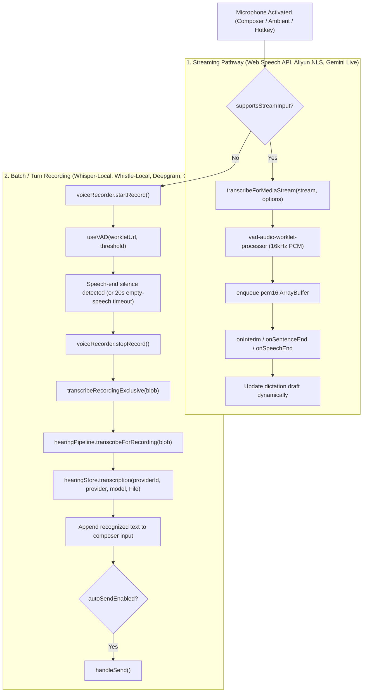

# Hearing & Speech-to-Text (STT) Pipeline

Own microphone capture, Voice Activity Detection (VAD), Speech-to-Text transcription, the composer microphone popover, and multi-surface mic authority arbitration.
- **Voice synthesis (TTS), UST transformers, and audio output playback**: belong to [speech synthesis pipeline](../airi-speech-pipeline/SKILL.md).
- **Speech intent scheduling, queueing, and playback ordering**: belong to [speech runtime](../airi-speech-runtime/SKILL.md).
- **Bidirectional Gemini Live sessions**: belong to [Gemini Live API](../airi-gemini-live-api/SKILL.md).
- **On-device model weight cache oversight**: belongs to [provider core registry](../airi-provider-core-registry/SKILL.md).

---

## 1. Source Map

Repository-relative paths:

| Responsibility | Source Path |
| --- | --- |
| Central Hearing store (active STT provider, model, preferences, mic owner) | `packages/stage-ui/src/stores/modules/hearing-store.ts` (`useHearingStore`) |
| Audio input pipeline (MediaStream worklet, streaming vs turn dispatch) | `packages/stage-ui/src/stores/modules/hearing-speech-input-pipeline.ts` (`useHearingSpeechInputPipeline`) |
| Composer voice popover host & popover card | `packages/stage-ui/src/components/scenarios/chat/VoiceInputHover.vue`, `VoiceInputHoverCard.vue` |
| Desktop composer dictation & VAD recording loop | `apps/stage-tamagotchi/src/renderer/components/InteractiveArea.vue` |
| Shared composer bar voice controls | `packages/stage-ui/src/components/scenarios/chat/WhisperComposerBar.vue` |
| Audio device & permission management | `packages/stage-ui/src/stores/settings/audio.ts` (`useSettingsAudioDevice`) |
| Central STT provider registry | `packages/stage-ui/src/stores/providers/registry/transcription.ts` (`transcriptionMetadata`) |
| On-device VAD processor worklet | `packages/stage-ui/src/workers/vad/process.worklet.ts` |
| Local Whisper adapter & worker | `packages/stage-ui/src/libs/inference/adapters/whisper.ts`, `packages/stage-ui/src/libs/workers/worker.ts` |
| Local Whistle adapter & worker | `packages/stage-ui/src/libs/inference/adapters/whistle-client.ts`, `packages/stage-ui/src/workers/whistle/worker.ts` |

---

## 2. Ingestion Pathways: Streaming vs. Batch/Turn

The composer and hearing pipeline arbitrate between two fundamentally different transcription flows via `shouldUseStreamInput`:



### 1. The Streaming Pathway (`transcribeForMediaStream`)
- Used when `providersStore.getTranscriptionFeatures(providerId).supportsStreamInput` is `true` or for `browser-web-speech-api`.
- Binds directly to the active `MediaStream` from `useSettingsAudioDevice()`.
- Dispatches incremental text chunks through `onInterim` and `onSentenceEnd` to update draft buffers without waiting for recording termination.

### 2. The Batch / Turn Pathway (`transcribeForRecording`)
- Used for all non-streaming providers (`whisper-local`, `whistle-local`, Deepgram, OpenAI-compatible).
- **VAD Activity Gate**: Managed by `useVAD` in `InteractiveArea.vue`.
  - Discards empty captures (if no speech detected within 20s) to prevent LLM/STT hallucination on background silence.
  - Automatically triggers `stopDictationRecording()` when user stops speaking.
- **Exclusive Slot Lock**: `transcribeRecordingExclusive()` polls boundedly if a prior transcription is already occupying the hearing worker, preventing dropped utterances under rapid back-to-back speech.

---

## 3. On-Device Speech Engines: Cactus Whistle (CPU/WASM)

In addition to Whisper (transformers.js / WebGPU), AIRI supports **Cactus Whistle** (`whistle-local`):
- **Ultra-lightweight**: 16.9 MB model weights (`whistle.cact`), ~1.2 MB WASM engine (`cactus.wasm`), ~63 KB JS runtime (`cactus.js`).
- **Zero-WebGPU requirement**: Runs directly on CPU/WASM without requiring WebGPU or 8 GB RAM, making it universally available on all desktop and browser platforms.
- **Sub-20ms TTFT**: Optimized ARM NEON / SIMD WebAssembly execution with keyword boosting (`keywords`) and word-level timestamps (`words`).

### Critical WASM & Audio Invariants for Whistle
1. **Emscripten Runtime Factory Requirement**:
   `cactus.wasm` is compiled with Emscripten. Invoking raw `WebAssembly.instantiate(module, {})` will fail immediately with `TypeError: Import #0 "a": module is not an object or function`.
   It **must** be instantiated using the `createCactus({ wasmBinary })` factory from `cactus.js`.
2. **Strict 16 kHz Mono Float32Array PCM**:
   Whistle strictly expects 16,000 Hz mono float audio. Most browser microphones and `AudioContext` pipelines record at 44.1 kHz or 48 kHz.
   `decodeToWhistleAudio` in `whistle-local/index.ts` must pass the decoded audio through `resampleTo16k` before delivering it to the worker; otherwise, audio is interpreted as slow-motion garble and results in blank transcriptions.
3. **Cactus Transcribe Signature & JSON Protocol**:
   ```ts
   // In packages/stage-ui/src/workers/whistle/worker.ts
   _cactusInstance._cactus_transcribe(
     pcmPtr,
     samplesCount,
     langPtr,
     kwPtr,
     wordTimestamps ? 1 : 0,
     outPtr,
     outCapacity
   )
   ```
   Output is an Emscripten UTF-8 JSON string read via `UTF8ToString(outPtr)`:
   `{"text":"...","language":"...","words":[{"word":"...","start":0.0,"end":0.5,"probability":0.9}],"ttft_ms":172.5,"decode_tps":182.9}`.
   All heap allocations (`_malloc`) must be cleanly deallocated in a `finally` block (`_free`).
4. **Settings Page Layout Contract**:
   Any dedicated transcription provider page in `packages/stage-pages/src/pages/settings/providers/transcription/<provider>.vue` must declare:
   ```yaml
   <route lang="yaml">
   meta:
     layout: settings
   </route>
   ```
   to render inside the standard settings shell (with sidebar and header).

---

## 4. Universal Composer Microphone Popover (`VoiceInputHoverCard.vue`)

Mounted on the microphone button in all chat composer bars (`InteractiveArea.vue`, `WhisperComposerBar.vue`):

1. **Tri-State STT Readiness**:
   - `ready`: An active transcription provider is configured and available.
   - `web-speech`: In browser/pocket environments, falls back to zero-setup Web Speech API.
   - `not-ready`: In Electron (`isStageTamagotchi()`) when no local or cloud provider has been configured.
2. **Audio Level Telemetry**:
   - Connects the active microphone `MediaStream` to `useAudioAnalyzer()` via `useAudioContext()`, powering a real-time volume bar.
3. **Key Controls & Persisted Preferences**:
   - `tapToTalk` (`settings/hearing/tap-to-talk`): Single tap captures one utterance and stops itself; open line stays active across turns.
   - `autoSendEnabled` (`settings/hearing/auto-send-enabled`): Automatically submits message on speech-end.
   - `voiceInputMode` (`settings/hearing/voice-input-mode`): `'dictation'` (transcribes to text) vs `'voice-message'` (attaches audio clip).
   - **Global Desktop Hotkeys**: In Electron, binds push-to-talk / toggle hotkeys (`Caps`, `Scroll`, `Num`) using `electronGetMicToggleHotkey` and `electronSetMicToggleHotkey`.
4. **Microphone Stream Acquisition Invariant**:
   - When a composer mic button is clicked, `stream.value` is initially `undefined`.
   - Never check `if (!stream.value) return` synchronously without awaiting stream acquisition.
   - Always await `ensureAudioStream()`: `settingsAudioDeviceStore.askPermission()` + `settingsAudioDeviceStore.startStream()` + `until(stream).toBeTruthy()`.
   - Always route the ingestion pathway based on provider capability `supportsStreamInput.value` rather than synchronous `stream.value` existence.

---

## 5. The Shared Mic Authority Pact

Multiple surfaces in AIRI can request the microphone: the desktop composer, the mobile control strip, global hotkeys, and ambient page listening loops.
To prevent audio device contention, echo, and duplicate transcription:

- **Single Owner Rule (`micOwner`)**: Persisted in `useHearingStore` under `'settings/audio/input/owner'`.
  - `'composer'`: An explicit composer tap claims ownership (`claimMicAuthority()`). Ambient stage loops stand down.
  - `'ambient'`: Floating control strip or lock-key toggle owns the microphone.
  - `null`: Microphone released.
- Releasing ownership always disables `settingsAudioDeviceStore.enabled`.
- **Cross-Surface Voice Handoff**: `pendingVoiceDraft` and `takeVoiceDraft()` allow ambient listening loops on the stage to collect text and hand it atomically to the composer when opened.

---

## 6. SOP: Adding a New STT Provider (Checklist)

When integrating a new STT model or service (e.g. Cactus Whistle):

1. **Registry Entry**: Add definition to `transcriptionMetadata` in [`packages/stage-ui/src/stores/providers/registry/transcription.ts`](packages/stage-ui/src/stores/providers/registry/transcription.ts).
   - Set `category: 'transcription'`.
   - Set `pricing: 'free' | 'paid'` and `deployment: 'local' | 'cloud'`.
   - Set `isAvailableBy`. For CPU/WASM models that do not require WebGPU or 8GB RAM, use `() => true`.
   - Define `defaultOptions`, `createProvider`, and `capabilities.listModels`.
2. **Model Cache Oversight (if on-device)**:
   - Add model item to `knownModels` under `category: 'audio'` in [`packages/stage-ui/src/components/scenarios/settings/ModelCacheManager.vue`](packages/stage-ui/src/components/scenarios/settings/ModelCacheManager.vue).
   - Add cache inspection and eviction helpers in [`packages/stage-ui/src/libs/inference/cache-utils.ts`](packages/stage-ui/src/libs/inference/cache-utils.ts).
3. **Dedicated Settings UI Page**:
   - Create `packages/stage-pages/src/pages/settings/providers/transcription/<provider-id>.vue` with live model cache status, test transcription playground, and language selectors.
4. **Composer Verification**:
   - Verify provider is selectable in `VoiceInputHoverCard.vue` and `Settings > Inference Providers > Hearing`.
   - Verify speech recording and dictation ingestion in `InteractiveArea.vue`.
5. **Onboarding V3 & Quick Start Integration**:
   - Elevate the engine in `heroProviderIds` in `packages/stage-ui/src/components/scenarios/dialogs/onboarding/v3/steps/step-hearing.vue` (3-column Hero Grid: Whistle Local, Whisper Local, Web Speech API).
   - Configure as default STT engine in `useOnboardingV3Draft.ts` (`sttProvider: 'whistle-local'`).
   - Wire pre-warming and model preparation into `quick-start.vue` via `getWhistleClient().prepare()`.
   - Ensure `useStarterCardCommit.ts` atomically persists `sttProvider` and `sttModel` to `hearingStore.activeTranscriptionProvider` and `activeTranscriptionModel`.

---

## 7. Verification Workflows

- **Voice Popover Tests**: `pnpm -F @proj-airi/stage-ui test packages/stage-ui/src/components/scenarios/chat/VoiceInputHoverCard.test.ts`
- **Hearing Store Unit Tests**: `pnpm -F @proj-airi/stage-ui test packages/stage-ui/src/stores/modules/hearing.test.ts`
- **Typecheck**: `pnpm -F @proj-airi/stage-ui typecheck` and `pnpm -F @proj-airi/stage-pages typecheck`
