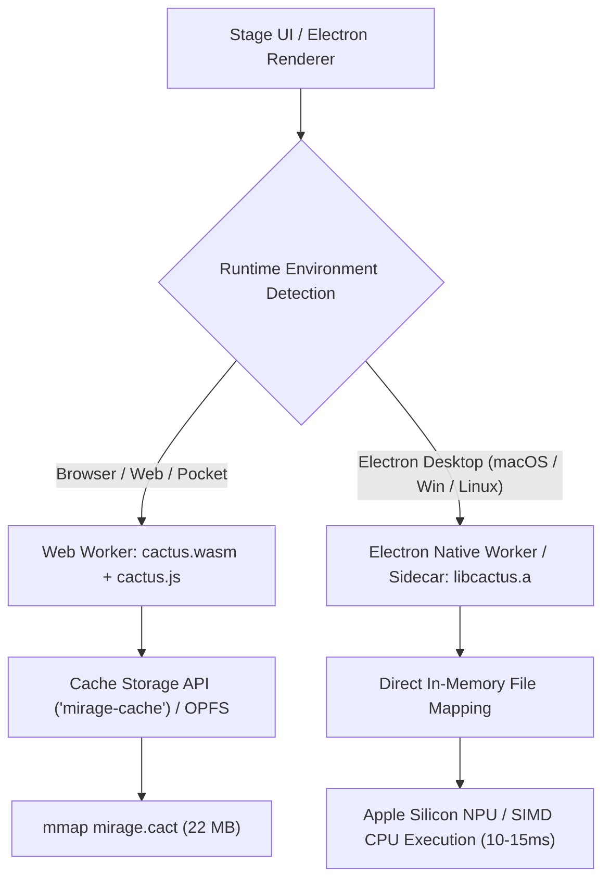
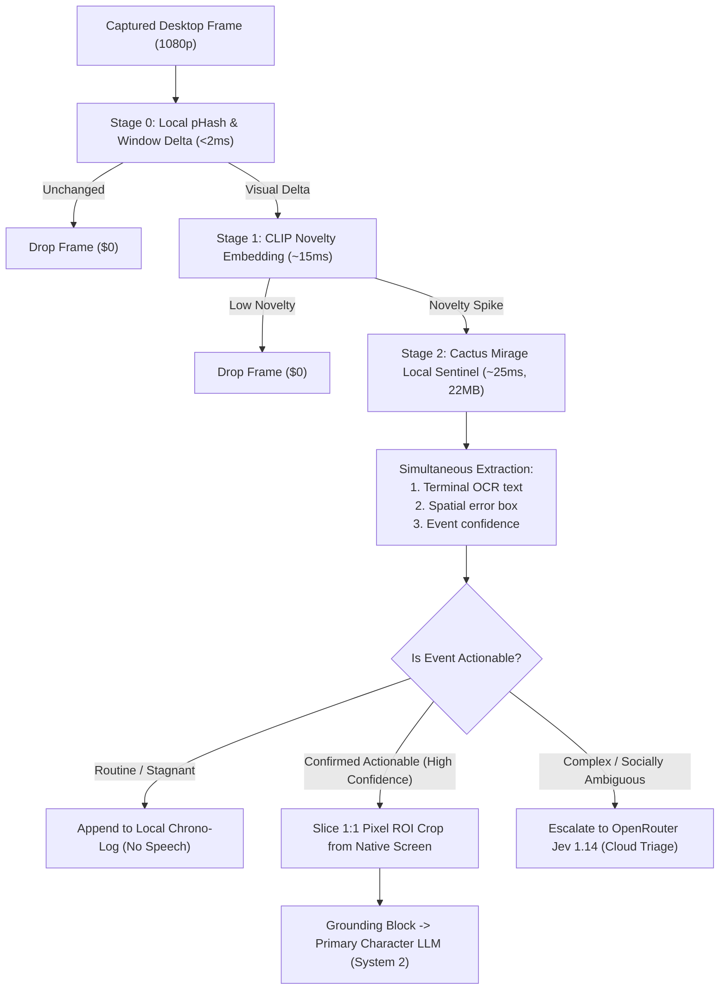

# Design Spec: Cactus Mirage Local Vision Coprocessor (22 MB On-Device Perception)

**Status:** Proposed Architecture & Design Specification
**Engine:** Cactus Runtime Engine 4.0.0 (`cactus.wasm`, `cactus.js`, native static libraries)
**Model Artifact:** `Cactus-Compute/mirage` (`mirage.cact` ~22 MB, 2-bit TurboQuant)
**Primary Subsystems:** Attention Ecology Screen Perception, System-1 Decision Engine, AnimaDex Wizard
**Related Documents:**
- [`docs/design-multimodal-system-one-vision.md`](./design-multimodal-system-one-vision.md) — Multimodal System-1 Cognitive Triage (Jev 1.14 & Temporal Contact Sheets)
- [`docs/design-attention-ecology-screen-watching.md`](./design-attention-ecology-screen-watching.md) — Cascaded Salience Gate & Screen Watching Engine
- [`docs/design-needle-subconscious-runtime.md`](./design-needle-subconscious-runtime.md) — Cactus Needle 2 Subconscious Runtime & Daydreaming Engine
- [`docs/proposal-jev-integration.md`](./proposal-jev-integration.md) — System-1 Decision Engine Specification

---

## 1. Executive Summary

Historically, on-device visual perception in AIRI faced a severe architectural bottleneck:
- **Local WebGPU VLMs (Moondream2 / BLIP)**: Required **~1,100 MB** of model shard downloads, long WebGPU shader compilation freezes, and reserved **~850 MB of VRAM**, competing directly against Three.js VRM shaders, Live2D render pipelines, and local STT/TTS models.
- **Local Tesseract WASM OCR**: Extremely fragile in non-text contexts (gaming, anime videos, stylized canvases) and starved the downstream System-1 Chrono-Log of meaningful semantic data.
- **Local Laya ModernBERT (`tozp/laya-onnx`)**: High-speed on-device System-1 text sequence classifier (~424 MB), but **completely blind** with zero image input support.
- **Cloud Jev 1.14**: Powerful non-autoregressive triage and spatial boxes, but requires internet connectivity, paid cloud tokens (~$42/Btok), and network roundtrips.

**Cactus Compute's Mirage** changes this dynamic entirely.

Mirage is a **22 MB multi-task vision model** packaged in the unified Cactus `.cact` format. Running via the **Cactus 4.0.0 WebAssembly / Native engine**, Mirage executes multi-task computer vision (simultaneous OCR, spatial object localization / bounding boxes, short descriptions, and structured decision classification) in a single **~20–30ms** forward pass with zero-copy memory mapping on standard consumer CPUs and NPUs.

This document defines the architectural integration of **Cactus Mirage as AIRI's canonical Local Vision Coprocessor**:
1. **Permanent Replacement for Heavy Local VLMs**: Eliminates the 1.1GB Moondream2 download and WebGPU VRAM hogging, providing instant, lightweight background vision.
2. **Local Zero-Cost Spatial ROI Cropping**: Computes spatial bounding boxes (`box`) locally for $0, slicing crisp 1:1 pixel crops around terminal errors or on-screen actions to feed primary cloud LLMs (Claude 3.5 Sonnet, GPT-4o) with 70–80% fewer cloud vision tokens.
3. **Full Local Parity for System-1**: Couples with Local Laya ModernBERT to provide a 100% offline, privacy-first, zero-subscription cognitive perception stack.

---

## 2. Core Architectural Philosophy: Single-Pass Multi-Tasking

Conventional visual perception cascades separate models for every task:

```
[Traditional Vision Stack]
Frame ──► Tesseract WASM (OCR, 80ms) ──► CLIP (Embeddings, 15ms) ──► Moondream2 (Captioning, 1500ms) ──► Laya (Classification, 30ms)
(Total footprint: ~1.5 GB | Total latency: ~1,600ms)
```

Mirage unifies these discrete capabilities into a single lightweight representation:

```
[Cactus Mirage Stack]
Frame ──► Cactus Mirage 4.0.0 (22 MB WASM / CPU Worker)
              ├── OCR String Extractor (Terminals, IDE lines, chat text)
              ├── Spatial Bounding Box Locator (Error modals, game bosses, active panels)
              ├── Short Scene Descriptor ("Visual Studio Code with compilation error")
              └── Discrete Decision Triage (Error severity, event importance)
(Total footprint: 22 MB | Total latency: ~20–30ms)
```

---

## 3. Engine & Runtime Architecture (Cactus 4.0.0)

Cactus Compute Release 4.0.0 ships unified native runners and WebAssembly modules. AIRI leverages a dual-tier deployment:



### A. WebAssembly Worker (`packages/stage-ui/src/workers/mirage/worker.ts`)
For browser, mobile pocket, and cross-platform Electron renderer contexts, Mirage runs inside a dedicated Web Worker:
* **Assets**:
  * Engine: `cactus.wasm` (~1.2 MB) + `cactus.js` glue code.
  * Weights: `mirage.cact` (~22 MB), downloaded from Hugging Face (`Cactus-Compute/mirage`) and cached persistently using the browser `CacheStorage` or `Origin Private File System (OPFS)`.
* **Zero-Copy Transfers**: The renderer passes captured frames as transferable `ArrayBuffer` or raw `ImageData` instances, avoiding serialization overhead.
* **Non-Blocking Execution**: Background screen perception ticks never stutter the 60fps Three.js / Live2D avatar rendering thread.

### B. Optional Native Desktop Accelerator (Electron Main Process)
For `stage-tamagotchi` on macOS Apple Silicon (`macos-arm64/libcactus.a`) and Windows x64 (`windows-x86_64/libcactus.a`):
* An optional Electron native sidecar or Node addon can link directly against static `libcactus.a`.
* Bypasses WASM memory sandboxing to run directly on Apple Neural Engine (ANE) or AVX-512 vector units, dropping frame evaluation latency to **sub-12ms**.

---

## 4. Subsystem Integration: Attention Ecology Screen Perception

In [`packages/stage-ui/src/stores/modules/vision/orchestrator.ts`](file:///Users/richardpinedo/Projects.nosync/airi/airi_dasilva333/packages/stage-ui/src/stores/modules/vision/orchestrator.ts), Mirage acts as the high-speed **Stage 2 Local Cognitive Sentinel**:



### Key Screen Watching Workflows:

#### 1. Instant Zero-Cost Spatial Bounding Boxes (`box`)
Rather than paying cloud tokens to discover where an error occurred, Mirage pinpoints the coordinates locally:
```typescript
interface MirageAnalysisResult {
  ocrSnippet: string
  hasError: boolean
  confidence: number
  boundingBox?: {
    top: number
    bottom: number
    left: number
    right: number
  }
}

// Executed in Web Worker in ~25ms
const result = await mirageClient.analyzeFrame(frameImageData, {
  detectErrors: true,
  locateFocalArea: true,
})
```

#### 2. Local Surgical High-Res Cropping
When `result.hasError` is true, the renderer immediately cuts a clean $400 \times 200$ crop around `result.boundingBox`. When System 2 (Claude 3.5 Sonnet / GPT-4o) generates its reaction, it receives:
1. The structured label: `[SCREEN EVENT: Terminal compiler error detected in src/auth.ts]`
2. The clean 1:1 pixel crop of the stack trace.
3. Cloud VLM vision cost drops from **1,600+ tokens to ~300 tokens** per promotion, with zero downscaling font blur.

---

## 5. Subsystem Integration: AnimaDex Character Card Wizard

In [`packages/stage-pages/src/pages/settings/airi-card/guided.vue`](file:///Users/richardpinedo/Projects.nosync/airi/airi_dasilva333/packages/stage-pages/src/pages/settings/airi-card/guided.vue):

### 1. Zero-Cloud Avatar Face Auto-Cropping
When users drag and drop high-resolution character wallpapers, card scans, or full-body art, Mirage executes a localized face detection query:
```typescript
const cropBox = await mirageClient.detectTarget(characterArtworkBase64, 'face_and_bust')
const avatarThumbnail = await cropToCanvas(characterArtworkBase64, cropBox)
```
The wizard automatically populates the square avatar thumbnail without requiring manual crop modal interactions or cloud uploads.

### 2. Offline Aesthetic & Archetype Tagging
Mirage analyzes character portrait visual cues (hair color, uniform/costume style, visual expression, posture) to auto-fill character tags, assisting the voice and archetype auto-binding pipeline completely offline.

---

## 6. Architecture Comparison Matrix

| Metric | Moondream2 WebGPU | Tesseract WASM + CLIP | Cloud Jev 1.14 | Cactus Mirage 4.0.0 |
| :--- | :--- | :--- | :--- | :--- |
| **Download Size** | ~1,100 MB | ~310 MB | **0 MB** (Cloud) | **~22 MB** |
| **RAM / VRAM Footprint** | ~850 MB VRAM (WebGPU) | ~180 MB WASM heap | **0 MB** | **~45 MB RAM (mmap)** |
| **Evaluation Latency** | 1,200 ms – 1,800 ms | 90 ms – 140 ms | 100 ms – 150 ms (Network) | **20 ms – 30 ms (Local)** |
| **Monetary Cost** | $0.00 | $0.00 | ~$42 / Billion tokens | **$0.00** |
| **Offline / Air-Gapped** | Yes | Yes | No (Requires Internet) | **Yes (100% Private)** |
| **Spatial Bounding Boxes** | No | No | Yes (`box` type) | **Yes (Native multi-task)** |
| **Integrated OCR** | Coarse / Paraphrased | Glyphs only | None | **Simultaneous OCR + Box** |
| **Complex Social Reasoning** | Moderate | Zero (Keywords only) | **Extremely High** | Moderate (Perceptual) |

---

## 7. Hybrid Tiering Strategy: Mirage $\leftrightarrow$ Jev 1.14

Rather than choosing between Mirage and Jev, AIRI establishes a **Dual-Coprocessor Synergy**:

1. **Mirage (Tier 2 Local Sentinel)**:
   - Always-on, 24/7 background screening at 0 cost.
   - Extracts OCR text and localizes bounding boxes on device.
   - Catches 90%+ of routine events (terminal errors, window switches, game over screens).
2. **Jev 1.14 (Tier 2 Cloud Escalation)**:
   - Invoked only for nuanced, ambiguous, or socially delicate situations (e.g., distinguishing affectionate teasing from genuine boundary violations, subtle emotional turns in dialogue, or lifetime memory pack curation).
   - Receives the pre-cropped, pre-localized ROI from Mirage, maximizing precision and minimizing token cost.

---

## 8. Rollout Plan & Implementation Roadmap

1. **Phase 1: Architecture & Specification (This Document)**
   - Commit architecture spec to `docs/design-cactus-mirage-local-vision.md`.
   - Cross-link in `design-multimodal-system-one-vision.md` and `design-attention-ecology-screen-watching.md`.
2. **Phase 2: Worker & Client Scaffold (`packages/stage-ui`)**
   - Implement `packages/stage-ui/src/workers/mirage/worker.ts` using `cactus.wasm` and `mirage.cact`.
   - Implement typed `mirage-client.ts` adapter following the existing `needle-client.ts` pattern.
   - Add cache storage verification in `packages/stage-ui/src/libs/inference/cache-utils.ts` (`isMirageModelCached()`).
3. **Phase 3: Screen Watching Orchestration**
   - Connect Mirage worker to `orchestrator.ts` as the primary Stage-2 Local Gate.
   - Implement local ROI canvas crop using Mirage bounding boxes.
4. **Phase 4: AnimaDex Wizard Integration**
   - Hook automatic avatar face detection and cropping into `CardCreationModal.vue` and `guided.vue`.
