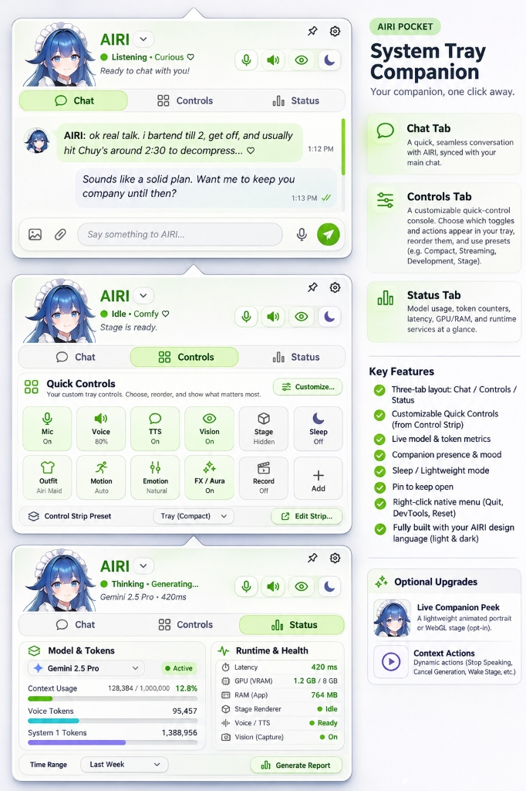
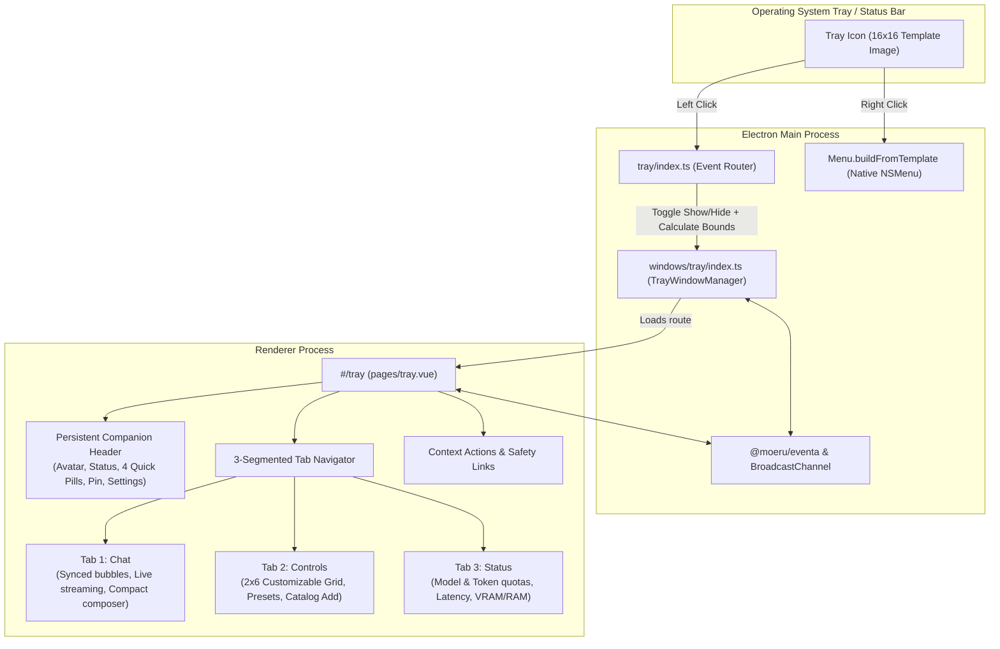

# Design: Desktop Tray Popover Window & Dual-Click Architecture ("AIRI Pocket")



## 1. Executive Summary

Today, clicking AIRI's system tray icon (`resources/tray-icon-macos.png` / `resources/icon.png`) opens an OS-native context menu (`NSMenu` on macOS, Win32 menu on Windows). While functional for basic window management, this native menu is completely isolated from AIRI's reactive design system, cannot display dynamic visual indicators (such as avatar emotions, model quotas, or latency), and provides zero interactive capability.

This design document establishes the architecture for **AIRI Pocket (System Tray Companion)**: a frameless, glassmorphic floating window (`BrowserWindow`) anchored directly beneath the macOS menu bar or above the Windows taskbar, paired with a **Dual-Click Philosophy** that preserves native OS right-click safety while unlocking a rich, reactive companion dashboard on left-click.

---

## 2. Problem Statement & Motivation

### 2.1 Limitations of Current Native Context Menu
- **Rigid OS Primitives**: Implemented in `apps/stage-tamagotchi/src/main/tray/index.ts` via Electron's `Menu.buildFromTemplate()`. macOS and Windows draw plain text labels with separators. Custom HTML, charts, buttons, and animations are impossible.
- **Zero Real-Time Telemetry**: Users cannot see active LLM status, quota consumption, inference latency, or proactivity states without opening heavy standalone windows (Chatbox or Settings).
- **Control Strip Screen Clutter**: Users currently have a floating on-screen Control Strip (`ControlStrip.vue`). Having all controls docked to the desktop edge can take up valuable workspace. Users need a way to offload secondary toggles and tools into the system tray so their on-screen strip can stay ultra-minimal.
- **Heavy Surface Inconvenience**: To perform simple interactions (like muting the mic, checking companion mood, or sending a quick whisper), users must toggle full floating windows across their desktop workspaces.

### 2.2 Design Goals
1. **Rich Companion Surface**: Turn the tray into an ambient micro-hub featuring character presence, multi-bubble chat, customizable controls, and engineering telemetry.
2. **Control Strip Synergy**: Seamlessly bridge with the existing 44-item `CUSTOMIZER_CATALOG` (`packages/stage-ui/src/constants/control-customizer.ts`) so users can configure which buttons appear on the floating strip versus the tray.
3. **Dual-Click Safety Guard**: Left-click opens the rich Vue Popover window; Right-click retains a pure OS-native fallback menu (Quit, Reset Windows, DevTools) so users can always recover even if the renderer process encounters a fatal issue.
4. **Flawless Auto-Dismissal**: Accurately simulate native menu dismiss behavior: clicking outside or switching app focus immediately hides the popover without flicker, with an optional "Pin" toggle to keep it open.
5. **Seamless Cross-Platform Anchoring**: Dynamically compute coordinates on macOS (top menu bar) and Windows (taskbar at bottom, top, or sides, including overflow flyouts), complete with an upward or downward pointing bubble caret notch.

---

## 3. Architecture & Component Topology



---

## 4. The Dual-Click Philosophy (Safety First)

To guarantee that the application remains 100% stable and recoverable under all failure modes, we strictly separate primary and secondary mouse clicks:

| Mouse Action | Target Surface | Implementation | Purpose |
| --- | --- | --- | --- |
| **Left Click** | **Rich Vue Popover Window** | `tray.on('click', (event, bounds) => trayWindowManager.toggle(bounds))` | Opens the interactive companion dashboard (Vue/UnoCSS). |
| **Right Click** | **Native OS Context Menu** | `tray.on('right-click', () => fallbackMenu.popup())` | Pure C++/AppKit menu. Guarantees Quit, Window Reset, and DevTools even if Vue crashes or hangs. |
| **Double Click** (macOS) | **Focus Main Window** | `tray.on('double-click', () => mainWindow.show())` | Preserves existing fast-focus behavior. |

> [!IMPORTANT]
> **macOS `setContextMenu` Removal**: On macOS, calling `appTray.setContextMenu(menu)` permanently hijacks single left-clicks to display the `NSMenu`. To enable the Dual-Click pattern, we must **NOT** call `appTray.setContextMenu(menu)` on macOS. Instead, we listen to `'right-click'` and invoke `fallbackMenu.popup()`.

---

## 5. Main Process: Tray Window Manager (`windows/tray/`)

A new window manager factory is located under `apps/stage-tamagotchi/src/main/windows/tray/index.ts`.

### 5.1 Window Configuration
```typescript
const window = new BrowserWindow({
  title: 'AIRI Pocket',
  width: 390,
  height: 580,
  show: false,
  frame: false,
  resizable: false,
  transparent: true,
  skipTaskbar: true,
  type: 'panel', // macOS NSPanel: allows floating above spaces & full screen apps
  alwaysOnTop: true,
  webPreferences: {
    preload: join(getElectronMainDirname(), '../preload/index.cjs'),
    sandbox: true,
  },
})

// Ensures visibility across all virtual desktops / workspaces without Dock re-surfacing
showWindowOnAllWorkspaces(window)
```

### 5.2 Dynamic Positioning & Caret Alignment

When the tray is clicked, Electron provides `bounds: Rectangle` (`{ x, y, width, height }`). The positioning logic resolves the active display's work area to prevent off-screen clipping and aligns the popover's pointer notch:

```typescript
export function calculatePopoverPosition(
  trayBounds: Electron.Rectangle,
  windowSize: { width: number, height: number },
  display: Electron.Display,
): { x: number, y: number, notchOffset: number } {
  const { workArea } = display
  const isMac = process.platform === 'darwin'

  const x = Math.round(trayBounds.x + trayBounds.width / 2 - windowSize.width / 2)
  let y = 0

  if (isMac) {
    // macOS: Menu bar is at the top of the display
    y = Math.round(trayBounds.y + trayBounds.height + 4)
  }
  else {
    // Windows/Linux: Detect taskbar placement from workArea vs display bounds
    const isTaskbarBottom = workArea.y === 0 && workArea.height < display.bounds.height
    if (isTaskbarBottom) {
      y = Math.round(trayBounds.y - windowSize.height - 4)
    }
    else {
      // Taskbar on top or side
      y = Math.round(trayBounds.y + trayBounds.height + 4)
    }
  }

  // Clamp horizontally so the popover never bleeds outside the screen edges
  const minX = workArea.x + 8
  const maxX = workArea.x + workArea.width - windowSize.width - 8
  const clampedX = Math.max(minX, Math.min(x, maxX))

  // Calculate the relative horizontal position of the caret notch so it points to the tray icon
  const iconCenter = trayBounds.x + trayBounds.width / 2
  const notchOffset = Math.round(iconCenter - clampedX)

  return { x: clampedX, y, notchOffset }
}
```

### 5.3 Auto-Dismissal, Pinning & Blur Handling
To mimic native menu behavior while allowing power-user persistence:
1. **Blur Event**: `window.on('blur', () => { if (!isPinned) window.hide() })`.
2. **Pin Action**: Users can click the Pin icon in the header (`isPinned = !isPinned`) to keep the popover open while working in other applications.
3. **Toggle Handling**: Clicking the tray icon while `window.isVisible()` triggers `window.hide()` instead of re-showing.

---

## 6. Renderer Surface: The Three-Segmented Cockpit (`#/tray`)

The popover renders a dedicated route: `apps/stage-tamagotchi/src/renderer/pages/tray.vue` (390×580 px).

### 6.1 The Persistent Companion Header (~72px)
Visible across all tabs, establishing AIRI's living presence:
- **Character Portrait**: 48–64px circular thumbnail. Displays active costume and expression.
- **Character Selector**: Interactive dropdown chevron (`AIRI [v]`) allowing rapid switching between installed character cards without navigating to settings.
- **Contextual Vitality Status**: Dynamic status indicators reflecting real-time engine activity:
  - *Listening*: `🟢 Listening • Curious ♡` — `"Ready to chat with you!"`
  - *Idle*: `🟢 Idle • Comfy ♡` — `"Stage is ready."`
  - *Generating*: `🟢 Thinking • Generating...` — `"Gemini 2.5 Pro • 420ms"`
  - *Observing*: `🟢 Observing • Focused` — `"Watching active screen window"`
- **Header Action Strip**:
  - **4 Rapid Pill Toggles**:
    1. `Mic`: Mute/unmute microphone input.
    2. `Voice`: Mute/unmute TTS speech output and adjust volume.
    3. `Vision`: Toggle screen observation and Vibe Island salience gate.
    4. `Sleep`: Instant engine standby (freezes 3D/2D render loops to save VRAM).
  - **Pin Icon**: Toggles `isPinned` state.
  - **Settings Gear**: Opens the main Settings Hub (`#/settings`).

---

### 6.2 Tab 1: Chat Tab
A quick, seamless conversation with AIRI, perfectly synchronized with the primary desktop chat session.

- **Shared State**: Operates directly on the active session in `chatSessionsStore` (`apps/stage-tamagotchi/src/renderer/stores/chat-sessions.ts`). Messages sent from Pocket appear in the desktop chat, and vice versa.
- **Multi-Bubble Rendering**: Renders the latest conversation turns using lightweight, compact bubbles:
  - *Airi's bubble*: Light green/pastel card, character name, timestamp, and optional emotion marker.
  - *User's bubble*: Soft neutral card, right-aligned, with double-check delivered indicators.
- **Live Response Streaming**: If an LLM response is actively generating when the user opens the tray, the window opens directly to the live streaming turn with active auto-scroll.
- **Integrated Composer**:
  - Image attachment button (`carbon:image`).
  - File attachment button (`carbon:attachment`).
  - Text input: `"Say something to AIRI..."`.
  - Microphone dictation button (uses composer STT pipeline).
  - Green circular send action (`carbon:send-alt-filled`).

---

### 6.3 Tab 2: Controls Tab (Control Strip Synergy)
Addresses the user's primary requirement: **Total customization and seamless interoperability with the desktop Control Strip**.

- **The Problem Solved**: Rather than cluttering the screen with 15+ floating icons on the on-screen strip, users can move secondary actions into the Tray Popover.
- **Catalog Integration**: Directly binds to the 44-item `CUSTOMIZER_CATALOG` (`packages/stage-ui/src/constants/control-customizer.ts`).
- **2×6 Quick Control Grid**:
  - *Row 1 (Core Toggles)*:
    - `Mic`: On/Off toggle.
    - `Voice`: 80% volume slider / popup.
    - `TTS`: On/Off synthesis toggle.
    - `Vision`: On/Off perception toggle.
    - `Stage`: Hidden/Visible 3D avatar window toggle.
    - `Sleep`: Standby power switch.
  - *Row 2 (Wardrobe & Behavior)*:
    - `Outfit`: Cycler / picker (`Airi Maid`, `Casual`, etc.).
    - `Motion`: Cycler (`Auto`, `Playground`, `Pose`).
    - `Emotion`: Cycler / palette (`Natural`, `Happy`, `Pout`).
    - `FX / Aura`: Procedural stage VFX toggle.
    - `Record`: Audio/Session recording toggle.
    - `+ Add`: Opens the full catalog picker to add any button from the Control Strip catalog.
- **Control Strip Presets**:
  - Dropdown selector: `Control Strip Preset: [ Tray (Compact) v ]` (e.g. `Default`, `Compact`, `Streaming`, `Development`).
  - Deep-link button: `[ ↗ Edit Strip... ]` opens the floating Customizer Studio (`customizer.vue`) for comprehensive arrangement.

---

### 6.4 Tab 3: Status Tab (Engineering & Telemetry Dashboard)
A high-density diagnostics and quota tracking surface directly inspired by the user's reference tool.

- **Column 1: Model & Tokens**:
  - Active provider / model dropdown: `[ ✨ Gemini 2.5 Pro v ]` with `🟢 Active` status pill.
  - **Context Usage Bar**: `128,384 / 1,000,000` tokens (`12.8%` green bar).
  - **Voice Tokens Bar**: `95,457` tokens (cyan bar).
  - **System 1 Tokens Bar**: `1,388,956` tokens (purple bar).
  - **Time Range Selector**: `[ Last Week v ]` (`Today`, `5H Rolling`, `Weekly`, `Monthly`).
- **Column 2: Runtime & Health**:
  - Latency: `420 ms` (streaming TTFT).
  - GPU (VRAM): `1.2 GB / 8 GB` (live Three.js / WebLLM footprint).
  - RAM (App): `764 MB`.
  - Stage Renderer: `🟢 Idle` / `🔵 Rendering` / `💤 Sleeping`.
  - Voice / TTS: `🟢 Ready`.
  - Vision (Capture): `🟢 On`.
- **Bottom Action**: `[ 📊 Generate Report ]` button to export recent activity logs and token consumption ledgers.

---

## 7. Optional Upgrades & Progressive Enhancement

### 7.1 Live Companion Peek (Opt-In)
- **Default (Option A)**: Static high-resolution WebP avatar thumbnail from `airi-model-preview-caching`. Zero GPU impact.
- **Opt-In (Option B)**: An animated 120×120 WebGL avatar peek at the top of the Chat tab.
  - *Resource Protection*: Rendering is strictly paused (`requestAnimationFrame` halted) whenever the popover window is blurred or hidden, ensuring it consumes zero GPU resources while closed.
  - *Shared Texture Stream*: In multi-window mode, consumes offscreen frame captures from the primary `RendererStage.vue` rather than duplicating the entire Three.js/Live2D engine.

### 7.2 Context Actions
The header and footer dynamically adapt to companion activity:
- When AIRI is speaking: Surfaces an immediate **Stop Speaking** button.
- When generating text: Surfaces a **Cancel Generation** button with progress spinner.
- When Stage is sleeping: Surfaces a single-click **Wake Stage** button.

---

## 8. Migration & Phasing Strategy

### Phase 1: Window Manager & Dual-Click Plumbing
- Implement `apps/stage-tamagotchi/src/main/windows/tray/index.ts`.
- Update `apps/stage-tamagotchi/src/main/tray/index.ts`:
  - Route left-click to `trayWindowManager.toggle(bounds)`.
  - Route right-click to native `fallbackMenu.popup()`.
- Register the new route `#/tray` in Vite renderer routing.

### Phase 2: Three-Segmented Cockpit Core UI
- Build `apps/stage-tamagotchi/src/renderer/pages/tray.vue` using UnoCSS and `@proj-airi/ui`.
- Implement the Persistent Companion Header with the 4 quick toggle pills and pin button.
- Build the 3 tabs: Chat timeline, 2×6 Controls grid, and Status telemetry dashboard.

### Phase 3: Control Strip Sync & Telemetry Wiring
- Bind the 2×6 Controls grid to `CUSTOMIZER_CATALOG` and `useSettingsControlStrip()`.
- Integrate live token telemetry and quota metrics for Gemini, Claude, and OpenRouter.
- Connect inline composer to speech runtime and chat ingestion.

---

## 9. Verification & Test Plan

1. **Typecheck**:
   - `pnpm -F @proj-airi/stage-tamagotchi typecheck` (verifies Node main process and Web renderer).
2. **Anchoring & Geometry**:
   - Verify caret notch aligns accurately with tray icon on macOS (top) and Windows (bottom/sides).
   - Test multi-monitor setups to ensure popover opens on the monitor containing the clicked tray icon.
3. **Auto-Dismissal & Pinning**:
   - Confirm clicking outside dismisses the popover immediately when unpinned.
   - Confirm clicking outside keeps the popover visible when pinned.
4. **Emergency Fallback Safety**:
   - Right-click tray icon to ensure native `NSMenu` opens instantly with working Quit, DevTools, and Window Reset actions under all conditions.
