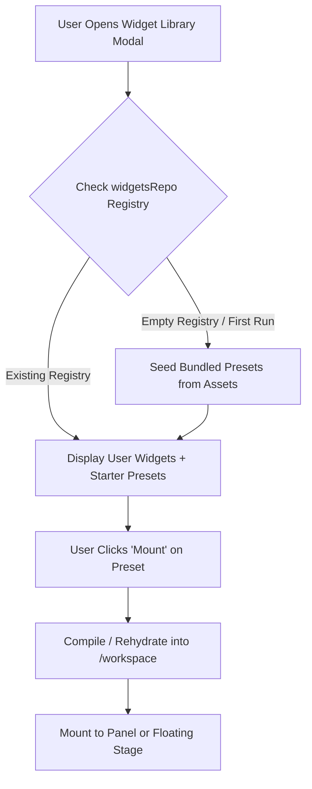

# Generative UI Widgets: Export Interface, Scoping Architecture & Bundled Presets
### 🧩 Micro-Frontends on the In-Memory Sandbox
**Specification & Architectural Design**

> **Status**: Approved Design / Ready for Implementation
> **Authors**: Richard Pinedo (@dasilva333 / azimuthal) & AI Engineering Pair
> **Date**: 2026-10-12
> **Related Documents**:
> - [`docs/proposal-in-memory-sandboxes-and-edge-wasm.md`](./proposal-in-memory-sandboxes-and-edge-wasm.md) — Master proposal for sandboxed agents and WebAssembly substrate.
> - [`docs/design-live2d-gimmick-deck-introspection.md`](./design-live2d-gimmick-deck-introspection.md) — Live2D tactile raycasts and DSL state machine introspection.
> - [`docs/data-catalog.md`](./data-catalog.md) — `local:widgets/registry` persistence schema.
> - [`docs/design-airi-card.md`](./design-airi-card.md) — Character card schema and `extensions.airi` metadata.

---

## 1. Executive Summary & Problem Space

AIRI's Generative UI widget subsystem (shipped across Phases 5–8) empowers agents and users to compile and mount interactive micro-apps into responsive UI surfaces across Desktop Electron, Web Browser, and Mobile Capacitor.

However, during real-world simulation and developer exploration, two critical architectural hurdles emerged:

1. **The "Barbaric UX" of Widget Extraction**:
   Persisted widgets live inside the in-memory POSIX filesystem (`/workspace/*.ts`) and IndexedDB (`local:widgets/registry`). When a user creates or tunes an outstanding widget (such as a multi-character POS terminal or an interactive pet companion), extracting it currently requires switching to the terminal tab, running `cat /workspace/widget.ts` or `cat /workspace/widget.json`, and manually copy-pasting the raw text. There is no first-class export mechanism.

2. **The Widget Scoping Dilemma (Global vs. Card-Specific)**:
   Currently, all persisted widgets are treated as a flat, global registry. This creates severe domain confusion:
   - A **Haven Cafe POS Terminal** belongs exclusively to a cafe barista card (e.g. Makise Kurisu or Haven Cafe) and makes zero sense if the user loads an adventure RPG or cyberpunk character.
   - Conversely, a **System Telemetry Monitor** or **Arona's Strawberry Pet** is an ambient companion utility that should persist across all cards and conversations.

3. **Community & Preset Distribution Bottleneck**:
   Designers and mockup artists have authored compelling widget layouts, but without an export/import standard and preset seed pipeline, new users launch the app with an empty widget library.

This document formalizes the **Export Interface**, the **Scoping Architecture (`global` vs. `card`)**, and the **Bundled Starter Presets Pipeline**.

---

## 2. Core Feature 1: The 1-Click Export Interface

To eliminate manual shell commands for extraction, both the Chat Inspector panel (`ChatWorkspaceWidgetsPanel.vue`) and the Floating Widget layer (`FloatingWidgetCard.vue`) receive a dedicated **Export Action** styled with the standard diskette glyph (`i-solar:diskette-bold`).

```
┌────────────────────────────────────────────────────────────────────────┐
│ [🧩 Widgets Sandbox]  (Tab 1) [Tab 2]       [💾] [➕] [🔄] [↗️] [✖️]    │
└────────────────────────────────────────────────────────────────────────┘
                                               │
                           ┌───────────────────┴───────────────────┐
                           ▼                                       ▼
                  [📋 Copy Manifest JSON]                 [⬇️ Download .json]
```

### 2.1 Action Controls & Visual Surface
- **Glyph**: `i-solar:diskette-bold` (or `i-solar:diskette-bold-duotone`), universally recognized for local asset export.
- **Locations**:
  - `ChatWorkspaceWidgetsPanel.vue`: In the header action button row alongside `openLibrary` (`widget-add`), `refreshActiveWidget` (`refresh`), `toggleSurface` (`square-top-down-broken`), and `unmount` (`close-circle`).
  - `FloatingWidgetCard.vue`: In the header drag-bar actions preceding the collapse and dock buttons.
- **Interaction Model**:
  - Clicking the diskette icon triggers a clean dropdown or modal action:
    1. **Copy JSON to Clipboard**: Copies formatted, validated JSON directly to `navigator.clipboard.writeText()` and displays a transient checkmark or toast: `"Widget manifest copied to clipboard!"`.
    2. **Download Manifest File**: Generates an in-memory `Blob` and triggers a browser file download named `<sanitized-title>_<timestamp>.json`.

### 2.2 Strict Architectural Boundary: Omission of `exportText`
> [!IMPORTANT]
> **No `exportText` Function at this Stage.**
> We deliberately do *not* bake in an unconstrained `exportText` helper or plain-text dump function into the runtime or UI.
>
> **Rationale**:
> - Generative widgets are multi-part objects containing TypeScript/JavaScript source code, compiled bundles, layout coordinates, surface assignments, and persistent state (`state.json`).
> - Exporting unstructured text loses the metadata required to re-mount the widget across devices or bundle it into character cards.
> - By restricting the export strictly to structured, schema-validated JSON manifests, exports remain 100% deterministic, machine-readable, and re-importable into `widgetsRepo`.

### 2.3 The Export Manifest Schema

```ts
export interface WidgetExportManifest {
  /** Manifest format version. */
  version: '1.0'
  /** Unique widget identifier. */
  id: string
  /** Human-readable title. */
  title: string
  /** Scoping boundary: global utility or card-specific micro-app. */
  scope: 'global' | 'card'
  /** Character card ID when scope === 'card'. */
  cardId?: string
  /** Mounted surface target. */
  surface: 'panel' | 'widget'
  /** Target surface subtype. */
  target?: 'sidepanel' | 'inline' | 'window'
  /** Layout coordinates when floating. */
  position?: { x: number, y: number }
  /** Saved interactive state (from /workspace/<name>.json). */
  state: Record<string, unknown>
  /** Original TypeScript source code if available. */
  sourceCode?: string
  /** Compiled JavaScript executable bundle. */
  code: string
  /** Export timestamp (epoch ms). */
  exportedAt: number
}
```

---

## 3. Core Feature 2: Widget Scoping (`global` vs. `card`)

### 3.1 The Scoping Taxonomy

```
┌──────────────────────────────────────────────────────────────────────────────────┐
│                                WIDGET SCOPING MAP                                │
├──────────────────────────────────────────────────────────────────────────────────┤
│                                                                                  │
│   GLOBAL SCOPE (`scope: 'global'`)                                               │
│   • Universally active across all characters, universes, and chat sessions       │
│   • Survives character card switching                                           │
│   • Examples:                                                                    │
│     - Arona's Strawberry Pet / Companion (Affection & Squish Counter)            │
│     - OS System Telemetry & CPU / Memory Monitor                                 │
│     - Global Ambient BGM / Audio Visualizer                                     │
│                                                                                  │
│   CARD SCOPE (`scope: 'card'`, `cardId: string`)                                 │
│   • Bound strictly to a single character card (e.g. Haven Cafe Barista)          │
│   • Automatically mounts when that character is active                           │
│   • Automatically hibernates / unmounts when switching to an unrelated card      │
│   • Examples:                                                                    │
│     - Haven Cafe POS Order Terminal & Shift Log                                  │
│     - Fantasy RPG Character Equipment & Inventory Sheet                          │
│     - Cyberpunk Terminal Port Scanner                                            │
│                                                                                  │
└──────────────────────────────────────────────────────────────────────────────────┘
```

### 3.2 Schema Extensions in `PersistedWidget` & Database Layer

In `packages/stage-ui/src/database/repos/widgets.repo.ts`:

```ts
export interface PersistedWidget {
  id: string
  title: string
  path: string
  sourcePath?: string
  sourceCode?: string
  code: string
  surface?: 'panel' | 'widget'
  target?: 'sidepanel' | 'inline' | 'window'
  position?: { x: number, y: number }
  state?: any
  isMounted: boolean
  mountedAt: number
  updatedAt: number

  // NEW: Scoping boundary
  /** Scope of the widget: 'global' across all cards, or 'card' scoped to a specific character. */
  scope?: 'global' | 'card'
  /** Associated character ID when scope === 'card'. */
  cardId?: string
}
```

### 3.3 Query & Rehydration Lifecycle

1. **Active Filter in UI (`ChatWorkspaceWidgetsPanel.vue` & `FloatingWidgetsLayer.vue`)**:
   - `activeCardId` is retrieved from `useCardsStore().activeCardId`.
   - The visible/mountable widget set is resolved as:
     ```ts
     const availableWidgets = computed(() => {
       return allWidgets.value.filter((w) => {
         if (w.scope === 'card') {
           return w.cardId === activeCardId.value
         }
         return true // global widgets are always available
       })
     })
     ```
2. **Character Switching Lifecycle**:
   - When the user switches characters (`activeCardId` changes):
     - All active `global` widgets remain mounted and continue running uninterrupted.
     - All active `card` widgets associated with the previous character are gracefully unmounted (`isMounted: false`) and their iframe contexts destroyed to prevent CPU/memory leaks.
     - Any `card` widgets previously marked as active for the new character are rehydrated and remounted.

### 3.4 Character Card Bundling (`character.extensions.airi.widgets`)

Card authors can package their custom widgets directly inside CCv3 character card files:

```json
{
  "spec": "chara_card_v3",
  "data": {
    "name": "Haven Cafe - Makise Kurisu",
    "extensions": {
      "airi": {
        "widgets": [
          {
            "id": "haven-cafe-pos",
            "title": "Haven Cafe POS Terminal",
            "scope": "card",
            "surface": "panel",
            "sourceCode": "...",
            "code": "...",
            "initialState": { "ordersServed": 12, "tips": 45.50 }
          }
        ]
      }
    }
  }
}
```

When a user imports this card into AIRI, the card ingestion pipeline automatically registers the bundled widget into `widgetsRepo` under `scope: 'card'` and `cardId: card.id`.

---

## 4. Core Feature 3: Bundled Starter Presets Pipeline

To provide instant value without requiring users to write code from scratch, AIRI bundles curated **Starter Presets** based on tested layouts from our design team and mockup artists.

### 4.1 Preset Catalog Architecture

Starter presets live in the application asset bundle (`packages/stage-ui/src/assets/widgets/presets/`):

| Preset ID | Title | Scope | Surface | Description |
| :--- | :--- | :--- | :--- | :--- |
| `preset-arona-pet` | Arona Strawberry Pet | `global` | `widget` (floating) | Interactive strawberry companion with squish animation, affection counter, and Live2D tactile sync. |
| `preset-system-telemetry` | System Telemetry HUD | `global` | `panel` | Real-time CPU load, memory graph, companion emotion state, and active window tracker. |
| `preset-haven-cafe-pos` | Haven Cafe POS Terminal | `card` | `panel` | Cafe register tracking drink orders, muffin inventory, tips, and dialogue turn counts. |

### 4.2 Seed & Library Discovery Flow



1. **Zero-Friction Discovery**: Users click `Browse Widget Library` (`i-solar:widget-add-bold-duotone`) and immediately see Starter Presets categorized by `[Global Utilities]` and `[Card Add-ons]`.
2. **Community Author Contribution Flow**:
   - Tinkerer authors a widget in `/workspace` using bash or chat.
   - Tinkerer tests the widget interactively.
   - Tinkerer clicks `[💾 Export]` and copies the formatted JSON.
   - Tinkerer submits the JSON via a pull request or community forum.
   - Maintainers place the verified manifest into `presets/`, making it available to all AIRI users.

---

## 5. Integration with the Live2D Tactile & Sensory Bus

Both Global and Card widgets can hook directly into the Live2D tactile state machine documented in [`docs/design-live2d-gimmick-deck-introspection.md`](./design-live2d-gimmick-deck-introspection.md).

### 5.1 Reactive Telemetry Contract
Inside the widget's `mount({ sidecar, onUpdate })` lifecycle:

```ts
import type { AiriWidgetContext } from './types/airi-widget'

export default function mount({ container, state, setState, onUpdate }: AiriWidgetContext) {
  // Read initial tactile hit count
  let pats = state.pats || 0

  const btn = document.createElement('div')
  btn.className = 'p-3 bg-pink-500/20 rounded-xl text-center'
  btn.innerHTML = `<span class="text-xs font-bold text-pink-400">Headpats: <span id="pat-val">${pats}</span></span>`
  container.appendChild(btn)

  // Subscribe to live telemetry updates
  const unsub = onUpdate(({ telemetry }) => {
    if (telemetry?.tactile?.lastHitArea?.includes('Head')) {
      pats++
      setState({ pats })
      const val = container.querySelector('#pat-val')
      if (val)
        val.textContent = String(pats)
    }
  })

  return () => unsub()
}
```

This completes the tactile feedback loop: clicking the Live2D avatar emits a raycast hit into the event bus, updates `telemetry.tactile`, and dynamically ticks the widget—all with zero CPU overhead and zero interference with the LLM conversational prompt.

---

## 6. Implementation Phasing & Validation Plan

### Phase 1: Export Interface & Clipboard Trigger (Low Complexity)
- Add diskette icon button (`i-solar:diskette-bold`) to `ChatWorkspaceWidgetsPanel.vue` and `FloatingWidgetCard.vue`.
- Implement `exportWidgetAsJson(widget: PersistedWidget)` utility in `packages/stage-ui/src/libs/sandbox/export.ts`.
- Wire up 1-click clipboard copy and file download triggers.
- *Validation*: Create a test widget, click export, paste clipboard content into JSON linter to verify full schema compliance.

### Phase 2: Schema Scoping & Card Filtering (Medium Complexity)
- Update `PersistedWidget` schema in `widgets.repo.ts` with `scope?: 'global' | 'card'` and `cardId?: string`.
- Update `ChatWorkspaceWidgetsPanel.vue` to filter mounted/persisted widgets by `activeCardId`.
- Implement unmount-on-card-switch hook in `useSandbox` / `cardsStore`.
- *Validation*: Mount a card-scoped widget on Character A, switch to Character B, confirm card widget unmounts while global widgets remain active.

### Phase 3: Starter Presets Bundling (Medium Complexity)
- Author starter preset manifests for Arona Pet, System Telemetry, and Haven Cafe POS.
- Add seed-on-empty logic to `SandboxManager.init()`.
- Add preset filter chips to the Micro-App Library modal.
- *Validation*: Clear IndexedDB, launch app, open library, confirm presets appear with instant mount capability.
