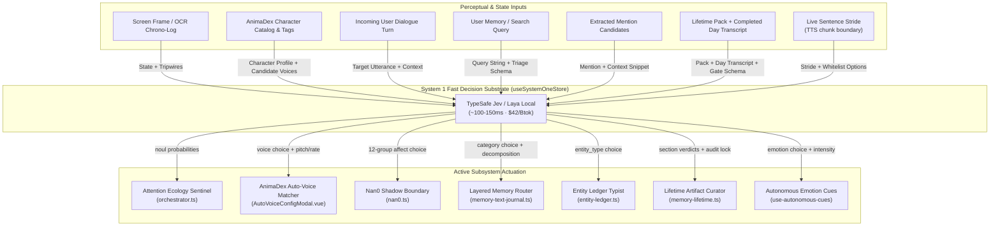

# Architecture & Design: TypeSafe Jev ("System 1") Integrated Subsystems

> **Status**: Active Architecture Specification & Shipped Inventory
> **Canonical RFC / Future Roadmap**: [`docs/proposal-jev-integration.md`](./proposal-jev-integration.md)
> **Related Domain Skill**: [`.agents/skills/airi-jev-decision-engine/SKILL.md`](../.agents/skills/airi-jev-decision-engine/SKILL.md)
> **Primary Store**: [`packages/stage-ui/src/stores/modules/system-one.ts`](../packages/stage-ui/src/stores/modules/system-one.ts)

---

## 1. Executive Summary & Paradigm

In Project AIRI, conversational dialogue and complex multi-hop roleplay are driven by autoregressive **System-2** frontier models (Claude, Gemini, DeepSeek, GPT-4o). While expressive, autoregressive generation carries 800ms–3,000ms latency, high token costs, and variance in schema compliance.

**TypeSafe Jev (and local Laya WASM/ONNX)** serves as AIRI's dedicated **System-1** discrete decision engine:
- **Non-Autoregressive**: Evaluates categorical decisions and probabilities directly using parallel classification heads (~100–150ms roundtrip, $42 per billion tokens on OpenRouter).
- **Zero Token Generation**: Does not generate prose, stream text, or output markdown preambles.
- **Strict Primitives**: Evaluates typed JSON by construction across:
  - `choice`: Multi-class selection over candidate string keys with calibrated probability distributions.
  - `noul`: Binary truth verification returning an exact 0.0 to 1.0 probability.
  - `score`: Continuous scalar evaluation (e.g. 0.0 to 1.0 intensity).
- **Universal Graceful Degradation**: Every consumer checks `systemOneStore.configured`. If offline or unconfigured, the system degrades silently to deterministic local regex, keyword heuristics, or default fallbacks without throwing unhandled exceptions.

---

## 2. Core Infrastructure & Provider Architecture

### 2.1 The Central Store: `useSystemOneStore`
- **Location**: [`packages/stage-ui/src/stores/modules/system-one.ts`](../packages/stage-ui/src/stores/modules/system-one.ts)
- **Test Suite**: [`packages/stage-ui/src/stores/modules/system-one.test.ts`](../packages/stage-ui/src/stores/modules/system-one.test.ts)
- **Key Capabilities**:
  - `execute(state, questions, model?)`: Unified entrypoint evaluating parallel questions against an arbitrary string or JSON state packet.
  - `runTriage(query)`: Classifies memory search intent into Category, Temporal Subtype, Search Scope, and Conjunction Structure using `JEV_TRIAGE_SCHEMA`.
  - `runRerank(query, candidates)`: Scores retrieved memory candidates against `JEV_RERANK_CRITERIA`.
  - `classifyEntities(mentions)`: Categorizes extracted text mentions into canonical entities or `conversational_artifact` via `JEV_ENTITY_CLASSIFIER_SCHEMA`.
  - `runLifetimeDayGate(payload)`: Evaluates one completed memory day against all 6 `DistilledPack` sections in parallel via `JEV_LIFETIME_DAY_GATE_SCHEMA` (system-one.ts lines 595–611); returns triggered sections for surgical System-2 invocation or fast-exit.
  - `runWinnowTurnCompaction(windows)`: Scores 4-turn exchange windows with paired `choice` + `score` heads via `JEV_WINNOW_TURN_CRITERIA` (system-one.ts lines 613–659); prunes routine filler before transcript composition.

### 2.2 Dual Provider Transport
1. **OpenRouter Alpha Decisions**:
   - Endpoint: `POST https://openrouter.ai/api/alpha/decisions`
   - Model Slug: `typesafe/jev-1.13` / `typesafe/jev-latest`
   - Contract Requirement: Probabilities **must** use `"type": "noul"`. Passing `"type": "boolean"` yields HTTP 400 Bad Request. Categorical selections use `"type": "choice"` with explicit string candidate options.
   - Zero-Friction Setup: Automatically reuses the user's existing OpenRouter API key configured in `providersStore` (`local:providers`).
2. **Local Laya (WASM / ONNX)**:
   - Provider: `laya-local` (weights per `LAYA_MODEL_SPECS` in `packages/stage-ui/src/libs/inference/laya-models.ts`)
   - Fully offline on-device classifier executing locally with zero API cost.

### 2.3 Management & Debug UI
- **Module Settings Page**: [`packages/stage-pages/src/pages/settings/modules/system-one.vue`](../packages/stage-pages/src/pages/settings/modules/system-one.vue)
  - Interactive test benches for Triage, Rerank, and Affect classification.
  - Real-time latency tracking and ping diagnostics.
- **Provider Settings Pages**:
  - [`packages/stage-pages/src/pages/settings/providers/system1/[providerId].vue`](../packages/stage-pages/src/pages/settings/providers/system1/[providerId].vue)
  - [`packages/stage-pages/src/pages/settings/providers/system1/laya-local.vue`](../packages/stage-pages/src/pages/settings/providers/system1/laya-local.vue)

---

## 3. Shipped & Active Integration Inventory

### 3.1 Domain E: AnimaDex Wizard Fast Voice Matching & Acoustic Assignment
- **Primary Source**: [`packages/stage-pages/src/pages/settings/airi-card/components/AutoVoiceConfigModal.vue`](../packages/stage-pages/src/pages/settings/airi-card/components/AutoVoiceConfigModal.vue) (lines 350–435)
- **Secondary Surfaces**: [`packages/stage-ui/src/stores/animadex-wizard.ts`](../packages/stage-ui/src/stores/animadex-wizard.ts) (binding target, no Jev wiring). NOTE: [`packages/stage-pages/src/pages/settings/airi-card/guided.vue`](../packages/stage-pages/src/pages/settings/airi-card/guided.vue) `prefillRosterBindings()` is still localStorage + legacy LLM only with zero `systemOne`/Jev references — do not cite it as a Jev surface.
- **Concrete Problem Solved**:
  - In the AnimaDex Guided Creation Wizard, selecting a multi-character cast requires assigning each character an installed voice profile and tuning speech acoustics (pitch, speed rate, idle motions).
  - Autoregressive LLM parsing caused 2,000ms–4,000ms UI freezes with frequent markdown preambles or invalid voice IDs.
- **The Jev Implementation**:
  - Compiles an installed candidate voice pool from `speechStore.availableVoices` and virtual voice profiles.
  - Sends a single multi-query Jev request containing:
    1. `best_voice_id` (`choice`): Matches character archetype and tags against voice candidate descriptions.
    2. `pitch_modifier` (`choice`): Selects semitone pitch offset from `0.70x` to `1.20x` matching physical stature.
    3. `speed_rate` (`choice`): Selects pacing cadence multiplier from `0.80x` (ponderous) to `1.15x` (rapid).
    4. `idle_motion` (`choice`): Selects the best mapped idle animation from the character's bound 3D/2D model.
  - Resolves in **~120ms**, binding directly into `useAnimaDexWizardStore` with zero UI lag.

---

### 3.2 Domain C: Attention Ecology Programmable Visual Attention Gate
- **Primary Source**: [`packages/stage-ui/src/stores/modules/vision/orchestrator.ts`](../packages/stage-ui/src/stores/modules/vision/orchestrator.ts) (lines 393–445, `gatingMode === 'system1_sentinel'` block inline in `processCapture()` — no standalone `evaluateJevVisualAttentionGate()` function exists)
- **Secondary Surfaces**: [`packages/stage-ui/src/stores/modules/vision.ts`](../packages/stage-ui/src/stores/modules/vision.ts), [`packages/stage-pages/src/pages/settings/airi-card/components/tabs/CardCreationTabProactivity.vue`](../packages/stage-pages/src/pages/settings/airi-card/components/tabs/CardCreationTabProactivity.vue)
- **Concrete Problem Solved**:
  - Continuous desktop perception traditionally relied on either brittle hardcoded keyword tags (`"coding"`, `"reading"`) or expensive cloud VLM calls on every screen delta ($5–$15/Mtok, 2,000ms latency), which bankrupts API budgets.
- **The Jev Implementation**:
  - Operates as **Stage 2** in the attention pipeline:
    $$\text{Screen Frame} \xrightarrow{\text{Stage 0: pHash}} \text{Changed Crop} \xrightarrow{\text{Stage 1: Local OCR}} \text{Chrono-Log Buffer + Entity Evidence} \xrightarrow[\sim 100\text{ms}]{\text{Stage 2: Jev Multi-Tripwire Gate}} \text{Proactive Turn}$$
  - The rolling Chrono-Log buffer (last $N$ frames) is enriched with biographical context from `useEntityLedgerStore` (e.g. recognizing collaborator names on screen).
  - Evaluates active user sentinel questions in parallel using `"type": "noul"`:
    - Default: *"Did a notable, unexpected, or socially meaningful event occur that warrants companion proactive dialogue?"*
    - Custom user tripwires: *"Did my code compilation or test suite fail with an error?"*, *"Is the user messaging a close friend?"*
  - Trigger Policy: If `max(prob) >= threshold` (typically 0.75), promotes the event to the primary LLM with calibrated confidence.

---

### 3.3 Domain B: Nan0 Living Cognition Pre-Processor & Shadow Boundary
- **Primary Source**: [`packages/stage-ui/src/stores/modules/nan0.ts`](../packages/stage-ui/src/stores/modules/nan0.ts) (lines 482–508)
- **Underlying Engine**: [`packages/nan0-runtime/`](../packages/nan0-runtime/) (`Nan0Kernel.ts`, `Nan0EmotionalDynamics.ts`)
- **Benchmark Suite**: `scripts/tests/rwkv-harness/experiments/jev-nan0-pragmatic-benchmark.py`
- **Concrete Problem Solved**:
  - Legacy regex broke on paraphrased statements, while small on-device WASM models (Needle 2 45M SAN) suffered from "hedging sinks", collapsing into `uncertain_or_mixed` when handling subtle human sarcasm and emotional pragmatics.
- **The Jev Implementation**:
  - Serves as the asynchronous **Tier 2 Shadow Challenger** inside Nan0's Telemetry-Only Shadow Boundary.
  - Evaluates contrastive queries mapping 1:1 to Kyo's 12 canonical speech-act perturbation groups (`admitted_false_statement`, `commitment_pledge`, `affection_care`, `dismissal_neglect`, `hostility_insult`, `persistence_threat`, `boundary_protection`, `completed_repair`, `stranger_demands`, `mystery_secret`, `glitch_system`, `roast_invitation`).
  - **Distractor Attractor Baselines**: Includes explicit negative options (e.g. `refused_or_negated_roast`, `technical_file_deletion`, `software_process_kill`) to absorb sarcasm and negate false positives.
  - Benchmark Performance: Achieved **100.0% spike recall, 0.0% false positive spikes, and 100% full-vector accuracy** across the 43-case contrastive shootout in ~430ms.

---

### 3.4 Hybrid Memory Triage & Search Reranking
- **Primary Sources**:
  - Schemas & entrypoints: [`packages/stage-ui/src/stores/modules/system-one.ts`](../packages/stage-ui/src/stores/modules/system-one.ts) (`JEV_TRIAGE_SCHEMA`, `JEV_RERANK_CRITERIA`, `runTriage`/`runRerank`/`classifyEntities`)
  - Execution: [`packages/stage-ui/src/libs/search/layered-memory.ts`](../packages/stage-ui/src/libs/search/layered-memory.ts) (calls `runTriage`/`runRerank` when `systemOneStore.configured`)
  - Consumers:
    - [`packages/stage-ui/src/stores/memory-text-journal.ts`](../packages/stage-ui/src/stores/memory-text-journal.ts) (lines 485–514, passes `systemOneStore` into `layeredMemory.search`)
    - [`packages/stage-ui/src/stores/entity-ledger.ts`](../packages/stage-ui/src/stores/entity-ledger.ts) (lines 158–185, 382–415, via `classifyEntities`)
- **Concrete Problem Solved**:
  - Natural language queries like *"When was the last time we visited Kyoto?"* or *"List all the books you recommended to me"* require fundamentally different retrieval strategies (temporal scan vs multi-session aggregation vs single-turn atomic lookup).
  - Passing all retrieved vector chunks directly to the LLM creates prompt bloat and pollutes reasoning with low-relevance snippets.
- **The Jev Implementation**:
  - **Query Triage (`JEV_TRIAGE_SCHEMA`)**: Evaluates query category (`c1_multihop`, `c2_temporal`, `c3_detective`, `c4_literal`), temporal subtype, search scope (`single_session` vs `multi_session`), conjunction structure, and `requires_decomposition` in a single pass.
  - **Candidate Reranking (`JEV_RERANK_CRITERIA`)**: Evaluates retrieved chunks from 0 (completely off-topic) to 3 (directly provides key evidence), filtering out noise before prompt synthesis.
  - **Entity Classification (`JEV_ENTITY_CLASSIFIER_SCHEMA`)**: Disambiguates whether an extracted capitalized word is a `person`, `place`, `organization`, `activity`, or `conversational_artifact` (e.g. "Obviously", "Goodnight", "Deal").

---

### 3.5 Domain G/K: Pillar 5 Eternal Thread Fast-Path & Surgical Section Lock
- **Primary Sources**:
  - Schemas, pure evaluator & entrypoints: [`packages/stage-ui/src/stores/modules/system-one.ts`](../packages/stage-ui/src/stores/modules/system-one.ts) (`JEV_LIFETIME_SECTION_CRITERIA` + `JEV_LIFETIME_DAY_GATE_SCHEMA` lines 127–168, `JEV_WINNOW_TURN_CRITERIA` lines 170–178, `evaluateLifetimeDayGateAnswers` lines 190–242, `runLifetimeDayGate`/`runWinnowTurnCompaction` lines 595–659)
  - Curatorial wiring: [`packages/stage-ui/src/stores/memory-lifetime.ts`](../packages/stage-ui/src/stores/memory-lifetime.ts) (`applySurgicalSectionLock` line 251, `buildDayTranscriptWithWinnow` line 479, System-1 gate inside `applyIncrementalUpdate`)
  - Authoritative design: [`docs/design-jev-powered-eternal-thread.md`](./design-jev-powered-eternal-thread.md)
  - Test suites: [`packages/stage-ui/src/stores/memory-lifetime.test.ts`](../packages/stage-ui/src/stores/memory-lifetime.test.ts) (gate evaluation + section-lock pure tests), [`packages/stage-ui/src/stores/memory-lifetime.incremental.test.ts`](../packages/stage-ui/src/stores/memory-lifetime.incremental.test.ts) (fast-exit, surgical-lock & gate-failure integration tests)
- **Concrete Problem Solved**:
  - Lifetime maintenance asked an autoregressive System-2 generator to perform classification, gating, and pruning: deciding `changed: false` (while biased toward inventing tweaks), re-emitting ~45 established bullets to append one observation ("telephone game" drift), and slicing dense days with blind 40%/60% head/tail truncation.
- **The Jev Implementation**:
  - **6-Head Contrastive Day Gate (`JEV_LIFETIME_DAY_GATE_SCHEMA`)**: One `choice` head per `DistilledPack` section over distractor attractor basins (`durable_new_addition`, `updates_existing_bullet`, `already_captured_in_pack`, `transient_routine_banter`, `no_relevant_evidence`) at a 0.60 conviction threshold. All-distractor days fast-exit in ~120ms with zero System-2 calls; triggered sections unlock surgical System-2 invocation.
  - **Surgical Section Lock (`applySurgicalSectionLock`)**: TypeScript freezes every section Jev did not unlock, so even a hallucinating System-2 response cannot reword or drop bullets outside the unlocked scope — composed with the existing true-diff verification and `<70%` contraction guard.
  - **Winnow Turn Compaction (`JEV_WINNOW_TURN_CRITERIA`, Domain G)**: Over-budget days score 4-turn windows with paired `choice` + `score` heads and prune `routine_chitchat_or_filler` below 0.40 retention before transcript composition, with head/tail fallback if every window is filler.
  - **Graceful Dual-Path**: All wiring runs only when `systemOneStore.configured`; otherwise (and if any Jev call throws) the hardened System-2 baseline runs untouched, and provider resolution stays eager so misconfigured `consciousness` modules fail fast via `incrementalError` instead of silently advancing watermarks.

---

### 3.6 Domain F: Ninja-Swap Stride Interceptor — Emotions Live, Motions Pending
- **Primary Sources**:
  - Interceptor: [`packages/stage-ui/src/composables/use-autonomous-cues.ts`](../packages/stage-ui/src/composables/use-autonomous-cues.ts) (`useSystemOneStore` import line 9, `configured` gate line 409–410, merged `execute(state, questions)` line 454, evaporation-only actuation line 520, `resolveAllowedEmotionOptions` whitelist-strict options line 255–261, `intensity` score 0.3–1.0 line 444)
  - Live wiring: [`packages/stage-ui/src/components/scenes/ControlStripHost.vue`](../packages/stage-ui/src/components/scenes/ControlStripHost.vue) (import line 31, `useAutonomousCues({...})` line 508, hold-release map lines 475–538)
  - Proving ground: [`apps/stage-tamagotchi/src/renderer/components/chat/chat_rehearsal.vue`](../apps/stage-tamagotchi/src/renderer/components/chat/chat_rehearsal.vue) (Rehearsal Room stride simulator, Phase A–C)
  - Authoring & schema: [`packages/stage-pages/src/pages/settings/models/emotions.vue`](../packages/stage-pages/src/pages/settings/models/emotions.vue) (`EmotionCalibrationStudio.vue`), `CharacterCueAllowlistSchema` (`cueAllowlist` v1 emotions & motions) on `card.extensions.airi.acting`
  - Authoritative design: [`docs/proposal-ninja-swap-interceptor.md`](./proposal-ninja-swap-interceptor.md) (Tier 1 shipped §2.1, Tier 2 stride spec §2.2, phased plan §3.5, integration order §3.7)
- **Concrete Problem Solved**:
  - Voice-face emotional disconnect: System-2-generated `<|ACT|>`/speech-tag markup costs 20–40 tokens per turn, breaks KV-cache prefix stability, hallucinates invalid tags on small models, and desyncs when TTS dispatches before avatar cues resolve — while raw VRM/Live2D rigs expose 40–100 blendshapes that dilute classifier probabilities and break persona.
- **The Jev Implementation (shipped: emotions)**:
  - **Tier 1 whitelist compile**: Per-character `cueAllowlist` (emotions live; motions inventoried per format, curation pending; speech tags deferred to after visual validation) constrains every `choice` pool — never the raw hardware catalog.
  - **Tier 2 stride interceptor, emotions-only, live in chat**: Sentence strides ride Jev `choice` (`emotion` from `['none', ...allowlist]` — mandatory `none` attractor) + `score` (`intensity` 0.3–1.0); 90%-of-spoken-duration drop budget; pre-prefixed strides skipped; injected cues evaporate in-memory (never `rawContent`, never history).
- **Explicitly still pending (do not cite as shipped)**:
  - `act_motion` widening (no motion `choice` head in the interceptor; `Auto-cue Motions` remains Coming Soon in `CardCreationTabActing.vue`), provider-side speech tags (`[whisper]`/`*sigh*`), sentence-sync boundary-clock subscription (WPM timing is fallback-only), and the §5 Q1 placement question (`ControlStripHost.vue` currently hosts the wiring vs `speech-pipeline.ts`).

---

## 4. Open Initiatives & Future Roadmap

The remaining unintegrated domains from the initial proposal are preserved in [`docs/proposal-jev-integration.md`](./proposal-jev-integration.md) for future promotion:

1. **Domain A: Arcade Room Retro Gaming, Catalog Triage & Self-Synthesizing Copilot — IN DEVELOPMENT (PoC proven, runtime wiring open)**:
   - Detailed Specification: [`proposal-generic-gaming-agent-runtime.md`](./proposal-generic-gaming-agent-runtime.md) (Sections 5.4–5.6).
   - **Catalog Triage (DONE)**: Offline Jev classification over the full 8,924-game DOS catalog (`scripts/tests/arcade-catalog-cleanroom/classify-full.mjs` → `data/classified-full.json`; 3.74 min, $0.70; 3,627 `system1_reflex` / 4,408 `system2_strategy`) recommending Path A (System-2 VLM Strategy) vs Path B (System-1 Reflex).
   - **Two-Tier Engine (PoC)**: `diffUtils` SDK + 80×40 collector + synthesizer + `arcade-replay-harness.mjs` (`--jev` reflex-verification flag) exist; early Snake PoC ate ~2 dots.
   - **Runtime Wiring (OPEN)**: `packages/stage-ui/src/composables/arcade/use-arcade-agent.ts` has zero `useSystemOneStore`/Jev wiring (LLM + vision only); live surface is `apps/stage-tamagotchi/src/renderer/components/chat/chat_arcade.vue`.
   - **Decoupled Two-Tier Semantic Engine (target)**: System 2 analyzes a 15s demonstration trace (80×40 sparse grid diffs) to synthesize a pure JavaScript **State Extractor** (`extractGameState`), which runs at 20 Hz in $<1\text{ms}$ feeding structured situation reports into System 1 (Laya Local / Jev ~100ms) to evaluate discrete action choices (`'UP'`, `'DOWN'`, `'LEFT'`, `'RIGHT'`).
2. **Domain F: Dual-Duty Ninja-Swap Interceptor — PARTIALLY SHIPPED (emotions live, see §3.6)**:
    - Standalone spec & refinement checklist: [`proposal-ninja-swap-interceptor.md`](./proposal-ninja-swap-interceptor.md).
    - Shipped: Tier 1 whitelist compile + emotions-only stride interceptor live in chat via `use-autonomous-cues.ts` (Jev `choice` + `intensity`, evaporation doctrine enforced).
    - Still open: `act_motion` widening, provider-side speech tags, sentence-sync boundary clock, §5 Q1 placement (`ControlStripHost.vue` vs `speech-pipeline.ts`).
3. **Domain G: Memory Token Compaction & Zero-Loss Context Garbage Collector — EXPANDING SPEC (first production realization: §3.5)**:
    - Primary References: `fast-jev-compaction` & `Winnow` (context garbage collection for coding agents / Claude Code).
    - Problem: Autoregressive LLM summarization often rewrites paths, bash outputs, and verbatim quotes into lossy or hallucinated summaries.
    - Target Implementation: Instead of rewriting text, Jev scores previous conversation turns, tool results, and bash outputs directly on retention value. Verbatim high-salience turns are preserved while routine banter or verbose terminal logs are pruned untouched (~70% token savings with 0% semantic loss).
    - Shipped beachhead: Pillar 5 Eternal Thread (§3.5) is the first production consumer of the Winnow pattern (`runWinnowTurnCompaction` over 4-turn windows at 0.40 retention) applied to lifetime memory days.
4. **Domain D: Toggle 4 (Recent Topics) Salience Rework**:
   - Discrete topic selection replacing the legacy 270-line stopword list.
5. **Domain H: Low-Latency Generative UI Component Assembler (`json-render + Jev`) — CANDIDATE**:
   - Primary Reference: Vercel Labs `json-render + Jev` experiment (reduced UI generation latency from 3.21s to 0.88s).
   - Problem: Streaming full JSON or HTML specifications token-by-token for companion generative UI widgets (`mount_widget`, `stage_widgets`, polls, timers, mood meters) creates noticeable latency.
   - Target Implementation: Define bounded component catalogs and property enums. Jev selects the layout and component IDs in ~100ms; deterministic TypeScript code assembles and mounts the generative widget instantly.
6. **Domain I: System 1 Semantic Shell & Predicate Guard (`SemDecide / bash + jev`) — CANDIDATE**:
   - Primary Reference: `SemDecide` (Unix command-line semantic filter, `grep | jq | jev`).
   - Target Implementation: Lightweight companion scripting utility (`runSemanticPredicate(state, question)`). Allows desktop scripts, proactive background watchers, and shell interactions to execute fast boolean/categorical checks without calling expensive frontier LLMs.
7. **Domain J: System 1 MCP Decision Tool Server (`typesafe-mcp` / `jev-mcp`) — CANDIDATE**:
   - Primary Reference: `typesafe-mcp`, `jev-mcp`.
   - Target Implementation: Expose AIRI's internal `laya-local` and OpenRouter Jev decision engine as an MCP tool (`system1_decide`) accessible to external agents (Claude Desktop, Claude Code, custom MCP clients) and internal companion tool loops to evaluate multi-choice rankings and probabilities without prompt-heavy chain-of-thought.
8. **Domain K: Autonomous Loop Verification & "Task Complete" Referee (`Canny`) — CANDIDATE**:
   - Primary Reference: `Canny` (agent task completion referee).
   - Target Implementation: Impartial System-1 referee running at the conclusion of autonomous loops (e.g. ComfyUI image generation runs, director loops, tool scripts). Inspects execution logs and diffs to verify that success criteria were empirically met before allowing the companion to claim completion.

---

## 5. Architectural Cross-Reference Index

| Subsystem | Primary Code Anchors | Authoritative Design Docs |
| :--- | :--- | :--- |
| **System 1 Engine** | `stage-ui/stores/modules/system-one.ts` | [`proposal-jev-integration.md`](./proposal-jev-integration.md) |
| **AnimaDex Wizard** | `stage-pages/.../AutoVoiceConfigModal.vue` | [`proposal-animadex-wizard.md`](./proposal-animadex-wizard.md) |
| **Attention Ecology** | `stage-ui/stores/modules/vision/orchestrator.ts` | [`design-attention-ecology-screen-watching.md`](./design-attention-ecology-screen-watching.md), [`design-vision-system-support.md`](./design-vision-system-support.md) |
| **Nan0 Cognition** | `stage-ui/stores/modules/nan0.ts`, `nan0-runtime/` | [`nan0/design-nan0-cognition-runtime.md`](./nan0/design-nan0-cognition-runtime.md), [`nan0/shadow-boundary-specification.md`](./nan0/shadow-boundary-specification.md) |
| **Memory & Ledger** | `stage-ui/stores/memory-text-journal.ts`, `entity-ledger.ts` | [`design-subconscious-system1-inference-providers.md`](./design-subconscious-system1-inference-providers.md) |
| **Lifetime Artifact (Pillar 5)** | `stage-ui/stores/memory-lifetime.ts`, `stage-ui/stores/modules/system-one.ts` (`JEV_LIFETIME_DAY_GATE_SCHEMA`, `runLifetimeDayGate`, `runWinnowTurnCompaction`) | [`design-jev-powered-eternal-thread.md`](./design-jev-powered-eternal-thread.md) |
| **Ninja-Swap Interceptor (Domain F)** | `stage-ui/composables/use-autonomous-cues.ts`, `stage-ui/components/scenes/ControlStripHost.vue`, `stage-tamagotchi/.../chat/chat_rehearsal.vue` | [`proposal-ninja-swap-interceptor.md`](./proposal-ninja-swap-interceptor.md) |
