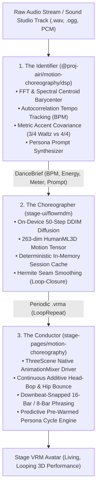

# Design: Motion Choreography & 3D Beat-Conductor Architecture

This document establishes the canonical architecture specification for **AIRI Motion Choreography & 3D Beat-Conductor**. It establishes the complete, self-contained generative dance engine in [`packages/motion-choreography`](../packages/motion-choreography) and [`packages/stage-pages/src/pages/settings/modules/motion-choreography.vue`](../packages/stage-pages/src/pages/settings/modules/motion-choreography.vue), formalizing its clean architectural decoupling from heavy neural inbetweening models (NVIDIA MotionBricks).

---

## 1. Executive Summary & Core Architectural Decoupling

Avatar choreography in AIRI historically faced a false dichotomy:
1. **Static Pre-baked Loops (MMD & Live2D)**: Rigid 3D animation clips that loop identically regardless of music tempo, unable to adapt to arbitrary audio.
2. **Heavy Autoregressive Inbetweening (MotionBricks)**: An ~800 MB neural controller running in native Unity Sentis/C# sidecars to synthesize inbetweens between sparse poses.

### The Decoupling Breakthrough
Empirical implementation across `@proj-airi/motion-choreography` proved that **musical dance does not require an 800 MB neural network.**

By combining:
- **Acoustic DSP Analysis** (autocorrelation tempo, spectral centroid, metric accent covariance),
- **FlowMDM WebGPU Diffusion** (86.8 MB on-device text-to-motion tensor generation),
- **Hermite Seam Smoothing** (mathematical loop boundary closure via quaternion SLERP), and
- **The Conductor Kinematic Warper** (60 FPS non-destructive hip bounce, pelvic sway, and tempo-locked head bop),

AIRI achieves **fully reactive, zero-latency, beat-synced 3D dance routines directly inside the browser / Three.js** with **0 MB additional model downloads, 0ms disk writes, and 0 VRAM waste.**

### Boundary Contract with MotionBricks
- **`@proj-airi/motion-choreography`** owns **100% of dance, rhythm alignment, and musical choreography** across Web, Desktop, and Pocket surfaces.
- **NVIDIA MotionBricks** is formally reserved for **Milestone 5 (Physical Spatial Contact)** in Stage-Mate (Unity): dynamic inverse kinematics for reaching/holding TRELLIS 3D items and seating avatars on detected 3D room furniture.

---

## 2. The 3-Tier Choreography Stack



### 2.1 Tier 1: The Identifier (Acoustic DSP & Prompt Synthesis)
Housed in [`packages/motion-choreography/src/dsp/`](../packages/motion-choreography/src/dsp/) and [`src/synthesizer.ts`](../packages/motion-choreography/src/synthesizer.ts):
- **WAV Codec**: Zero-dependency IEEE 32-bit float and 16-bit PCM parser/serializer (`decodeWav`, `encodeWav`).
- **FFT & Spectral Brightness**: Cooley-Tukey Radix-2 FFT with Hann windowing; calculates spectral centroid barycenter (Dark <1400Hz, Balanced 1400–3200Hz, Bright >3200Hz).
- **Tempo Autocorrelation with Locomotion Prior**: 60–200 BPM lag correlation weighted by human dance resonance prior ($120\text{ BPM}, \sigma = 40$), resolved with subharmonic octave disambiguation.
- **Metric Accent Covariance**: Covariance over lag 2 vs lag 3 onsets distinguishing Triple Meter ($3/4$ Waltz) from Quadruple Meter ($4/4$ Four-on-the-Floor).
- **Prompt Synthesizer**: Injects kinetic primitives tuned for HumanML3D motion diffusion across persona archetypes (`idol`, `gothic_maid`, `cool_android`, `none / pure_beat`).

### 2.2 Tier 2: The Choreographer (On-Device FlowMDM Diffusion)
Housed in [`packages/stage-ui/src/utils/flowmdm/`](../packages/stage-ui/src/utils/flowmdm/):
- **WebGPU DDIM Solver**: 50-step linear schedule running locally inside the browser.
- **Deterministic Session Cache**: In-memory Map keyed by `dance:${trackId}_${bpm}bpm_${meter}_${persona}`. Repeated playback hits memory with 0ms synthesis and 0 IndexedDB writes.
- **Zero-Click Proactivity**: Playback begins immediately with Tier 3 kinematics while Tier 2 diffusion runs in the background, cross-fading into the 3D dance routine as soon as denoising completes.

### 2.3 Tier 3: The Conductor (Kinematic Warper & Real-Time Groove)
Housed in [`packages/motion-choreography/src/conductor/`](../packages/motion-choreography/src/conductor/) and [`motion-choreography.vue`](../packages/stage-pages/src/pages/settings/modules/motion-choreography.vue):
- **Elastic Beat-Warping (`alignDanceSheetToBeats`)**: Maps extracted anchor key-poses to physical audio beats with monotonic time-warping constraints.
- **Unbroken Acoustic Layering**: During active FlowMDM routine playback, the Three.js mixer has full body authority while `handleVrmFrame` layers non-destructive, tempo-synced head-bops and hip groove bounces on top. The avatar never freezes into a mannequin.

---

## 3. Continuous Periodic Motion: Hermite Seam Smoothing

### 3.1 The Boundary Discontinuity Problem
Standard linear diffusion models (like FlowMDM / HumanML3D) generate open-loop motions ($t \in [0, T]$). Frame 0 (initial pose) and Frame $N-1$ (ending pose) reside in different spatial and rotational states.

Using native `LoopRepeat` on raw diffusion output produces an instantaneous velocity spike and pose pop at the wrap-around boundary ($T \to 0$).

### 3.2 The Hermite SLERP Mathematical Contract
To produce seamless, infinite periodic loops, `@proj-airi/motion-choreography` applies **Hermite Seam Smoothing** over a boundary window of duration $\tau = 0.5\text{s}$ ($K = 10\text{ frames}$ at $20\text{fps}$):

For each frame $t$ in the seam window $t \in [N - K, N - 1]$:
1. Compute the normalized blend progress $u \in [0, 1]$:
   $$u = \frac{t - (N - K)}{K - 1}$$
2. Evaluate the S-curve smoothstep weight $\alpha(u)$:
   $$\alpha(u) = 3u^2 - 2u^3$$
3. Apply Spherical Linear Interpolation (SLERP) to every humanoid bone rotation:
   $$q_{\text{bone}}(t) = \text{quatSlerp}\big(q_{\text{bone}}(t), \; q_{\text{bone}}(0), \; \alpha(u)\big)$$
4. Apply Linear Interpolation (LERP) to root pelvic translation:
   $$\mathbf{p}_{\text{hips}}(t) = \text{lerp}\big(\mathbf{p}_{\text{hips}}(t), \; \mathbf{p}_{\text{hips}}(0), \; \alpha(u)\big)$$

By Frame $N-1$, the pose and position identically match Frame 0. When Three.js `LoopRepeat` wraps, there is **zero angular acceleration spike and zero visual hitch.**

---

## 4. Musical Phrasing & The Dynamic Cycle Engine

Rather than forcing the avatar to repeat a single 6-second routine for an entire 3-minute song, the **Dynamic Cycle Engine** treats personas as **musical movements** that evolve across phrases.

### 4.1 Measure-Based Phrasing (The 16-Bar Rule)
Human perception of dance transitions operates on **musical measures (bars)**, not arbitrary seconds. The engine dynamically calculates the duration of a musical bar:

$$T_{\text{bar}} = \frac{\text{beatsPerMeasure}}{\text{BPM} / 60}$$

#### Section Durations by Genre & Tempo:

| Genre / Track | Meter | BPM | Bar Duration | 8-Bar Phrase (Fast) | 16-Bar Section (Standard) |
| :--- | :---: | :---: | :---: | :---: | :---: |
| **The Blue Danube** (Waltz) | $3/4$ | $150$ | $1.20\text{s}$ | $9.6\text{s}$ | **$19.2\text{s}$** *(or 24 bars = **$28.8\text{s}$**)* |
| **House / Pop** | $4/4$ | $120$ | $2.00\text{s}$ | $16.0\text{s}$ | **$32.0\text{s}$** |
| **EDM / Dance** | $4/4$ | $128$ | $1.87\text{s}$ | $15.0\text{s}$ | **$30.0\text{s}$** |
| **Fast Breakbeat / DnB** | $4/4$ | $174$ | $1.38\text{s}$ | **$11.0\text{s}$** | **$22.0\text{s}$** |

### 4.2 Energy-Aware Phrase Budgets
Using the DSP analyzer's `energyTier`:
- **Low / Moderate Energy (`chill`, `moderate`, Classical, Waltz)**:
  Phrases develop over **16 measures** (or 24 measures in $3/4$), creating broad, graceful sections lasting **$\sim 24\text{s} - 30\text{s}$**.
- **High / Explosive Energy (`high`, `explosive`, EDM, Hardstyle)**:
  Phrases shift rapidly over **8 measures**, matching fast drops and buildups every **$\sim 12\text{s} - 15\text{s}$**.

### 4.3 3-Phase Execution Timeline

```
Phrase Timeline: 0s ──────────────── (T_phrase - 5s) ───────────── T_phrase (Beat 1) ────────── Next Phrase
Status:          Playing Movement 1            │                            │                     Playing Movement 2
Pipeline:                                      ▼                            ▼
                                         [PHASE 1: PRE-WARM]          [PHASE 2: SNAP & CROSSFADE]
                                         • Predict next persona       • Detect exact Downbeat (Beat 1)
                                         • Fire FlowMDM in background • Three.js mixer crossFadeFrom(0.8s)
                                         • Buffer warmed by T - 2s    • Smooth movement morphing
```

1. **Phase 1: Background Pre-Warming ($T_{\text{phrase}} - 5\text{s}$)**:
   The engine selects the next persona in the cycle (`idol` $\to$ `gothic_maid` $\to$ `cool_android` $\to$ `none`) and begins background diffusion. Denoising finishes in ~2.2s, so the next 3D clip is warmed in memory before the section ends.
2. **Phase 2: Downbeat Measure Snapping ($T_{\text{phrase}}$)**:
   Transitions **never occur mid-beat or on an off-beat.** The engine synchronizes the trigger to **Beat 1 of the new measure**.
3. **Phase 3: 800ms Smooth Crossfade**:
   The Three.js mixer executes `nextAction.crossFadeFrom(currentAction, 0.8, true)`. The avatar blends seamlessly between choreographic movements without interrupting the audio groove.

---

## 5. Public API & Monorepo Integration

### 5.1 Package Exports (`@proj-airi/motion-choreography`)

```typescript
export { alignDanceSheetToBeats } from './conductor/aligner'
export { evaluateWarpedPoseAt } from './conductor/warper'
// DSP & Acoustic Analysis
export { analyzeAudioBuffer } from './dsp/analyzer'

export { computeMagnitudeSpectrum, computeSpectralCentroid } from './dsp/fft'
export { decodeWav, encodeWav } from './dsp/wav'

export { extractKeyPosesFromHumanML3D } from './kinematics/key-pose-extractor'
// Kinematics & Conductor
export { quatNormalize, quatSlerp, vec3Lerp } from './kinematics/math'
// Hermite Seam Smoothing
export { applyHermiteSeamSmoothing } from './kinematics/seam-smoother'
// Prompt Synthesis & Personas
export { synthesizeDanceBrief } from './synthesizer'

export type { DanceBrief, PersonaArchetype } from './types'
```

### 5.2 Store Integration Contracts
- `useModelStore`: Dispatches `triggerMotion(url, { loop: true, fadeDuration: 0.5 })` across BroadcastChannel (`airi-stores-live2d`).
- `VRMModel.vue`: Binds `LoopRepeat` with `clampWhenFinished = false` when looping is requested, preventing animation freezing.
- `ThreeScene.vue`: Exposes `setVrmFrameHook(hook)` enabling non-destructive frame callbacks after `vrmAnimationMixer.update(delta)`.

---

## 6. Verification & Quality Invariants

1. **Zero-Binary In-Memory Test Suite**:
   All test cases run against pure mathematical PCM audio (`tests/synthetic-audio.ts`) and synthetic HumanML3D tensors (`tests/synthetic-motion.ts`). Vitest suite runs 31+ tests in under 500ms without committing binary audio to Git.
2. **Type Safety & Build Parity**:
   - `pnpm -F @proj-airi/motion-choreography test` must pass 100% green.
   - `pnpm -F @proj-airi/stage-ui-three typecheck` must pass with 0 errors.
   - `pnpm -F @proj-airi/stage-pages typecheck` must pass with 0 errors.
3. **Resource Guardrails**:
   - Dance diffusion memory footprint is strictly ephemeral (blob URLs stored in deterministic session Map).
   - Permanent IndexedDB storage is strictly user-opt-in via the "Save to Library" button.
