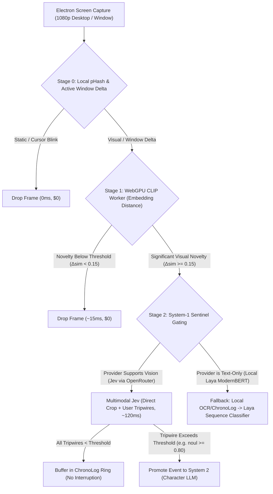

# Design Spec: Multimodal System-1 Cognitive Triage (Jev Vision & Pixel Sentinels)

**Status:** Proposed / Draft
**Target Upstream Availability:** OpenRouter Decisions API (`/api/alpha/decisions` Multimodal)
**Primary Subsystems:** Attention Ecology Screen Perception, System-1 Decision Engine, AnimaDex Wizard
**Related Documents:**
- [`docs/design-attention-ecology-screen-watching.md`](./design-attention-ecology-screen-watching.md)
- [`docs/proposal-jev-integration.md`](./proposal-jev-integration.md)
- [`docs/design-jev-powered-eternal-thread.md`](./design-jev-powered-eternal-thread.md)

---

## 1. Executive Summary

TypeSafe Jev has introduced multimodal input capabilities: evaluating non-autoregressive discrete decisions (`choice`, `score`, `noul`) directly from raw images paired with structured natural-language questions.

Historically, using System 1 for visual screening in AIRI required an awkward, lossy, two-step pipeline: an intermediate Vision-Language Model (VLM) such as Moondream2 (~1.1GB WebGPU download, high VRAM footprint, ~1.5s latency) or WASM Tesseract OCR had to transcribe screen pixels into imperfect text captions before Jev or Laya could evaluate them.

This specification outlines the architecture for **Multimodal System-1 Vision** once supported upstream on OpenRouter:
1. **Screen Watching / Attention Ecology**: Replaces the intermediate Moondream2/OCR bottleneck with direct pixel-to-decision evaluation of user-configured sentinel questions, while preserving Stage 0 (pHash) and Stage 1 (local WebGPU CLIP) to prevent unnecessary network calls.
2. **Temporal Contact Sheets (The Jevreel Pattern)**: Composites rolling frame history into labeled $2 \times 2$ canvas contact sheets, turning Jev from an isolated static pixel classifier into a state-transition detector (e.g. distinguishing a *fresh build error* from a stale, stagnant screen) for the cost of a single image API token.
3. **AnimaDex Wizard Voice & Archetype Picker**: Enables instant (~120ms) automated character voice, pitch offset, speaking rate, and personality archetype matching directly from character card artwork or avatar portraits.
4. **Zero-Embedding Ephemeral Visual Recall ("Rewind")**: Maintains a lightweight in-memory circular buffer of recent frames that can be queried on-demand via contact sheets without vector databases or continuous OCR.
5. **Provider Parity & Fallback Integrity**: Preserves compatibility with on-device text-only models (Local Laya ModernBERT) via runtime capability detection and automatic fallback routing.

> [!NOTE]
> Implementation is intentionally parked until OpenRouter exposes multimodal input on its Decisions API (`/api/alpha/decisions`) or associated Jev model routes, allowing existing account credits and unified credential management to be utilized without standalone TypeSafe billing accounts.

---

## 2. Problem Statement & Motivation

### Current Limitations of Vision Salience Gating
In the current implementation ([`orchestrator.ts`](file:///Users/richardpinedo/Projects.nosync/airi/airi_dasilva333/packages/stage-ui/src/stores/modules/vision/orchestrator.ts)):
- **Heavy Client Footprint**: Local Moondream2 requires a ~1.1GB model download and competes directly for WebGPU VRAM against Live2D renderers, VRM Three.js shaders, and local speech transformers.
- **OCR Fragility**: In non-text environments (video games, streaming video, anime cutscenes, stylized UIs), OCR captures little or nothing, leaving the sliding Chrono-Log starved of meaningful signal.
- **Latency & Roundtrips**: Generating autoregressive captions from Moondream takes 1000–1800ms before Jev can even evaluate tripwires.

### Current Limitations of AnimaDex Wizard Auto-Binding
In the AnimaDex Wizard ([`guided.vue`](file:///Users/richardpinedo/Projects.nosync/airi/airi_dasilva333/packages/stage-pages/src/pages/settings/airi-card/guided.vue)):
- Auto-matching voices and archetypes for custom-imported characters currently relies on static tag heuristics or BLIP captioning, which often misidentifies visual character vibes, age brackets, or stylistic archetypes.

---

## 3. Architecture & Cascaded Pipeline

The updated pipeline strictly preserves local fast-paths to avoid burning cloud bandwidth or API tokens on idle frames.



### Stage Breakdown

| Stage | Technology | Run Location | Latency | Financial Cost | Function |
| :--- | :--- | :--- | :--- | :--- | :--- |
| **Stage 0** | aHash / pHash + Window PID | Main Process / Worker | < 2ms | $0.00 | Drops unchanged frames, scrolling micro-deltas, blinking cursors (~90%+ drop rate). |
| **Stage 1** | `Xenova/clip-vit-base-patch32` | Local WebGPU Worker | ~15ms | $0.00 | Measures cosine novelty distance against rolling centroid of recent frames. |
| **Stage 2** | Multimodal TypeSafe Jev | Cloud (OpenRouter Decisions) | ~120ms | ~$0.00004 | Evaluates user-defined natural language tripwires directly on the raw visual frame. |
| **Stage 3** | Primary Character LLM (System 2) | Cloud or Local LLM | Autoregressive | Normal chat | Generates companion dialogue with attached visual context. |

---

## 4. OpenRouter Decisions Multimodal Contract (Authoritative Reference)

OpenRouter supports multimodal decisions via `POST https://openrouter.ai/api/alpha/decisions` with `typesafe/jev-1.14`.

### A. Authoritative SDK / Wire Format
```typescript
import { OpenRouter } from '@openrouter/sdk'

const openrouter = new OpenRouter({
  apiKey: process.env.OPENROUTER_API_KEY,
})

const decision = await openrouter.alpha.decisions.create({
  decisionsRequest: {
    model: 'typesafe/jev-1.14',
    // State accepts mixed text and OpenAI-style image_url payloads
    state: [
      'Current context: IDE active window is Visual Studio Code - src/auth.ts',
      {
        type: 'image_url',
        image_url: {
          url: `data:image/png;base64,${screenshotBase64}`,
        },
      },
    ],
    questions: {
      // 1. NOUL: returns scalar probability [0.0, 1.0]
      matches_listing: {
        type: 'noul',
        instructions: 'Does the attached media show a compiler error or broken build?',
        criteria: {
          true: 'Terminal shows error stack trace or compiler failure',
          false: 'Terminal is clean or normal code editing',
        },
      },
      // 2. CHOICE: returns discrete choice + probability distribution
      category: {
        type: 'choice',
        instructions: 'Which activity fits this screen?',
        criteria: {
          coding: 'Code editor or terminal',
          gaming: 'Video game gameplay',
          browsing: 'Web browser or documentation',
        },
      },
      // 3. SCORE: returns continuous score + anchored distribution
      condition: {
        type: 'score',
        instructions: 'How severe is the problem?',
        criteria: ['Minor warning', 'Build failure', 'Fatal crash / panic'],
      },
    },
  },
})

// Response parsing contract
const { matches_listing, category, condition } = decision.answers
// matches_listing.noul -> 0.92
// category.choice -> "coding"
// category.probabilities -> { coding: 0.95, gaming: 0.02, browsing: 0.03 }
// condition.score -> 0.81
```

### B. AIRI Provider Adapter Implementation (`openrouter-ai/index.ts`)
In [`openrouter-ai/index.ts`](file:///Users/richardpinedo/Projects.nosync/airi/airi_dasilva333/packages/stage-ui/src/libs/providers/providers/openrouter-ai/index.ts#L47-L76), `systemOne()` maps the internal `(state, questions, model, options)` into this wire format:

```typescript
systemOne: async (
  state: string | object,
  questions: Record<string, any>,
  model = 'typesafe/jev-1.14',
  options?: System1ExecuteOptions,
): Promise<System1Response> => {
  const targetModel = model?.startsWith('typesafe/jev') ? model : 'typesafe/jev-1.14'

  // Build state array supporting text + image attachments
  const stateArray: any[] = []
  if (typeof state === 'string') {
    stateArray.push(state)
  }
  else if (state && typeof state === 'object') {
    stateArray.push(JSON.stringify(state))
  }

  if (options?.images && options.images.length > 0) {
    for (const img of options.images) {
      const url = img.data.startsWith('data:') ? img.data : `data:${img.mimeType || 'image/png'};base64,${img.data}`
      stateArray.push({
        type: 'image_url',
        image_url: { url },
      })
    }
  }

  const decisionsUrl = 'https://openrouter.ai/api/alpha/decisions'
  const res = await fetch(decisionsUrl, {
    method: 'POST',
    headers: {
      'Authorization': `Bearer ${config.apiKey}`,
      'Content-Type': 'application/json',
      'HTTP-Referer': 'https://github.com/dasilva333/airi',
      'X-Title': 'AIRI System 1 Coprocessor',
    },
    body: JSON.stringify({
      model: targetModel,
      state: stateArray.length === 1 && typeof stateArray[0] === 'string' ? stateArray[0] : stateArray,
      questions,
    }),
    signal: options?.signal,
  })

  if (!res.ok) {
    const errText = await res.text()
    throw new Error(`[OpenRouter Decisions] API error ${res.status}: ${errText}`)
  }

  return await res.json() as System1Response
}
```

---

## 5. Subsystem Integration: Attention Ecology Screen Watching

### 5.1 Direct Evaluation of User-Defined Sentinel Questions
Rather than hardcoding arbitrary questions, the multimodal engine evaluates the exact tripwires configured by the user in `CardCreationTabProactivity.vue` (`settings/vision/sentinel-questions`):

```typescript
// Payload passed to Jev Decisions API
const requestPayload = {
  image: contactSheetBase64, // 512x512 JPEG/PNG (single frame or 2x2 contact sheet)
  state: {
    activeWindow: payload.activeWindow,
    recentChronoLog: chronoLogBuffer.slice(-3).map(e => `[${e.activeWindow}] ${e.caption}`),
  },
  questions: {
    // Dynamic mapping from user's active tripwires in card settings
    compiler_error: {
      type: 'noul',
      instructions: 'Did the user encounter a compiler error, broken build, failed test, or terminal exception?',
    },
    social_interaction: {
      type: 'noul',
      instructions: 'Is the user messaging, chatting, or collaborating with someone in a communication app?',
    },
    notable_event: {
      type: 'noul',
      instructions: 'Did a notable, dramatic, or unexpected event occur that warrants companion proactive commentary?',
    },
  },
}
```

### 5.2 Temporal Contact Sheet Compositing (The Jevreel Pattern)
Single visual snapshots have a fundamental blind spot: **temporal blindness**. An isolated screenshot showing a terminal error cannot reveal whether:
1. The user *just* ran a build that exploded, or
2. The user has been reading documentation for 20 minutes while an old error sits in the background.

To solve this without increasing token costs, AIRI adapts the **contact sheet pattern** pioneered by [`DeepAleph/jevreel`](https://github.com/DeepAleph/jevreel).

Instead of sending 1 isolated frame, the renderer's offscreen HTML5 canvas draws the rolling frame buffer ($t-15\text{s}$, $t-10\text{s}$, $t-5\text{s}$, $t=0\text{s}$) into a labeled $2 \times 2$ contact sheet in under 2 milliseconds:

```
┌─────────────────────────┬─────────────────────────┐
│ [Frame 1: t = -15s]     │ [Frame 2: t = -10s]     │
│ Editing code            │ Running test suite      │
├─────────────────────────┼─────────────────────────┤
│ [Frame 3: t = -5s]      │ [Frame 4: t = 0s]       │
│ Compilation in progress │ Build failed (Red trace)│
└─────────────────────────┴─────────────────────────┘
```

#### Canvas Compositor Implementation
```typescript
export function composeTemporalContactSheet(
  frames: Array<{ dataUrl: string, label: string }>,
  size = 512,
): string {
  const canvas = document.createElement('canvas')
  canvas.width = size
  canvas.height = size
  const ctx = canvas.getContext('2d')!

  const half = size / 2
  const positions = [
    { x: 0, y: 0 },
    { x: half, y: 0 },
    { x: 0, y: half },
    { x: half, y: half },
  ]

  frames.slice(-4).forEach((f, idx) => {
    const pos = positions[idx]
    const img = new Image()
    img.src = f.dataUrl
    ctx.drawImage(img, pos.x, pos.y, half, half)
    // Timestamp badge overlay
    ctx.fillStyle = 'rgba(0,0,0,0.65)'
    ctx.fillRect(pos.x + 4, pos.y + half - 20, 80, 16)
    ctx.fillStyle = '#ffffff'
    ctx.font = '10px sans-serif'
    ctx.fillText(f.label, pos.x + 8, pos.y + half - 8)
  })

  return canvas.toDataURL('image/jpeg', 0.85)
}
```

Because OpenRouter treats the resulting $512 \times 512$ image as **1 single image input**, the token cost is completely unchanged, but Jev can now classify **state transitions and causality**:
```typescript
questions: {
  state_transition: {
    type: 'choice',
    instructions: 'What transition occurred across this 4-frame temporal sequence?',
    criteria: {
      new_failure: 'Code or action was triggered and ended in a fresh failure, crash, or error',
      resolved: 'An error was cleared or build succeeded',
      stagnant: 'Screen remained in the exact same state throughout',
      normal_flow: 'Continuous routine editing or browsing without disruption',
    },
  },
  action_urgency: {
    type: 'noul',
    instructions: 'Did a fresh failure or disruption occur specifically in the final frame (Frame 4)?',
  },
}
```
**Outcome:** Eliminates false-positive companion interruptions. The companion never interrupts for stale, pre-existing errors.

### 5.3 Post-Promotion Speech Grounding (How System 2 Speaks)
When Jev triggers promotion (`noul >= threshold`), the system avoids redundant VLM captioning:
1. **Triggered Tripwire Metadata**: Injected into the grounding prompt block:
   ```markdown
   [REAL-TIME SCREEN OBSERVATION]
   Active Window: Visual Studio Code - src/auth.ts
   Triggered Sentinel: "Compiler error, broken build, or failed test" (Confidence: 88%)
   Temporal Transition: new_failure (Fresh disruption occurred in final frame)
   ```
2. **On-Demand Frame Forwarding**:
   - If the user's primary chat model supports vision (e.g., Claude 3.5 Sonnet, GPT-4o, Gemini 1.5/2.0 Flash), the single promoted high-res frame is attached *once* to the prompt turn. The primary model sees the full-resolution screenshot without paying for continuous VLM video polling.
   - If the primary model is text-only, it generates in-character commentary based directly on the high-confidence sentinel label and active window name.

### 5.4 Zero-Embedding Ephemeral Visual Recall ("Rewind Buffer")
A frequent companion interaction is asking about fleeting visual events that just disappeared:
> *"Airi, did you catch what error that modal showed before it closed?"*

Traditional systems require continuous video recording and dense vector indexing. AIRI instead leverages Jev's zero-embedding search pattern:
1. **In-Memory Ring Buffer**: Maintains the last 30–60 seconds of downscaled thumbnails in RAM (~5 MB heap footprint).
2. **On-Demand Contact Sheet**: When the user asks about recent activity, the buffer tiles 16 frames into a $4 \times 4$ contact sheet labeled $F_1 \dots F_{16}$.
3. **Discrete Jev Localizer**:
   ```typescript
   questions: {
     target_frame: {
       type: 'choice',
       instructions: 'Which labeled frame contains an alert, error dialog, or modal pop-up?',
       criteria: {
         frame_1: '0-2s ago',
         frame_2: '2-4s ago',
         // ...
         frame_16: '28-30s ago',
         none: 'No alert or pop-up appeared in any frame',
       },
     },
   }
   ```
4. **Targeted Extraction**: Once Jev pinpoints `frame_6`, the system fetches only that specific uncompressed frame and passes it to System 2 for detailed conversational answer. Zero vector databases, zero disk thrashing.

### 5.5 External Video Intelligence via MCP (`DeepAleph/jevreel`)
For long, pre-recorded video files (e.g. gameplay replays, tutorials, meeting recordings) that exceed the scope of the real-time screen watcher, AIRI's native MCP integration ([`airi-mcp-integration`](file:///Users/richardpinedo/Projects.nosync/airi/.agents/skills/airi-mcp-integration/SKILL.md)) supports plugging in `jevreel` directly as an external MCP server:
```json
{
  "mcpServers": {
    "jevreel": {
      "command": "uvx",
      "args": ["jevreel", "serve"],
      "env": {
        "OPENROUTER_API_KEY": "${OPENROUTER_API_KEY}"
      }
    }
  }
}
```
This grants the companion tools (`query_video`, `locate_moment_in_recording`) to interrogate MP4/WebM files using the same zero-embedding contact sheet philosophy.

---

## 6. Subsystem Integration: AnimaDex Wizard (Visual Voice & Archetype Binding)

When a user selects or uploads a custom character in the AnimaDex Wizard ([`guided.vue`](file:///Users/richardpinedo/Projects.nosync/airi/airi_dasilva333/packages/stage-pages/src/pages/settings/airi-card/guided.vue)), Multimodal Jev eliminates manual trial-and-error voice configuration by inspecting the character portrait in a single batch pass (~120ms).

```typescript
// Evaluated during Step 1 -> Step 2 roster transition
export async function autoMatchCharacterFromArtworkWithJev(
  avatarImageBase64: string,
  candidateVoices: VoiceItem[],
): Promise<CharacterVoiceProfile> {
  const systemOneStore = useSystemOneStore()

  const res = await systemOneStore.execute(
    { totalVoices: candidateVoices.length },
    {
      matched_voice: {
        type: 'choice',
        instructions: 'Which voice identifier best matches the visual aesthetic, age, and vibe of this character portrait?',
        criteria: Object.fromEntries(candidateVoices.map(v => [v.id, `${v.name} (${v.gender}, ${v.description})`])),
      },
      pitch_shift: {
        type: 'choice',
        instructions: 'Select semitone pitch offset for character build.',
        criteria: {
          '-4': 'Deep / Mature',
          '-2': 'Slightly Lower',
          '0': 'Natural / Baseline',
          '+2': 'Bright / Youthful',
          '+4': 'High / Petite',
        },
      },
      speech_rate: {
        type: 'score',
        instructions: 'Speaking speed multiplier (0.85 slow/calm to 1.25 fast/energetic).',
        min: 0.85,
        max: 1.25,
      },
      character_archetype: {
        type: 'choice',
        instructions: 'Identify primary character trope / archetype:',
        criteria: {
          tsundere: 'Sharp exterior, defensive, easily flustered',
          kuudere: 'Cool, quiet, emotionless, blunt',
          genki: 'High energy, cheerful, loud, extroverted',
          dandere: 'Shy, soft-spoken, reserved',
          oneesan: 'Mature, teasing, caring, elder demeanor',
          mentor: 'Serious, intellectual, composed authority',
        },
      },
    },
    undefined,
    { images: [avatarImageBase64] },
  )

  return {
    voiceId: res.answers.matched_voice?.choice,
    pitch: Number(res.answers.pitch_shift?.choice || 0),
    rate: res.answers.speech_rate?.score || 1.0,
    archetype: res.answers.character_archetype?.choice,
  }
}
```

---

## 7. Spatial Grounding & The 'box' Type

Jev 1.14 introduces the `box` question type, enabling discrete spatial object localization within an image alongside standard categorical/probability heads.

### 7.1 Mechanics & Mandatory `noul` Presence Pairing
The `box` type outputs resolution-independent decimal coordinates normalized between `0.0` and `1.0`:
```json
"answers": {
  "error_boundary": {
    "type": "box",
    "box": {
      "top": 0.42,
      "bottom": 0.68,
      "left": 0.12,
      "right": 0.58
    },
    "confidence": 0.91
  }
}
```

> [!WARNING]
> **Mandatory Pairing Rule**: TypeSafe notes that the `box` classifier **always emits coordinates**, even when the target object is absent from the image. In AIRI, a `box` question **must always be paired with a companion `noul` presence gate**:
> ```typescript
> questions: {
>   has_compiler_error: {
>     type: 'noul',
>     instructions: 'Is a compiler error, exception, or terminal stack trace visible on screen?',
>   },
>   error_box: {
>     type: 'box',
>     instructions: 'Locate the bounding box around the primary error or failure message.',
>   },
> }
> ```
> Application code only parses and acts upon `error_box.box` when `has_compiler_error.noul >= 0.80`.

---

### 7.2 [HIGH PRIORITY] Surgical High-Res ROI Cropping (Screen Watching Initiative)

**The Problem:** When promoting a screen event to the primary character LLM (e.g., Claude 3.5 Sonnet, GPT-4o, Gemini 2.0 Flash), attaching an entire 4K or 1080p desktop screenshot has two major flaws:
1. **Severe Token Drain**: A full-res desktop frame consumes 1,600+ vision tokens per promotion.
2. **Font Blur & Unreadability**: Automated downscaling in cloud VLMs frequently renders small terminal code, variable names, and line numbers illegible.

**The Solution:**
When Jev triggers promotion, AIRI uses the normalized coordinates to extract a crisp, 1:1 pixel **Region-of-Interest (ROI) crop** directly from the native desktop capture:

```typescript
export function cropRegionOfInterest(
  fullNativeDataUrl: string,
  box: { top: number, bottom: number, left: number, right: number },
  paddingPx = 24,
): Promise<string> {
  return new Promise((resolve) => {
    const img = new Image()
    img.onload = () => {
      const x = Math.max(0, Math.floor(box.left * img.width) - paddingPx)
      const y = Math.max(0, Math.floor(box.top * img.height) - paddingPx)
      const w = Math.min(img.width - x, Math.ceil((box.right - box.left) * img.width) + paddingPx * 2)
      const h = Math.min(img.height - y, Math.ceil((box.bottom - box.top) * img.height) + paddingPx * 2)

      const canvas = document.createElement('canvas')
      canvas.width = w
      canvas.height = h
      const ctx = canvas.getContext('2d')!
      ctx.drawImage(img, x, y, w, h, 0, 0, w, h)
      resolve(canvas.toDataURL('image/png'))
    }
    img.src = fullNativeDataUrl
  })
}
```

**Benefits:**
- **70–80% Token Reduction**: Transmits a compact $\sim 450 \times 250$ crop rather than a giant desktop canvas.
- **100% Font Legibility**: The primary LLM sees exact, uncompressed pixels for stack traces, line numbers, and syntax errors.
- **Immediate Context Injection**: The crop is attached directly to the companion's dialogue prompt turn.

---

### 7.3 [FUTURE EXTENSIONS] Exploratory Spatial Capabilities

Beyond ROI cropping, the `box` coordinates unlock several ambient physical interactions:

1. **Spatial Eye Gaze & Head Tracking (Avatar Attention)**:
   - Live2D and VRM avatar runtimes track `lookAt` target coordinates.
   - Using the box midpoint $x_c = \frac{\text{left} + \text{right}}{2}$, $y_c = \frac{\text{top} + \text{bottom}}{2}$, the companion turns its head and shifts its gaze directly toward where the event or error occurred on the user's monitor, delivering lifelike physical presence.
2. **Floating Desktop Overlay Highlights (Vibe Island / Stage-Mate)**:
   - When the companion speaks (*"Looks like line 42 threw a TypeError"*), the Electron transparent stage overlay or Vibe Island indicator paints an ephemeral, animated outline box around the exact desktop coordinates for 3 seconds.
3. **AnimaDex Wizard Automated Face / Portrait Extraction**:
   - When users drop full-body illustrations or group wallpapers into the wizard, a `face_crop: { type: 'box' }` query extracts and centers the square avatar portrait automatically, eliminating manual crop adjustments.

---

## 8. Provider Interface & The Laya Boundary

Local Laya (`tozp/laya-onnx`) is an on-device ModernBERT sequence classifier that does not support image tensors. The interface must remain strongly typed while gracefully degrading.

### Provider Interface Extension ([`types.ts`](file:///Users/richardpinedo/Projects.nosync/airi/airi_dasilva333/packages/stage-ui/src/libs/providers/types.ts))
```typescript
export interface System1ExecuteOptions {
  modelOverride?: string
  images?: Array<{
    data: string // Data URL or base64 string
    mimeType?: string
  }>
  signal?: AbortSignal
}

export interface System1Capabilities {
  supportsVision?: boolean
  maxImages?: number
}

export interface System1Provider {
  capabilities?: System1Capabilities
  systemOne: (
    state: string | object,
    questions: Record<string, any>,
    model?: string,
    options?: System1ExecuteOptions,
  ) => Promise<System1Response>
}
```

### Runtime Degradation Matrix

| Provider | `supportsVision` | Behavior on Multimodal Call |
| :--- | :--- | :--- |
| `openrouter-ai` | `true` | Forwards image payload to `/api/alpha/decisions` Jev vision endpoint. |
| `typesafe-ai` | `true` | Forwards image payload to `/v1/systemone`. |
| `opencode-go` | `true` (when enabled) | Forwards session-authenticated image payload to `/zen/v1/systemone`. |
| `laya-local` | `false` | Falls back to local OCR/ChronoLog text summarization and invokes ModernBERT on text state. Ignores image payload without throwing. |

---

## 9. Performance & Resource Impact Comparison

| Metric | Current Pipeline (Moondream2 + Jev) | Multimodal Jev Pipeline | Delta |
| :--- | :--- | :--- | :--- |
| **Model Assets to Download** | ~1,100 MB (Moondream weights + WASM) | 0 MB (Cloud Jev) | **-100% (-1.1 GB)** |
| **Local WebGPU VRAM** | ~850 MB reserved | 0 MB (Handled by Cloud) | **-850 MB VRAM** |
| **Pipeline Latency (Stage 2)** | 1,200 ms – 1,800 ms | 100 ms – 150 ms | **~10x faster** |
| **Background Battery Drain** | High (Periodic GPU shader dispatch) | Negligible (Only pHash + CLIP) | **Substantial reduction** |
| **OCR Failure Rate in Games/Video** | High (WASM OCR yields empty text) | Zero (Evaluates visual pixels) | **Robust visual triage** |
| **VLM Promotion Cloud Cost** | High (1,600+ tokens per full 4K desktop frame) | Minimal (~300 tokens for surgical ROI crop) | **~75% reduction** |

---

## 10. Rollout Plan & Milestones

1. **Phase 1 (Preparation & Specification)**: Complete this architecture document and keep `packages/stage-ui/src/stores/modules/system-one.ts` clean of speculative code.
2. **Phase 2 (Upstream OpenRouter Availability)**: Target `typesafe/jev-1.14` decisions multimodal parameters on OpenRouter `/api/alpha/decisions`.
3. **Phase 3 (Screen Watching & Surgical ROI Cropping) [HIGH PRIORITY]**:
   - Add `images` parameter to `openrouter-ai` provider adapter.
   - Add `supportsVision` capability check in `useSystemOneStore`.
   - Update `orchestrator.ts` to skip Moondream provisioning when an active vision-capable System-1 provider is configured.
   - Compose temporal contact sheets ($2 \times 2$ canvas) for state-transition triage.
   - **[HIGH PRIORITY]** Implement `box` + `noul` query pairing in `orchestrator.ts` and slice crisp, 1:1 pixel high-res ROI crops for the primary LLM turn, eliminating font downscaling blur and slashing vision tokens by 70–80%.
4. **Phase 4 (AnimaDex Integration)**:
   - Hook `autoMatchCharacterFromArtworkWithJev` into `guided.vue` Step 1 $\rightarrow$ Step 2 transition.
   - Add automated voice preview playback upon selection.
5. **Phase 5 (Spatial Presence & Overlay Explorations) [FUTURE EXTENSION]**:
   - Hook normalized `box` centers into Live2D/VRM `lookAt` spatial head and eye gaze tracking.
   - Render 3-second animated outline highlights on desktop overlay or Vibe Island.
   - Add automated avatar face cropping in AnimaDex character creation modal.
