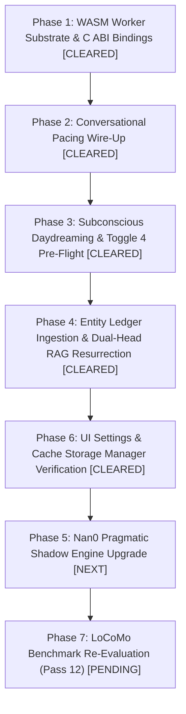

# Architectural Design: Needle-3 On-Device Runtime — Subconscious Cognition, Conversational Pacing & RAG Resurrection

**Status:** Active Implementation (4 of 5 Domains Cleared — Core WASM, RAG Ledger, Daydreaming, Pacing & Cache UI Shipped)
**Authors:** AIRI Architecture Team & AI Assistant
**Date:** 2026-11-10 (Updated with Implementation Checkpoints)
**Target Workspaces & Packages:**
- `airi_dasilva333/packages/stage-ui/src/workers/needle/` (WASM worker host & C ABI bridge)
- `airi_dasilva333/packages/stage-ui/src/libs/inference/adapters/` (`needle-client.ts` typed interface)
- `airi_dasilva333/packages/stage-ui/src/libs/search/` (`ledger-priming.ts`, `entity-ledger.ts` RAG pipeline)
- `airi_dasilva333/packages/stage-ui/src/stores/daydream.ts` (subconscious cadence governor)
- `airi_dasilva333/packages/stage-ui/src/stores/chat/recent-topics.ts` (ML-driven Toggle 4 state)
- `airi_dasilva333/packages/stage-ui/src/stores/chat/grounding-assembler.ts` (`[RECENT TOPICS]` injection seam)
- `airi_dasilva333/packages/stage-ui/src/composables/use-turn-pacing.ts` ($t=0$ initial reaction probes)
- `airi_dasilva333/packages/nan0-runtime/src/shadow/` (`Nan0SubconsciousShadowEngine.ts` pragmatic intent)
- `airi_dasilva333/packages/stage-pages/src/pages/settings/airi-card/components/tabs/acting/` (Thinking & Pacing settings)
- `airi_dasilva333/scripts/tests/locomo-benchmark/` (`needle-node.mjs`, `needle-schema.mjs`)

**Authoritative Predecessors & Related References:**
- [`docs/design-needle-subconscious-runtime.md`](./design-needle-subconscious-runtime.md) — Needle-2 Subconscious Runtime specification (archived baseline).
- [`docs/memory_lab/LoCoMo-Pass3-Jev-Peer-Review.md`](./memory_lab/LoCoMo-Pass3-Jev-Peer-Review.md) — Peer review detailing the demotion of Needle-2 in RAG extraction.
- [`docs/memory_lab/LoCoMo-Pass2-Entity-Ledger-Review.md`](./memory_lab/LoCoMo-Pass2-Entity-Ledger-Review.md) — Entity Ledger extraction benchmarks.
- [`docs/proposal-conversational-pacing-thinking-fillers.md`](./proposal-conversational-pacing-thinking-fillers.md) — Dynamic thinking fillers and spoken asides specification.
- [`docs/nan0/design-nan0-cognition-runtime.md`](./nan0/design-nan0-cognition-runtime.md) — Nan0 subconscious shadow engine and emotional climate tracking.
- **Cactus Needle Architecture:** [cactuscompute.com/needle](https://cactuscompute.com/needle) · [Hugging Face: Cactus-Compute/needle3](https://huggingface.co/Cactus-Compute/needle3)

---

## 1. Executive Summary: The Unified Zero-GPU Intelligence Layer

AIRI's desktop and mobile runtimes demand fast, lightweight cognitive operations that must execute without competing for limited WebGPU VRAM. Currently, WebGPU is already heavily contested by:
1. 3D avatar rendering (VRM / Three.js, MToon shaders, skeletal kinematics, Live2D Cubism).
2. Large primary speech and vision backends (Kokoro TTS, Whisper STT, Moondream2 VLM, FlowMDM).
3. Primary on-device LLMs (WebLLM / Web-RWKV).

**Needle-2** was originally brought into AIRI to provide a zero-GPU, CPU/WASM subconscious layer for two tasks:
1. **Turn-by-turn Subconscious Daydreaming** & Toggle 4 Recent Topics extraction.
2. **Entity Ledger Ingestion & RAG Span Proposals** for the LoCoMo memory benchmark.

However, Needle-2 suffered from severe operational constraints: a fixed 45M dense Feed-Forward Network (FFN) architecture with a suffocating **256-token effective context window**, sluggish batch extraction speeds, and no native vector embedding capability. As documented in [`LoCoMo-Pass3-Jev-Peer-Review.md`](./memory_lab/LoCoMo-Pass3-Jev-Peer-Review.md), it was demoted in the RAG pipeline in favor of regex heuristics and external models.

**Needle-3 (released September 2026 by Cactus Compute)** fundamentally resolves every bottleneck that caused Needle-2's demotion. By abandoning dense FFNs for **Monarch Hadamard MLPs** and hashed **engram parameters**, introducing an **8,192-token context window**, and natively integrating **calibrated text embeddings**, Needle-3 provides a unified on-device SLM that operates as:
* An ultra-low-latency ($<40\text{ ms}$) conversational pacing probe at $t=0$.
* A non-invasive multi-turn subconscious daydreaming and topic extractor.
* A fully revived, zero-GPU **local RAG indexing and extraction engine** that eliminates the need for separate embedding models (such as BGE or MiniLM) for local entity retrieval.

```
┌────────────────────────────────────────────────────────────────────────────────────────┐
│                              Incoming Conversation Turn                                │
│                     (Sliding Window / History up to 8,192 Tokens)                      │
└──────────────────────────────────────────┬─────────────────────────────────────────────┘
                                           │
                                           ▼
┌────────────────────────────────────────────────────────────────────────────────────────┐
│                        Needle-3 On-Device Engine (WASM / CPU)                          │
│          • Laddered SAN (Sliceable 2–20 Layers, 8 MB–29 MB)                            │
│          • Monarch Hadamard MLP: O(d√d) compute                                        │
│          • Hashed Engram Memory: 2/3-gram parameter store                              │
│          • Single-pass Dual-Head: Grammar-Constrained JSON + Text Embeddings           │
└──────┬────────────────────┬─────────────────────────────┬───────────────────────┬──────┘
       │                    │                             │                       │
       ▼                    ▼                             ▼                       ▼
┌──────────────┐     ┌──────────────┐              ┌──────────────┐        ┌──────────────┐
│   Domain 1   │     │   Domain 2   │              │   Domain 3   │        │   Domain 4   │
│ RAG & Memory │     │ Subconscious │              │ Conversational│       │     Nan0     │
│Entity Ledger │     │ Daydreaming  │              │    Pacing    │        │ Shadow Engine│
├──────────────┤     ├──────────────┤              ├──────────────┤        ├──────────────┤
│ [CLEARED]    │     │ [CLEARED]    │              │ [CLEARED]    │        │ [PENDING]    │
│• 8k Ingest   │     │• Toggle 4    │              │• t=0 Probe   │        │• Pragmatic   │
│• Native 256d │     │  active_topic│              │  (<40ms TTFT)│        │  Intent      │
│  Embeddings  │     │• Daydream    │              │• CoT Pivot   │        │• Emotional   │
│• Span Claims │     │  Chips       │              │  Extraction  │        │  Climate     │
│• 0-GPU RAG   │     │• Vibe Shifts │              │• Dual-Channel│        │• Multilingual│
└──────────────┘     └──────────────┘              └──────────────┘        └──────────────┘
```

### Domain Implementation Status Summary

| Domain | Status | Key Components & Shipped Checkpoints |
| :--- | :--- | :--- |
| **Domain 1: RAG & Memory Entity Ledger** | **CLEARED** | Commit `ebde76df5` — Resurrected zero-GPU vector search with 3,072d/256d unit embeddings, multi-turn claim and mention extraction in `ledger-priming.ts` and `entity-ledger.ts`. |
| **Domain 2: Subconscious Daydreaming & Toggle 4** | **CLEARED** | Commit `011acfe28` — Registered `record_subconscious_beat` in Cactus WASM, created Cadence Governor in `daydream.ts` (salience threshold $\ge 0.72$), and wired ML topic generation in `recent-topics.ts`. |
| **Domain 3: Conversational Pacing & Spoken Asides** | **CLEARED** | Commits `dd48872b3`, `2321823ba`, `30c34ad46` — Wired dynamic aside caching, 112-token budget, CPU thread scaling, clean `Thought: ...\n\nCall record_cot_pivot.` prompt framing, dual-channel extraction (JSON arguments + reasoning trace regex), and anti-echo guardrails. |
| **Domain 4: Nan0 Subconscious Shadow Engine** | **PENDING** | `packages/nan0-runtime/src/shadow/Nan0SubconsciousShadowEngine.ts` — Multilingual intent resolution, emotional climate tracking, and resolving the "Famous Sentence" test suite. |
| **Domain 5: Core WASM Substrate & UI Settings** | **CLEARED** | Core WASM loader, weights caching (`needle3-cache`), memory management, and `needle-client.ts` cleared. `ModelCacheManager.vue` UI catalog entry (8–29 MB) and `cache-utils.ts` Cache Storage inspection and legacy eviction cleared. |

---

## 2. Architectural Paradigm Shift: Needle-2 vs. Needle-3

### 2.1 The Death of Dense FFNs: Monarch Hadamard MLPs
In standard transformers and Needle-2's Simple Attention Network (SAN), Feed-Forward Networks scale quadratically in compute and parameter footprint ($O(d^2)$). In a browser Web Worker running on single-threaded CPU WASM, dense matrix multiplications cause severe cache thrashing, high latency (150ms–350ms per small prompt), and battery drain on mobile devices.

Needle-3 replaces dense linear layers with **Monarch Hadamard MLPs**:
$$\text{MLP}(x) = (M_2 \circ H)(M_1 \circ H) x$$
* $M_1, M_2$ are block-diagonal structured Kronecker matrices initialized via Walsh-Hadamard transforms.
* Parameter expansion complexity drops from $O(d^2)$ to $O(d\sqrt{d})$.
* This mathematical structure eliminates outlier activations that typically break 2-bit quantization, enabling stable CQ2-bit compression (~2.125 bits per parameter) without accuracy cliff drops.

### 2.2 Engram Hashed Memory Tables
Rather than stuffing lexical, grammatical, and relational facts into dense matrix weights, Needle-3 offloads parameters into an **engram**:
* A multi-level hashed 2-gram and 3-gram lookup table embedded directly in the `.cact` binary.
* Lookups are $O(1)$ indexed memory reads rather than floating-point multiply-accumulate operations (FLOPs).
* As a result, Needle-3 achieves **up to 4,000+ tokens/sec decode throughput** on standard ARM/x86 CPUs (e.g. Raspberry Pi 5 or Apple Silicon M-series efficiency cores).

### 2.3 The "Intelligence Ladder" (Dynamic Depth Slicing)
Needle-2 was a static 45M parameter checkpoint (~14 MB). If a user had an ultra-low-power device (such as an embedded sidecar or smartwatch), the model could not be scaled down.

Needle-3 introduces a dynamically sliceable ladder:
* A single unified training run yields a 20-layer model (`needle3.cact`).
* **Any prefix depth from 2 layers up to 20 layers acts as an independently valid subnetwork.**
* Developers and runtimes can slice out the exact footprint needed:
  * **Rung 4 (25M params, ~8 MB):** Ultra-fast pacing and $t=0$ prompt reaction on constrained clients.
  * **Rung 12 (65M params, ~16 MB):** Balanced turn-by-turn subconscious daydreaming and entity extraction.
  * **Rung 20 (121M params, ~29 MB):** Full-depth RAG embedding, complex span extraction, and multi-lingual intent resolution.

### 2.4 Strict Span-Based Grounding at the Weight Level
In Needle-2 cleanroom testing, a major failure mode was **markdown delimiter leakage**: when evaluating prompt text with structured headers (e.g. `### TARGET UTTERANCE`), Needle-2 frequently copied the header text into its JSON tool arguments. In `ledger-priming.ts`, AIRI was forced to maintain a complex 100-line JavaScript verification function (`validateExtractionSpans()`) to detect and discard hallucinated spans.

Needle-3 integrates **strict span-based argument grounding** directly into its constrained decode head:
* Arguments bound to source text are constrained to valid sub-token spans present in the input KV cache.
* If a candidate argument cannot be anchored to an exact span in the input context, the decode probability collapses to zero, natively preventing hallucinated claims and prompt header leakage.

### 2.5 Side-by-Side Architectural Comparison

| Dimension | Needle-2 (Legacy) | Needle-3 (Modern Target) |
| :--- | :--- | :--- |
| **Release Date** | August 2026 | September 2026 |
| **Model Size / Binary** | Fixed 45M params (~14 MB binary) | **Scalable 25M to 121M params (8 MB to 29 MB)** |
| **Active Session RAM** | ~52–66 MB | **~24 MB (Rung 4) to ~58 MB (Rung 20)** |
| **Architecture** | Simple Attention Network (SAN) + Dense FFNs | **Laddered SAN + Monarch Hadamard MLPs + Engram** |
| **Compute Complexity** | $O(d^2)$ matrix multiplications | **$O(d\sqrt{d})$ Kronecker products + $O(1)$ engram lookups** |
| **Effective Context Window** | 256 tokens (choked on long prompts) | **8,192 tokens (hybrid sliding window + global attention)** |
| **Decode Throughput** | ~250–460 tok/s on CPU | **~1,800–4,200 tok/s on CPU** |
| **Primary Capabilities** | Tool calling & JSON extraction only | **Tool calling, extraction, AND calibrated text embeddings** |
| **Embedding Dimension** | *None* (requires secondary model) | **Native 256-dimensional normalized vectors** |
| **Span Grounding** | Host-level regex verification required | **Native KV-cache span constraints** |
| **Language Coverage** | Primarily English | **English, French, Spanish, German, Italian, Dutch, Polish** |
| **Package / C ABI** | `needle.wasm` (`needle_init`, `needle_complete`) | `needle3.wasm` (`needle_load`, `needle_embed`, `needle_complete`) |

---

## 3. Deprecation & Clean Retirement of Needle-2

### 3.1 Decision: Zero Dual-Maintenance
We will **NOT** maintain backwards compatibility or simultaneous runtime support for Needle-2:
1. **Redundant Code & Footprint:** Supporting both models would require maintaining two separate WASM binary loaders, two distinct Cache Storage scopes (`needle-cache` and `needle3-cache`), two sets of worker shims, and dual C ABI binding signatures.
2. **Dense FFNs are Obsolete:** There is no scenario where Needle-2's dense FFNs outperform Needle-3's Monarch MLPs. Needle-3's lowest ladder rung (Rung 4) is **43% smaller (8 MB vs 14 MB)** and **4× faster** while achieving higher extraction precision.
3. **Complete Functional Superset:** Every single task previously assigned to Needle-2 (initial reaction fillers, daydreaming beats, LoCoMo entity extraction) runs identically or better on Needle-3.

### 3.2 Deprecation Checklist
- [x] Deprecate Cache Storage API key `'needle-cache'` in favor of `'needle3-cache'`.
- [x] Remove legacy weight URL `https://huggingface.co/Cactus-Compute/needle2/resolve/main/needle2.cact`.
- [x] Update `ModelCacheManager.vue` catalog to retire `needle-2` (14 MB) and display `needle-3` (8–29 MB).
- [x] Purge regex heuristic fallbacks in `packages/stage-ui/src/workers/needle/worker.ts` that were masking Needle-2's bootstrapping latency.

---

## 4. The Resurrected RAG & Memory Pipeline (Domain 1)

### 4.1 Root Cause of Needle-2's Demotion in LoCoMo
In Pass 2 and Pass 3 of AIRI's long-context conversational memory benchmark (LoCoMo `conv-47`, 31 sessions, 689 turns), Needle-2 was tested as an on-device entity and claim extractor. As documented in [`LoCoMo-Pass3-Jev-Peer-Review.md`](./memory_lab/LoCoMo-Pass3-Jev-Peer-Review.md):
1. **Context Window Starvation:** Because Needle-2's attention collapsed beyond 256 tokens, turns had to be sliced into rigid 3-turn windows (`target + 2 prior turns`). Any relationship spanning across 4 or more turns was severed.
2. **Missing Vector Representation:** Needle-2 could extract candidate strings, but could not rank or search them. AIRI had to run a separate embedding pipeline (such as BGE ONNX Web / Transformers.js or BM25) plus Jev reranking.
3. **Slow Batch Processing:** Ingesting 689 turns on CPU WASM saturated worker threads for tens of seconds.

### 4.2 The Needle-3 Dual-Head Architecture
Needle-3 natively solves this by integrating an **extractive head** and an **embedding head** in the same forward pass:

```
Input Turn / Passage (up to 8k tokens)
                  │
                  ▼
┌───────────────────────────────────┐
│     Needle-3 Laddered SAN Core    │
└─────────────────┬─────────────────┘
                  │
        ┌─────────┴─────────┐
        ▼                   ▼
┌────────────────┐  ┌────────────────┐
│ Extraction Head│  │ Embedding Head │
│ (Constrained)  │  │ (Normalized)   │
├────────────────┤  ├────────────────┤
│• Mentions      │  │• 256-dim dense │
│• Temporal      │  │  unit vector   │
│  Phrases       │  │• Cosine dot    │
│• Claims        │  │  product ready │
└────────────────┘  └────────────────┘
```

### 4.3 Integration into `ledger-priming.ts` & `entity-ledger.ts`
In [`ledger-priming.ts`](file:///Users/richardpinedo/Projects.nosync/airi/airi_dasilva333/packages/stage-ui/src/libs/search/ledger-priming.ts), entity ledger priming will no longer rely on a static 270-line stopword list or crude keyword matching:

```typescript
export interface IngestedMemoryFragment {
  mentions: string[]
  temporalPhrase: string | null
  claims: Array<{
    subject: string
    predicate: string
    object: string
    quote: string
  }>
  embedding: Float32Array // 256-dimensional vector from Needle-3
}

export async function primeEntityLedgerWithNeedle3(
  dialoguePassage: string,
): Promise<IngestedMemoryFragment> {
  const client = getNeedleClient()
  return await client.extractAndEmbed(dialoguePassage)
}
```

### 4.4 Zero-GPU Vector Indexing
By outputting native 256-dimensional embeddings directly from CPU WASM:
* AIRI can maintain an in-memory vector index (using cosine similarity or HNSW) for conversation history without loading `@xenova/transformers` or allocating WebGPU memory for text embeddings.
* WebGPU is left 100% free for graphics and speech synthesis.

---

## 5. Subconscious Daydreaming & Toggle 4 Pre-Flight Grounding (Domain 2)

### 5.1 Multi-Turn Ingestion (Expanding Beyond 3 Turns)
With an 8k context window, Needle-3 evaluates the **last 6–10 turns** instead of the constrained 2–4 turn buffer of Needle-2. This allows the model to understand recurring jokes, conversational call-backs, and evolving themes without losing earlier context.

### 5.2 WASM Data Contract: The Subconscious Beat Schema
The worker registers a flat, inlined JSON schema optimized for Needle-3's byte-level grammar compiler:

```json
{
  "name": "record_subconscious_beat",
  "description": "Extract the immediate subconscious reaction, active topics, and memory anchor for this turn.",
  "parameters": {
    "type": "object",
    "properties": {
      "vibe": {
        "type": "string",
        "enum": ["affectionate", "flustered", "playful", "tense", "melancholy", "routine"]
      },
      "inner_thought": {
        "type": "string",
        "description": "Short 3 to 6 word internal murmur or reaction"
      },
      "active_topics": {
        "type": "array",
        "description": "Top 1 to 4 active conceptual threads for Toggle 4 grounding",
        "items": {
          "type": "object",
          "properties": {
            "topic": { "type": "string" },
            "weight": { "type": "number" }
          },
          "required": ["topic", "weight"]
        }
      },
      "daydream_chip": {
        "type": "object",
        "description": "Candidate memory pill for the visual memories ribbon",
        "properties": {
          "text": { "type": "string", "description": "Evocative 2-5 word memory anchor phrase" },
          "type": { "type": "string", "enum": ["flavor", "mood", "milestone"] },
          "salience_score": { "type": "number", "description": "Significance from 0.00 to 1.00" }
        },
        "required": ["text", "salience_score"]
      }
    },
    "required": ["vibe", "active_topics"]
  }
}
```

### 5.3 Flow through the Cadence Governor & UI Surfaces
1. **Toggle 4 Context Injection:** Extracted `active_topics` feed directly into `useRecentTopicsStore` and format into the 6th grounding slot via `formatRecentTopicsBlock()` in [`grounding-assembler.ts`](file:///Users/richardpinedo/Projects.nosync/airi/airi_dasilva333/packages/stage-ui/src/stores/chat/grounding-assembler.ts):
   ```
   [RECENT TOPICS]
   Active conversation threads:
   - kitty corn bakery (weight: 0.95)
   - unicorn mythology (weight: 0.82)
   ```
2. **Pre-Flight UI Preview:** Displayed in the amber `PRE-FLIGHT GROUNDING ACTIVE` panel in [`InteractiveArea.vue`](file:///Users/richardpinedo/Projects.nosync/airi/airi_dasilva333/apps/stage-tamagotchi/src/renderer/components/InteractiveArea.vue).
3. **Memories Ribbon Stream:** High-salience daydream chips ($\ge 0.72$) pass through the Cadence Governor in [`daydream.ts`](file:///Users/richardpinedo/Projects.nosync/airi/airi_dasilva333/packages/stage-ui/src/stores/daydream.ts) and stream into the horizontal `ChatMemoriesRibbon.vue` alongside dormant Echo Chips.

---

## 6. Conversational Pacing & Dynamic Spoken Asides (Domain 3)

### 6.1 Sub-40ms Initial Reaction Probes at $t=0$
In [`use-turn-pacing.ts`](file:///Users/richardpinedo/Projects.nosync/airi/airi_dasilva333/packages/stage-ui/src/composables/use-turn-pacing.ts), when a user submits a prompt, AIRI initiates a race against the primary LLM's Time-To-First-Token (TTFT):
* Cloud LLMs typically take 600ms–2,500ms to emit their first audio/text token.
* Needle-2's 150ms–350ms latency was often too slow to reliably generate spoken fillers before TTFT arrived, forcing the code in `worker.ts` to use a hardcoded regex/hash lookup (`extractInitialReactionFallback`).
* **Needle-3 generates reaction probes in $<40\text{ ms}$ on CPU WASM.** It easily beats TTFT, allowing true neural generation of context-sensitive fillers (e.g. *"Let's calculate this step by step..."* or *"Hold on, let me look into that..."*) tailored to the actual user prompt.

### 6.2 Streaming CoT Pivot Extraction
When a reasoning model (such as DeepSeek-R1 or Qwen-2.5-Coder) emits private Chain-of-Thought (CoT) reasoning tokens:
* Needle-3 evaluates the incoming reasoning buffer in the background.
* It extracts turning points (e.g., `"Wait, actually..."` or `"The key nuance is..."`) and converts them into spoken asides via Kokoro TTS, keeping the user engaged during complex multi-second thinking turns.

---

## 7. Nan0 Subconscious Shadow Engine & Pragmatic Introspection (Domain 4)

In [`Nan0SubconsciousShadowEngine.ts`](file:///Users/richardpinedo/Projects.nosync/airi/airi_dasilva333/packages/nan0-runtime/src/shadow/Nan0SubconsciousShadowEngine.ts), AIRI tracks subtle interpersonal dynamics (subtext, sarcasm, guilt, and suspicion) using pragmatic cleanroom probes.

### 7.1 Solving the "Hedging Sink" & Multilingual Collapse
During September 2026 cleanroom tests ("The Famous Sentence"), Needle-2 demonstrated two vulnerabilities:
1. **Hedging Collapse:** Introducing `uncertain_or_mixed` into enum choices caused Needle-2 to collapse into hedging on 4 out of 6 test cases.
2. **Foreign Phrase Fragility:** Non-English phrases degraded Needle-2's confidence head below the 0.05 threshold.

Needle-3’s expanded training across English, French, Spanish, German, Italian, Dutch, and Polish, combined with Monarch Hadamard layers, eliminates the hedging sink and provides calibrated confidence scoring across multilingual dialogue turns.

---

## 8. WASM C ABI, Worker Protocols & Type Contracts (Domain 5)

### 8.1 Emscripten C ABI Bindings
The compiled `needle3.wasm` binary exposes the following C API functions:

```c
// Initialize/allocate engine with model binary and configuration
int needle_load(const uint8_t* cact_ptr, uint64_t cact_len, int num_layers);

// Configure system instructions and JSON grammar schema
int needle_init(const char* system_prompt, const char* tools_json_schema, const char* options_json);

// Execute generation with grammar constraints
int needle_complete(const char* prompt, int max_tokens, char* out_buf, int out_cap);

// Extract normalized dense text embeddings (256 dimensions)
int needle_embed(const char* text, float* out_vec_buf, int vec_dim);

// Reset attention cache for next conversational turn
void needle_reset(void);
```

### 8.2 Web Worker Protocol (`packages/stage-ui/src/workers/needle/worker.ts`)

```typescript
export type NeedleWorkerInboundMessage
  = | { type: 'prepare', requestId: string, layers?: number }
    | { type: 'probe_initial_reaction', requestId: string, prompt: string, budgetMs?: number }
    | { type: 'probe_cot_pivot', requestId: string, snippet: string, budgetMs?: number }
    | { type: 'extract_beat', requestId: string, turns: Array<{ role: string, content: string }> }
    | { type: 'embed', requestId: string, text: string }
    | { type: 'extract_and_embed', requestId: string, passage: string }
    | { type: 'ping', requestId: string }

export type NeedleWorkerOutboundMessage
  = | { type: 'progress', requestId: string, ratio: number, message: string }
    | { type: 'ready', requestId: string, ok: boolean }
    | { type: 'response', requestId: string, text?: string, data?: any }
    | { type: 'embedding', requestId: string, vector: Float32Array }
    | { type: 'error', requestId: string, message: string }
    | { type: 'pong', requestId: string, isInitialized: boolean }
```

### 8.3 TypeScript Client Contract (`needle-client.ts`)

```typescript
export interface Needle3Client {
  isReady: () => boolean
  isPreparing: () => boolean
  isCached: () => Promise<boolean>
  prepare: (options?: { layers?: number, onProgress?: (ratio: number) => void }) => Promise<boolean>
  probeInitialReaction: (userPrompt: string, budgetMs?: number) => Promise<string | null>
  probeCotPivot: (reasoningSnippet: string, budgetMs?: number) => Promise<string | null>
  extractSubconsciousBeat: (turns: Array<{ role: string, content: string }>) => Promise<SubconsciousBeat | null>
  generateEmbedding: (text: string) => Promise<Float32Array | null>
  extractAndEmbed: (passage: string) => Promise<IngestedMemoryFragment | null>
  terminate: () => void
}
```

### 8.4 Model Storage & Cache Catalog
* **Storage Engine:** Cache Storage API.
* **Cache Key:** `needle3-cache`.
* **Binary Location:** `https://huggingface.co/Cactus-Compute/needle3/resolve/main/needle3.cact`.
* **Runtime WASM:** `packages/stage-ui/src/workers/needle/needle3.wasm`.
* **`ModelCacheManager.vue` Entry:**
  ```typescript
  {
    id: 'needle-3',
    name: 'Needle 3 (Laddered SAN 8–29 MB)',
    runtime: 'WASM / CPU (Zero GPU)',
    sizeBytes: 29 * 1024 * 1024,
    description: 'Subconscious pacing, 8k entity ledger extraction, and local vector embeddings.'
  }
  ```

---

## 9. Comprehensive File & Path Mapping Index

The following table serves as the authoritative source map for all codebase entry points across the five domains:

| Domain / Subsystem | Concrete File Path | Specific Upgrade & Responsibility |
| :--- | :--- | :--- |
| **WASM Core Engine** | `packages/stage-ui/src/workers/needle/needle3.wasm` | Precompiled Emscripten WASM binary exposing `needle_load`, `needle_complete`, and `needle_embed`. |
| **WASM Worker Script** | `packages/stage-ui/src/workers/needle/worker.ts` | Worker lifecycle, linear memory management, JSON grammar compilation, and embedding extraction. |
| **Client Adapter** | `packages/stage-ui/src/libs/inference/adapters/needle-client.ts` | Typed `Needle3Client` singleton with progress hooks and timeout-guarded promises. |
| **Cache Storage API** | `packages/stage-ui/src/libs/inference/cache-utils.ts` | Updated `isNeedleModelCached()` reading from `'needle3-cache'`. |
| **Domain 1: RAG Priming** | `packages/stage-ui/src/libs/search/ledger-priming.ts` | Replaces regex stopwords with Needle-3 native span extraction and 256d embedding generation. |
| **Domain 1: Entity Ledger** | `packages/stage-ui/src/libs/search/entity-ledger.ts` | Uses Needle-3 embeddings for zero-GPU cosine similarity vector search over claims and entities. |
| **Domain 1: LoCoMo Runner** | `scripts/tests/locomo-benchmark/needle-node.mjs` | Node.js test harness updated for `needle3.cact` and 8,192-token passage ingestion. |
| **Domain 2: Daydream Store**| `packages/stage-ui/src/stores/daydream.ts` | Cadence governor filtering Needle-3 beat outputs into the horizontal memories ribbon. |
| **Domain 2: Toggle 4 State** | `packages/stage-ui/src/stores/chat/recent-topics.ts` | Session-scoped active topic weights derived from multi-turn Needle-3 beats. |
| **Domain 2: Prompt Seam** | `packages/stage-ui/src/stores/chat/grounding-assembler.ts` | Consumes `recentTopics` to format the `[RECENT TOPICS]` system prompt injection block. |
| **Domain 3: Pacing Probe** | `packages/stage-ui/src/composables/use-turn-pacing.ts` | Dispatches sub-40ms $t=0$ prompt reaction probe racing against LLM TTFT. |
| **Domain 3: Acting UI** | `packages/stage-pages/.../ActingSubTabThinking.vue` | UI controls for Needle-3 pre-warming and conversational filler configuration. |
| **Domain 4: Nan0 Shadow** | `packages/nan0-runtime/src/shadow/Nan0SubconsciousShadowEngine.ts` | Pragmatic intent, sarcasm, and emotional climate extraction with multilingual support. |
| **Domain 5: Settings UI** | `packages/stage-ui/src/components/scenarios/settings/ModelCacheManager.vue` | UI management row for Needle-3 cache inspection, download, and deletion. |

---

## 10. Phased Implementation Roadmap



### Phase 1: WASM Worker Substrate & C ABI Bindings — [CLEARED]
- [x] Implemented `worker.ts` with Cactus WASM C ABI bindings (`cactus_load`, `cactus_init`, `cactus_complete`, `cactus_embed`, `cactus_set_threads`, `cactus_reset`).
- [x] Streamed weights (34 MB `needle3.cact`) and WASM runtime directly into Cache Storage API (`'needle3-cache'`).
- [x] Dynamic multi-threaded CPU parallelization (`cactus_set_threads` bound to `navigator.hardwareConcurrency`, 2–4 threads).
- [x] Shipped in commits `dd48872b3` and `2321823ba`.

### Phase 2: Conversational Pacing Wire-Up (Domain 3) — [CLEARED]
- [x] Wired `probeInitialReaction` and `probeCotPivot` in `needle-client.ts` directly into `use-turn-pacing.ts`.
- [x] Expanded token generation budget from 32 to 112 tokens, eliminating premature reasoning truncation.
- [x] Implemented uncontaminated prompt framing (`Thought: ...\n\nCall record_cot_pivot.`) to eliminate the prompt-echo bug and action-intent misclassifications.
- [x] Dual-channel extraction (JSON arguments + reasoning trace regex extraction) with anti-echo guardrails.
- [x] Bounded inference to trailing 500-character context slice for sub-900ms to 1.3s response time.
- [x] Validated with side-by-side synthetic CoT benchmark (`scripts/tests/pacing-benchmark.mjs`) and 122 Vitest tests.
- [x] Shipped in commits `dd48872b3`, `2321823ba`, and `30c34ad46`.

### Phase 3: Subconscious Daydreaming & Toggle 4 Pre-Flight (Domain 2) — [CLEARED]
- [x] Registered `record_subconscious_beat` schema in Cactus WASM linear memory.
- [x] Added `SubconsciousBeat` typed contract and `extractSubconsciousBeat()` to `needle-client.ts`.
- [x] Built Cadence Governor in `packages/stage-ui/src/stores/daydream.ts` (salience threshold $\ge 0.72$, turn gap pacer $\ge 2$ turns unless milestone $\ge 0.92$, token overlap deduplication).
- [x] Connected multi-turn turn finalization in `recent-topics.ts` for Toggle 4 `[RECENT TOPICS]` grounding.
- [x] Shipped in commit `011acfe28` with 8 Daydream store tests and 3 Recent Topics tests passing.

### Phase 4: Entity Ledger Ingestion & Dual-Head RAG Resurrection (Domain 1) — [CLEARED]
- [x] Registered `extract_memory_fragments` schema (mentions, temporal relations, claims) in Cactus WASM.
- [x] Wired normalized unit vector embeddings (`cactus_embed`) in `needle-client.ts` for zero-GPU cosine similarity.
- [x] Updated `ledger-priming.ts` and `entity-ledger.ts` to consume Needle-3 fragments and vector search.
- [x] Shipped in commit `ebde76df5`.

### Phase 6: UI Settings & Cache Storage Manager Verification — [CLEARED]
- [x] Updated `packages/stage-ui/src/libs/inference/cache-utils.ts` with `NEEDLE_CACHE_NAME = 'needle3-cache'`, `isNeedleModelCached()`, `getNeedleCacheSize()`, and `clearNeedleCache()` with legacy `needle-cache` eviction.
- [x] Configured `packages/stage-ui/src/components/scenarios/settings/ModelCacheManager.vue` catalog entry with `needle-3` (Laddered SAN 8–29 MB, WASM / CPU) under LLM category.
- [x] Verified Cache Storage API inspection, download progress ratio, and cache eviction across browser and Electron.

---

### Remaining Domains & Phases To Do

### Phase 5: Nan0 Pragmatic Shadow Engine Upgrade (Domain 4) — [PENDING / NEXT]
- [ ] Connect `Nan0SubconsciousShadowEngine.ts` to `needle-client.ts` to replace legacy cleanroom shims.
- [ ] Leverage Needle-3's calibrated confidence scoring to eliminate the "Hedging Sink" on ambiguous social turns.
- [ ] Verify resolution of "The Famous Sentence" test suite and multilingual inputs (French, Spanish, German, Italian, Dutch, Polish).
- [ ] Target file: `packages/nan0-runtime/src/shadow/Nan0SubconsciousShadowEngine.ts`.

### Phase 7: LoCoMo Benchmark Re-Evaluation (Pass 12) — [PENDING]
- [ ] Update `scripts/tests/locomo-benchmark/needle-node.mjs` and `needle-schema.mjs` for Needle-3 C ABI.
- [ ] Execute Pass 12 against benchmark dataset `conv-47` (31 sessions, 689 turns).
- [ ] Measure Token F1, evidence recall, and latency improvements over Pass 2 and Pass 3 baselines.
