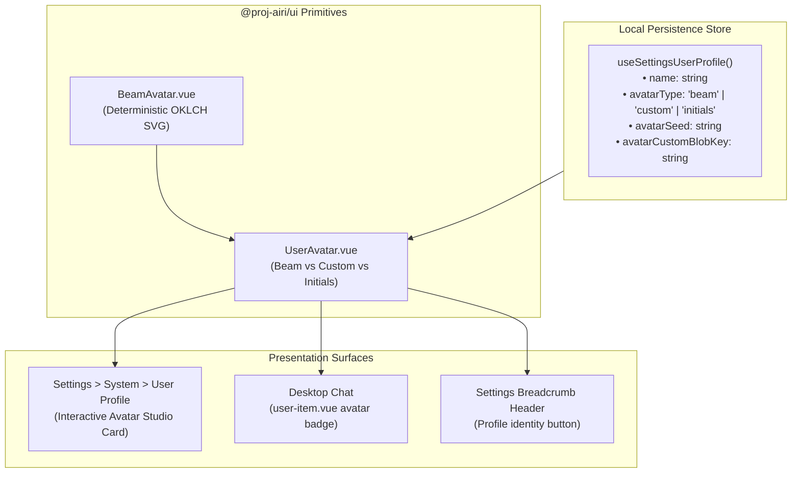

# Design Document: Procedural Beam Avatars & User Profile Identity

> **Status**: Proposed / Architectural Blueprint
> **Originating Upstream PR**: [PR #3468](https://github.com/moeru-ai/airi/pull/3468): `feat(ui): use generated beam avatars as the default user avatar` (Author: `@luoling8192` / RainbowBird)
> **Related Upstream Items**: [PR #3472](https://github.com/moeru-ai/airi/pull/3472) / [Issue #3220](https://github.com/moeru-ai/airi/issues/3220): `fix(stage-layouts): safely fallback undefined route.meta in settings layout` (Author: `@neverbiasu`)
> **Target Subsystems**: UI Component Library (`packages/ui`), User Profile Store & Settings (`packages/stage-ui/src/stores/settings/user-profile.ts`, `packages/stage-pages/src/pages/settings/system/user-profile.vue`), Desktop Chat Identity (`packages/stage-ui/src/components/scenarios/chat/user-item.vue`, `packages/stage-layouts/src/components/Layouts/ChatWorkspace/`)

---

## 1. Executive Summary & Problem Space

In the `dasilva333/airi` fork, virtual companion characters enjoy rich, multi-layered visual representations:
- 4 avatar engines: 3D VRM models with MToon shading, Live2D cubism models, PMX MMD with rigid-body physics, and Spine 2D skeletal animations.
- Dynamic character card media: High-resolution cover art, in-scene photobooth selfies (`getLatestSelfie`), engine 3D canvas snapshots (`previewImage`), and author icons.

In contrast, the **Human User** has zero visual presence across the application:
1. **User Profile Settings Gap**: [`packages/stage-pages/src/pages/settings/system/user-profile.vue`](../packages/stage-pages/src/pages/settings/system/user-profile.vue) allows customizing the user's name, narrative role description, visual prompt tags for generative ComfyUI scenes, and a speech voice profile for Dating Sim choice narration. However, it provides **no avatar control, image upload, or visual identity preview**.
2. **Chat Asymmetry**: In desktop chat ([`user-item.vue`](../packages/stage-ui/src/components/scenarios/chat/user-item.vue)), character messages display responsive `CharacterAvatar` circular badges, while human user messages display only a plain text label (`{{ label }}`).
3. **Settings Header Anonymity**: The settings window header shows a generic icon rather than an active user profile badge.

### The Upstream Breakthrough (PR #3468)
In upstream PR [#3468](https://github.com/moeru-ai/airi/pull/3468), RainbowBird introduced a zero-dependency, pure Vue port of the `boring-avatars` "beam" generator ([`beam-avatar.vue`](../packages/ui/src/components/misc/beam-avatar.vue)).
Key technical strengths:
- **Zero External Dependencies**: Generates pure inline SVGs dynamically via deterministic string hashing (wrapper position, scale, rotation, eye spread, mouth spread, smile/frown).
- **Dynamic Chromatic Hue Binding**: Rather than hardcoding static hex colors, it derives an OKLCH 5-color palette directly from the application's CSS root variable `--chromatic-hue` (`DEFAULT_THEME_COLORS_HUE = 220.44`). When the user changes their theme or hue slider in Settings or the Control Strip, the avatar updates instantly without re-rendering or network calls.
- **Strict Accessibility**: Lightness levels are calibrated to guarantee a minimum 3.6:1 contrast ratio against the dynamic wrapper colors.

---

## 2. Upstream Architecture vs. Fork Divergence

While upstream's `beam-avatar.vue` primitive is pristine, upstream's integration approach directly conflicts with `dasilva333/airi`'s core architectural tenets:

| Dimension | Upstream Implementation (PR #3468) | `dasilva333/airi` Invariant & Target Architecture |
| :--- | :--- | :--- |
| **Identity Source** | Hosted cloud authentication (`user.id` from `server/apps/auth`, OIDC sessions). | **100% Offline-First**: Stored locally in IndexedDB / `localStorage` via `useSettingsUserProfile` (`name`, `avatarSeed`). Zero cloud accounts. |
| **Fallback Network Chain** | Prioritizes `user.image` ➔ Gravatar HTTP request (`gravatar.com/avatar/...`) ➔ Beam Avatar fallback on HTTP error. | **Strict Privacy Invariant**: **Zero third-party network requests**. Never leak user email or hashed identifiers to Gravatar. Beam avatar is generated purely in-process. |
| **Account Pages** | Wired into `packages/stage-pages/src/pages/settings/account/account-settings-page.vue` and `apps/ui-server-auth/src/pages/profile.vue`. | Our fork rejected and deleted cloud account pages. The single source of truth is [`packages/stage-pages/src/pages/settings/system/user-profile.vue`](../packages/stage-pages/src/pages/settings/system/user-profile.vue). |
| **Desktop Surfaces** | Injected into legacy `controls-island-auth-button.vue` inside `controls-island`. | **Decoupled Architecture**: `controls-island` was completely deleted in our fork. User identity belongs in the dedicated Chat Workspace (`chat.vue`), Settings Header, and User Profile. |
| **Component Location** | Placed in `packages/ui/src/components/misc/` alongside an extracted `avatar.vue`. | `packages/ui` in our fork currently houses core buttons and inputs. We must cleanly introduce `packages/ui/src/components/misc/` without breaking `@proj-airi/ui` re-exports. |

---

## 3. Existing Avatar Surfaces Audit in `dasilva333/airi`

An exhaustive audit of the fork revealed the following existing surfaces:

```
┌──────────────────────────────────────────────────────────────────────────────────┐
│                         AVATAR SUBSYSTEM LANDSCAPE                               │
├────────────────────────────────────────┬─────────────────────────────────────────┤
│ Surface & File                         │ Responsibility & Current State          │
├────────────────────────────────────────┼─────────────────────────────────────────┤
│ 1. packages/stage-pages/.../           │ Primary User Profile settings page.     │
│    system/user-profile.vue             │ Has Name, Description, Prompt, Voice.   │
│                                        │ MISSING: Avatar preview & seed control. │
├────────────────────────────────────────┼─────────────────────────────────────────┤
│ 2. packages/stage-ui/stores/settings/  │ Pinia store using localStorageManual-   │
│    user-profile.ts                     │ Reset. Holds name, description, prompt, │
│                                        │ voiceProfileId. MISSING: avatar fields. │
├────────────────────────────────────────┼─────────────────────────────────────────┤
│ 3. packages/stage-ui/.../chat/         │ Desktop & Mobile user chat bubble.      │
│    user-item.vue                       │ Displays {{ label }} text only.         │
│                                        │ MISSING: User avatar badge component.   │
├────────────────────────────────────────┼─────────────────────────────────────────┤
│ 4. packages/stage-ui/components/misc/  │ Character / Companion avatar renderer.  │
│    CharacterAvatar.vue                 │ 4-tier fallback: Selfie ➔ AuthorIcon ➔  │
│                                        │ 3D Canvas Preview ➔ Initial Letter.     │
├────────────────────────────────────────┼─────────────────────────────────────────┤
│ 5. Control Strip & Popovers            │ Floating ribbon avatar controls for     │
│    (AvatarsPopover.vue)                │ VRM/Live2D/Spine/MMD stage companions.   │
├────────────────────────────────────────┼─────────────────────────────────────────┤
│ 6. Chat Workspace Right Drawer         │ Character display model switcher in     │
│    (ChatWorkspaceAvatarView.vue)       │ desktop chat. Scoped to character card. │
└────────────────────────────────────────┴─────────────────────────────────────────┘
```

---

## 4. Triage of Upstream PR #3472 (Settings Route Hydration)

During the upstream radar review, PR [#3472](https://github.com/moeru-ai/airi/pull/3472) (`fix(stage-layouts): safely fallback undefined route.meta in settings layout`) was evaluated for cherry-pick applicability:

- **Upstream Problem**: In upstream's `packages/stage-layouts/src/layouts/settings.vue`, destructuring `const { titleKey, subtitleKey, title, subtitle } = routeMeta.value` threw an uncaught `TypeError` when returning from OAuth redirects because `route.meta` was momentarily `undefined`.
- **Fork Analysis**:
  - In our fork, `packages/stage-layouts/src/layouts/settings.vue` was completely rewritten into our **Master-Detail widescreen architecture** (`SettingsSidebarNav.vue` + `SettingsBreadcrumbHeader.vue`).
  - Titles and breadcrumbs are computed dynamically via `resolvePathFromRoute(topology, route.path, route.hash)`. **`route.meta` is never accessed in `stage-layouts`**.
  - Upstream PR #3472 therefore **does not apply** to our shared layouts package.
  - In desktop Electron (`apps/stage-tamagotchi/src/renderer/layouts/settings.vue`), the older single-column layout still reads `route.meta`, but because our fork has zero OAuth redirect loops, the crash cannot occur under normal operation. Minor optional chaining `(route?.meta ?? {})` can be applied defensively during layout maintenance.

---

## 5. Architectural Blueprint & Porting Recommendations



### Pillar I: Core UI Primitives in `@proj-airi/ui`
1. **Port `beam-avatar.vue`**:
   - Location: `packages/ui/src/components/misc/beam-avatar.vue`.
   - Preserves RainbowBird's deterministic hashing math (`hashCode`, `getDigit`, `getUnit`, `getBoolean`).
   - Keeps OKLCH palette calculation dynamically referencing `var(--chromatic-hue, 220.44)`.
   - Formats UnoCSS classes into readably grouped arrays per fork conventions.
2. **Author `UserAvatar.vue`**:
   - Location: `packages/ui/src/components/misc/user-avatar.vue`.
   - Encapsulates three render modes:
     1. `'beam'`: Renders `<BeamAvatar :seed="effectiveSeed" />`.
     2. `'custom'`: Renders a user-uploaded image blob (from local storage).
     3. `'initials'`: Classic 2-letter uppercase initials on a chromatic background.
   - Re-export from `packages/ui/src/components/index.ts`.

### Pillar II: Store Schema Extension
Extend [`packages/stage-ui/src/stores/settings/user-profile.ts`](../packages/stage-ui/src/stores/settings/user-profile.ts) with reactive persistence:
```typescript
export type UserAvatarType = 'beam' | 'custom' | 'initials'

export const useSettingsUserProfile = defineStore('settings-user-profile', () => {
  const name = useLocalStorageManualReset<string>('settings/user-profile/name', 'Richy')
  const description = useLocalStorageManualReset<string>('settings/user-profile/description', '...')
  const prompt = useLocalStorageManualReset<string>('settings/user-profile/prompt', '')
  const voiceProfileId = useLocalStorageManualReset<string>('settings/user-profile/voice-profile-id', '')

  // New Avatar State
  const avatarType = useLocalStorageManualReset<UserAvatarType>('settings/user-profile/avatar-type', 'beam')
  const avatarSeed = useLocalStorageManualReset<string>('settings/user-profile/avatar-seed', '')
  const avatarCustomUrl = useLocalStorageManualReset<string>('settings/user-profile/avatar-custom-url', '')

  const effectiveSeed = computed(() => avatarSeed.value.trim() || name.value.trim() || 'User')

  function randomizeSeed() {
    avatarSeed.value = Math.random().toString(36).substring(2, 10)
  }

  function resetState() {
    name.reset()
    description.reset()
    prompt.reset()
    voiceProfileId.reset()
    avatarType.reset()
    avatarSeed.reset()
    avatarCustomUrl.reset()
  }

  return {
    name,
    description,
    prompt,
    voiceProfileId,
    avatarType,
    avatarSeed,
    avatarCustomUrl,
    effectiveSeed,
    randomizeSeed,
    resetState,
  }
})
```

### Pillar III: User Profile Settings UI ("Avatar Studio")
Enhance [`packages/stage-pages/src/pages/settings/system/user-profile.vue`](../packages/stage-pages/src/pages/settings/system/user-profile.vue):
- Add an **Avatar Studio Card** above the User Display Name input.
- Displays a live preview of `<UserAvatar :size="64" />`.
- When in `'beam'` mode:
  - Displays the current seed string (defaults to mirroring `name`).
  - Includes a **"Roll Dice"** (`i-solar:dice-bold-duotone`) action button allowing the user to click and instantly cycle through unique procedural faces.
  - Responds in real time to chromatic theme color changes.
- Mode Selector: Segmented toggle between `Procedural (Beam)`, `Custom Image`, and `Initials`.
- When in `'custom'` mode: Drag-and-drop local image uploader saving to local IndexedDB (`localforage`).

### Pillar IV: Chat Integration (`user-item.vue`)
Enhance [`packages/stage-ui/src/components/scenarios/chat/user-item.vue`](../packages/stage-ui/src/components/scenarios/chat/user-item.vue):
- Import `UserAvatar` from `@proj-airi/ui`.
- Embed `<UserAvatar :size="32" shape="circle" />` next to the user's name label in both Desktop and Mobile chat layouts.
- Matches visual balance with character turns ([`assistant-item.vue`](../packages/stage-ui/src/components/scenarios/chat/assistant-item.vue)).

---

## 6. Implementation Checklist & Verification Gates

When scheduled for implementation:

- [ ] **Step 1**: Create `packages/ui/src/components/misc/beam-avatar.vue` and `user-avatar.vue`.
- [ ] **Step 2**: Add export bindings in `packages/ui/src/components/index.ts`.
- [ ] **Step 3**: Extend `useSettingsUserProfile` store in `packages/stage-ui/src/stores/settings/user-profile.ts` with typed reset support.
- [ ] **Step 4**: Build the Avatar Studio section in `packages/stage-pages/src/pages/settings/system/user-profile.vue`.
- [ ] **Step 5**: Integrate `UserAvatar` into `packages/stage-ui/src/components/scenarios/chat/user-item.vue`.
- [ ] **Step 6**: Run verification:
  - `pnpm -F @proj-airi/ui typecheck`
  - `pnpm -F @proj-airi/stage-ui typecheck`
  - `pnpm -F @proj-airi/stage-pages typecheck`
  - `pnpm -F @proj-airi/stage-tamagotchi typecheck`
  - Visual verification across dark/light mode and chromatic hue slider shifts.
