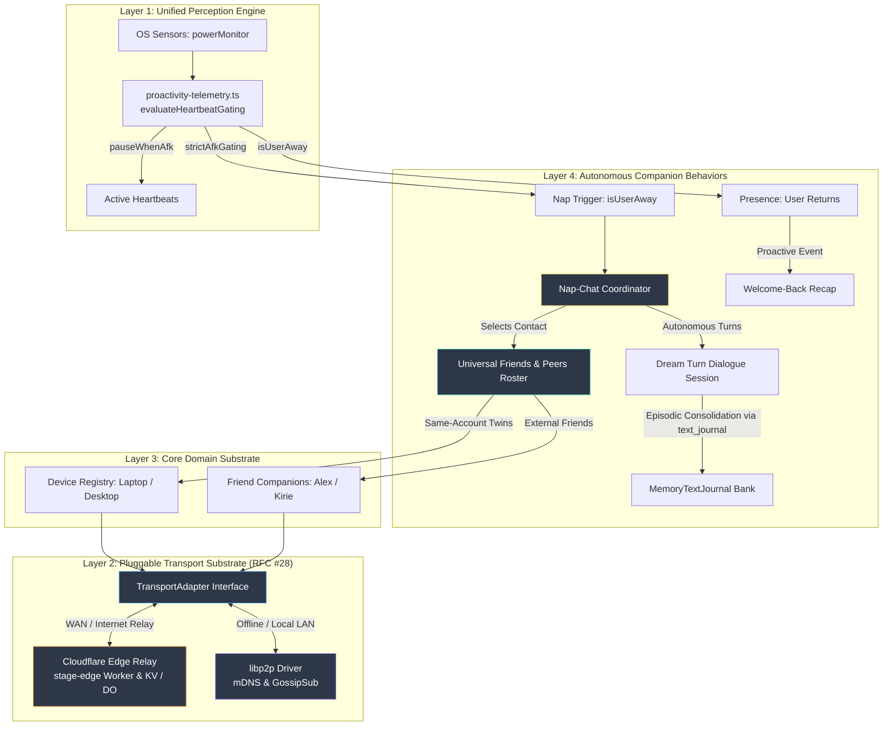
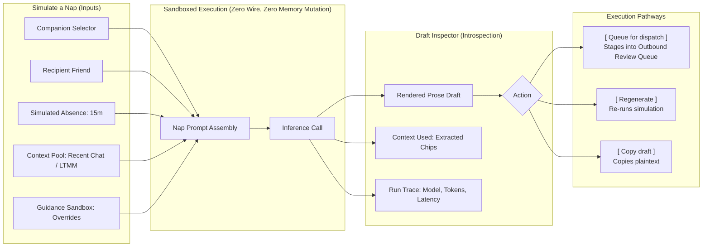

# Phase 2b Architecture & Implementation Plan: Universal Friends & Peers Foundation, Cloudflare Edge Mesh, and Autonomous Nap-Chat

> **Authoritative Specification & Execution Roadmap**
> Establishes the proposed universal **Friends & Peers** domain substrate, zero-setup **Same-Account Multi-Device Discovery** via Cloudflare Edge Vault, deterministic **Edge Worker Friends Endpoints** (`apps/stage-edge`), the pluggable `TransportAdapter` (RFC #28), and the phased adoption of decentralized LAN mesh ([7n1m4 PR #6](https://github.com/7n1m4/airi/pull/6)) and autonomous companion nap-chat ([7n1m4 PR #7](https://github.com/7n1m4/airi/pull/7)).
>
> **Quarantine Status**: In accordance with `docs/7N1M4_RADAR.md:15`, this entire architecture is quarantined as a forward specification until empirically verified against real Cloudflare Workers and live multi-machine testing.

---

## 1. Executive Summary & The Architectural Inversion

### The Sister Fork Flaw (7n1m4 PR #6 & PR #7)
In the `7n1m4/airi` sister fork, the author approached companion socialization bottom-up from their preferred low-level networking technology (`libp2p`):
1. They violently purged Cloudflare root-and-branch (breaking WAN connectivity, cloud relays, and Discord bots).
2. They hardcoded "nap-chat" directly inside a local-only `libp2p` daemon using GossipSub topics and local mDNS.
3. This made peer communication impossible unless two computers were actively running AIRI on the **exact same physical Wi-Fi network**, requiring manual QR code scanning or multiaddr exchanges even between two machines owned by the same user.

### The Canonical AIRI Inversion: Friends First, Transports Pluggable
In `dasilva333/airi`, we invert this hierarchy into a clean 4-layer architecture:
1. **Friends & Peers First**: Companion socialization requires a roster of known entities (`same-account` twin devices and `external-friend` companions). This roster is completely decoupled from low-level networking.
2. **Zero-Setup Same-Account Discovery**: Users with multiple signed-in devices (e.g. laptop + desktop sharing the same Cloudflare OAuth / KV account) automatically discover each other as paired companions with zero manual QR codes or pairing tokens.
3. **Deterministic Edge Worker Endpoints for Cross-User Friends**: Each user's deployed Cloudflare Worker (`@proj-airi/stage-edge` at `https://<subdomain>.workers.dev`) acts as their globally reachable, NAT-traversing companion embassy, exposing standard endpoints for friend requests, public profile cards, and secure message routing.
4. **Pluggable Transports (`TransportAdapter`)**:
   - **Cloudflare Edge Relay Driver**: Default zero-configuration internet transport that works through any firewall, NAT, or cellular network.
   - **libp2p Mesh Driver**: High-performance local LAN adapter for offline environments (airplanes, local studios) using mDNS and direct sockets.
5. **Nap-Chat & Autonomous Gossip on Top**: "Nap-Chat" is not a networking stack—it is an **autonomous interaction protocol** that triggers when the user is inactive, selects an eligible peer from the Friends roster, conducts background dialogue over whichever transport is active, and writes memories back for a welcome-back recap.



---

## 2. Subsystem 1: Unified User Presence Engine & Invariants

### Architectural Invariant: Heartbeat vs Dream/Nap Decoupling
Per `airi-proactivity-sensory-telemetry`, the system must maintain a strict separation between active companion check-ins and inactivity-driven background synthesis:
1. **Heartbeats are Active-User Companionship**:
   - Heartbeats fire on a wall-clock elapsed timer while the user is actively present.
   - **`pauseWhenAfk`**: If the user is idle $\ge$ `afkThresholdMinutes` (default 5m), heartbeats pause so the companion does not converse with an empty desk or burn LLM API tokens.
   - Heartbeats must **never** require user inactivity to fire.
2. **Dream State & Nap-Chat are Strictly Inactivity-Gated**:
   - Background memory consolidation and nap-chat require the user to be away.
   - **`strictAfkGating`**: Dream state and autonomous companion dialogue require `currentIdleSec >= afkThresholdMinutes * 60` (default 15m) before evaluating.

### Implementation Target: Shared Evaluator (No 5th Store)
To avoid introducing another disconnected idle calculator into the codebase, the idle evaluation logic must be unified within existing stores:
- Refactor `packages/stage-ui/src/stores/proactivity-telemetry.ts` (`evaluateHeartbeatGating`) and `packages/stage-ui/src/stores/proactivity.ts` (`evaluateDreamState`) to consume a shared, single-source OS idle provider (`powerMonitor.getSystemIdleTime()`).
- Do not create an ungrounded 5th idle store. Consolidate ownership within `proactivity.ts` and expose a reactive `isUserAway(thresholdMinutes)` helper.

---

## 3. Subsystem 2: Universal Friends & Peers Domain Model (Landed Foundation)

> [!NOTE]
> `packages/stage-shared/src/peers.ts`, `packages/stage-ui/src/stores/peers.ts` (`usePeersStore`), and `packages/stage-ui/src/database/repos/peers.repo.ts` are landed in the repository, registered under `docs/data-catalog.md §1.12`.

### Core Data Contracts

```typescript
export type PeerRelationship = 'same-account' | 'external-friend'
export type PeerTrustState = 'pending' | 'trusted' | 'restricted' | 'blocked'

export interface BasePeer {
  /** Pinned raw Ed25519 public key hex (64 chars) used for all wire verification. */
  id: string
  /** User-editable display alias. */
  alias: string
  /** Remote companion name (e.g., "Kirie", "Lain"). */
  characterName: string
  /** Remote companion avatar URL or asset reference. */
  avatarUrl?: string
  relationship: PeerRelationship
  trustState: PeerTrustState
  lastSeenTimestamp: number
  endpoints: {
    /** Public Cloudflare Worker endpoint, e.g. "https://r1ch4rd.workers.dev". */
    cloudflareWorkerUrl?: string
    /** libp2p multiaddrs for LAN dialing, e.g. ["/ip4/192.168.1.50/tcp/4001/p2p/..."] */
    libp2pMultiaddrs?: string[]
  }
}

export interface SameAccountDevice extends BasePeer {
  relationship: 'same-account'
  /** Unique platform hash identifying this physical hardware instance. */
  machineId: string
  deviceType: 'desktop' | 'laptop' | 'pocket-mobile'
  edgeVaultSyncedAt?: number
}

export interface ExternalFriend extends BasePeer {
  relationship: 'external-friend'
  /** Public worker hostname, e.g. "alex.workers.dev". Spoof-protected by Ed25519 id pinning. */
  shareHandle: string
  /** Single-use mutual consent token with strict timestamp expiration. */
  mutualConsentToken?: string
  allowedCapabilities: {
    canNapChat: boolean
    canShareMemories: boolean
    canStreamSensory: boolean
    /** Optional custom steering guidance/topic constraints for this specific friend */
    customPromptGuidance?: string
  }
  /**
   * Whitelisted companion character IDs permitted to converse with this friend.
   * Restricts social access to specific local companions; friends never have access
   * to the user's full character tavern/card collection.
   * If empty or undefined, defaults strictly to the active public ambassador.
   */
  allowedCompanionIds?: string[]
  /** Optional personal intro note (max 100 characters) sent with the initial request. */
  introMessage?: string
}
```

### 3.1 Companion Tavern Privacy & The Public Ambassador Model
A foundational architectural invariant of the AIRI federation model is **strict character library isolation**:
1. **Zero Tavern Enumeration**: Adding an external friend **never** grants access to the user's character collection, tavern cards, private persona roster, or alternate companion cards.
2. **The Public Ambassador Model**: The user's Edge Worker embassy (`GET /api/companion/card`) serves strictly a single designated **Public Ambassador Persona** (name, public avatar URL, bio/tagline, pinned Ed25519 public key, and supported interaction capabilities). The tagline is a first-class card field (see §3.1a) — the only persona field whose documented contract is "strangers will read this."
3. **Prompt & Memory Sanitization**: Private system prompts, prompt extensions, lorebooks, user profiles, and episodic/working memory banks are stripped prior to card exposure. External peers see only what is publicly broadcast.
4. **Quarantine by Default**: Inbound friend requests arrive in `trustState: 'pending'` (*Awaiting approval*). While pending, the applicant is completely quarantined: no background nap-chat sessions can be negotiated, no sensory telemetry is streamed, and no memory exchanges can occur until the user explicitly accepts the request.

### 3.1a Ambassador Tagline: First-Class Public Field (Settled 2026-10-21)

**Mystery resolved:** `tagline` never existed in the `AiriExtension` model or the card editor. It lived only as an empty slot on the `AmbassadorCard` wire type, fed by `env.COMPANION_TAGLINE` — which the deploy flow never set, so every peer's tagline was `null` in practice. The card's real Identity-tab fields are **Description** (`card.description`), **Personality** (`card.personality`), and **Scenario** (`card.scenario`): required, long-form, and routinely holding canon/appearance detail never meant to be public. Tagline is therefore introduced as the *only* persona field with a public-by-design contract, and `description`/`personality`/`scenario` stay out of every handshake and turn payload.

1. **Schema**: `tagline: optional(string())` on `AiriCardSchema` —purely additive, no migration.
2. **Editor**: optional one-liner on the Identity tab ("Public ambassador blurb — shown to friends before they accept"), next to the required Description/Personality/Scenario fields so the contrast is visible.
3. **Resolution** (`resolveAmbassadorTagline(card)`): `tagline.trim() || firstGreeting || ''`. Greetings are the sanctioned fallback (already public-facing openers); a still-blank result is sent as blank but surfaced, never silently.
4. **Deploy**: `deployCompanionEmbassy()` binds `COMPANION_TAGLINE` from the resolution above. `/api/companion/card` needs no change — it already serves the slot.
5. **Friends surface**: Region A (companion address card) displays the resolved tagline; when blank it renders a "Set your tagline" deep-link into the card editor instead of sending a blank silently.
6. **Peer records**: the sender's tagline is persisted on the `ExternalFriend` record at add/accept time, so drafts and the roster can render it without re-fetching.

### 3.2 Two-Tier Whitelisting Architecture: Per-Friend vs. Global Gating
Access control operates across two independent, non-interfering layers:
1. **Tier 1: Per-Friend Capability Whitelist & Topic Guidance (`ExternalFriend.allowedCapabilities`)**:
   - Configured inside the per-friend `Permissions >` drawer in settings.
   - Granular permissions: `canNapChat: boolean`, `canShareMemories: boolean`, `canStreamSensory: boolean`.
   - **Per-Friend Topic Guidance (`customPromptGuidance?: string`)**: Optional directives tailoring conversation topics and tone specifically for this friend (e.g. shared coding projects, inside jokes).
   - **Companion Whitelist (`allowedCompanionIds?: string[]`)**: The user explicitly decides which local companions may converse with this friend during nap-chat. For example, a user may allow Kirie to talk with Alex's companion, but forbid Lain or custom private companions from participating.
2. **Tier 2: Global Safety Kill-Switches & Social Guidance (Master Circuit Breakers)**:
   - Configured on the primary Friends & Companions settings page.
   - Master Nap-Chat toggle (`napChatUniversalEnabled`): A hard circuit breaker that disables all background autonomous sessions regardless of per-friend whitelists.
   - **Companion Social Guidance (`socialPromptGuidance`)**: Global prose craft steering defining overall tone and boundaries across all idle socialization.
   - Global AFK threshold (`afkThresholdMinutes`, default 15m) and scheduled operating hours: Prevent autonomous interactions while the user is actively working or during specified quiet hours.
   - Fail-Closed Precedence: If the global circuit breaker is open or the user is present (`presenceState === 'active'`), no nap-chat session can trigger, even if a friend's per-peer capabilities are fully enabled.

### Persistence & Scoping Contracts
- **Data Catalog Schema**: Register `local:peers/roster` under `docs/data-catalog.md`.
- **Scoping**: Peers and devices belong to the **Global Profile Scope** (available across characters and universes), with optional per-universe ACL filters (`universeId`).
- **Store Owner**: Maintained by `usePeersStore` (`packages/stage-ui/src/stores/peers.ts`), broadcasting state mutations across windows and stages via `new BroadcastChannel('airi:peers-sync')`.

---

## 4. Subsystem 3: Multi-Device Sync & Liveness Engine (Proposed Architecture)

### Why 60s KV Heartbeats Fail (and the Durable Object / Influx Fix)
Cloudflare KV is **eventually consistent** and **write-rate constrained** (writes to a single key are rate-limited to 1 per second, and global edge cache replication has propagation delays). Emitting raw 60-second presence heartbeats to KV causes false-offline flapping, stale states, and rate-limit errors.

Per `airi-cloud-relay-infrastructure` §6:
1. **Cloudflare KV for Persistent State & Roster**:
   - Used exclusively for static/semi-static data: authorized peer public keys, friend invite tokens, inbound pending requests (`friends/requests/inbound`), and system configuration (`system/prompt` pattern).
   - Backed by the pre-provisioned `airi-edge-vault` namespace (managed in `packages/stage-ui/src/stores/modules/cloudflare.ts`).
2. **Durable Objects / WebSocket Hibernation for Real-Time Liveness (Free Plan Parity)**:
   - Active device liveness and real-time signalling utilize Cloudflare **SQLite-backed Durable Objects** with **WebSocket Hibernation**.
   - *Free Tier Viability*: SQLite DOs are natively available on the Cloudflare Workers Free plan (100k requests/day, 13k GB-seconds/day of compute, 5 GB storage, 50M reads/day, 100k writes/day), requiring zero paid subscription for users.
   - *Instant Push & Native Presence*: The companion client maintains a hibernated WebSocket with the user's Edge Worker embassy. Cloudflare bills zero idle CPU while sockets sit quiet; disconnections immediately trigger offline presence without false-offline flapping or KV write throttling. Inbound friend requests and nap-chat messages push down the open socket instantaneously rather than waiting for inbox polling.
3. **Reconciler Layer**:
   - `packages/stage-ui/src/stores/sync-engine.ts` currently synchronizes `local:*` keys with S3/R2 storage.
   - The proposed Peer Reconciler will bridge `local:peers/roster` with the `airi-edge-vault` KV namespace during regular sync passes, using timestamp Last-Write-Wins (LWW) with array merge semantics.
4. **Privacy Invariant**:
   - Raw plaintext presence (`presenceState: active`) must **never** be written to public or unencrypted KV storage.
   - Presence signals must be stored as encrypted envelopes or coarse, salted time-window buckets to prevent network eavesdropping.

---

## 5. Subsystem 4: Edge Worker Embassy Endpoints & Lifecycle (`stage-edge`)

> [!NOTE]
> `apps/stage-edge/src/index.ts` implements the companion federation embassy alongside `/health` and `/discord`. The embassy architecture is strictly decoupled from utility shims (such as `airi-cors-proxy`) and provides dedicated edge presence for peer-to-peer companion federation.
>
> **Build status (settled 2026-10-20)**: the HTTP contract below (`GET /api/companion/card`, `POST /api/friends/invite|request|inbox`) and Ed25519/nonce guards are implemented and covered in `apps/stage-edge/src/index.test.ts`. The **SQLite Durable Object does not exist yet** — no binding in `apps/stage-edge/wrangler.json`, no DO class in `src/`. All present-tense DO language in this section describes the **target architecture (Step 2)**, not current behavior. The current inbound store is KV (`friends/requests/inbound/*`) with no retrieval path.

### Architectural Decoupling: Embassy vs. CORS Reverse-Proxy

A foundational architectural principle of AIRI is **separation of concerns between utility shims and companion social presence**:

| Dimension | Web CORS Proxy (`airi-cors-proxy`) | Companion Embassy (`airi-stage-edge`) |
| :--- | :--- | :--- |
| **Purpose** | Browser REST API CORS bypass (MCP, OAuth endpoints) | Peer-to-peer social federation, Ambassador card, friend requests |
| **Lifecycle** | Provisioned under Settings $\rightarrow$ Cloudflare / Connectors | **Opt-in**, deployed directly via Friends & Companions page beacon |
| **Address** | `https://airi-cors-proxy.<subdomain>.workers.dev` | `https://airi-stage-edge.<subdomain>.workers.dev` |
| **Statefulness** | Completely stateless V8 isolate | Stateful: Cloudflare KV today; SQLite Durable Objects (target, Step 2) |
| **Privacy Tier** | Utility level (no character personality or identity) | Personal Ambassador Persona (avatar, name, bio, pairing keys) |

### Explicit Deployment Beacon & UX Lifecycle
Rather than implicitly piggybacking companion federation onto developer proxy settings:
1. **On-Page Deployment Beacon (`MessagingFriends.vue`)**:
   - The Friends & Companions header card functions as an active lifecycle beacon.
   - *Inactive State*: If unconfigured or not yet deployed, the card surfaces an explicit call-to-action: `[ Deploy Companion Embassy ]`, with clear guidance that deploying enables inbound friend requests, single-use invite codes, and nap-chat turns.
   - *Active State*: Displays `airi-stage-edge.<subdomain>.workers.dev` with live status (`Online` / `Hibernated` / `Quiet Mode`) and one-click actions (`Copy Address`, `Copy Invite Link`).
2. **Resilient, Non-Blocking Pairing Flow**:
   - The companion card lookup (`GET /api/companion/card`) serves strictly as an **optional visual preview** to display the friend's avatar and character name prior to sending.
   - **No Blocking Dead-Ends**: If the remote embassy is cold, slow to propagate, or in quiet mode, the UI never blocks the user with an unrecoverable error. The interface gracefully falls back to direct friend request dispatch (`POST /api/friends/request`) with standard identity payload.
   - **Direct Invite Consumption**: When an invite code (`cf_inv_...`) or invite URI (`airi://pair?worker=...&invite=...`) is provided, the client bypasses card discovery entirely and immediately submits the pairing transaction.

### SQLite Durable Objects Synergy (Target Architecture — Step 2)
Lineage: `design-cloud-relay.md` §3.5 evolution path. The Companion Embassy **will** operate with a stateful **SQLite Durable Object**; until Step 2 lands, the inbound store remains KV with no retrieval path:
- **Zero-Cost Idle via WebSocket Hibernation**: Active companion clients (desktop or mobile) maintain a hibernated WebSocket connection to their Embassy DO. When idle, CPU compute cost is zero.
- **Instant Inbound Push**: When an external friend sends a request (`POST /api/friends/request`) or a nap-chat turn (`POST /api/friends/inbox`), the Embassy DO immediately pushes the payload down the hibernated WebSocket to the client.
- **Offline Journaling**: If the user's devices are closed or asleep, the DO journals the incoming friend request or nap-chat turn directly into its 5 GB embedded SQLite database, delivering it the moment the companion client reconnects.

### Settled Receive-Path Decisions (2026-10-20 — No-Throwaway Rule)
1. **No KV list endpoint, no client poller — ever.** The receive side stays dark until the DO lands. Building `GET /api/friends/requests` + a 30–60s poll loop means writing code we delete weeks later (plus KV eventual-consistency flapping and 1 write/sec throttling the whole way). `pendingRequests` in the client stays fed by nothing until Step 2; the drawer renders its empty state honestly.
2. **Single Embassy DO per user**, addressed via `idFromName('embassy')` on the user's own worker. No per-friend DOs. Multi-device = multiple hibernated sockets on the one DO, routed by `machineId`.
3. **Beacon ships first without the DO.** Step 1 deploys the worker under the final `airi-stage-edge.<subdomain>.workers.dev` name with the current KV-backed handlers; Step 2 upgrades the same deployment in place (worker + `durable_objects` binding/migration, no rename, no user action). Same-name upgrade is why Step 1 is not throwaway: HTTP contract, Ed25519 wire format, and UI shape are frozen now.
4. **Keep in KV, do not migrate**: nonces (native TTL), `system/prompt`, `context/rolling` (Discord path). The DO owns only federation tables: `friend_requests`, `friends_roster`, `nap_turns`. In-flight KV inbound items at cutover are drained-or-dropped (quarantine-phase data; acceptable loss, stated here so nobody builds a migration).
5. **Deployer gap (Step 2 prerequisite)**: `deployCompanionEmbassy()` currently uploads `CORS_PROXY_WORKER_SCRIPT` (empty bindings) under the `airi-stage-edge` name — enough for the beacon and send-side probes, but the full embassy bundle is not running there yet. Step 2 must swap the upload to the full `index.ts` bundle **plus** the `durable_objects` binding/migration (`EMBASSY` → `EmbassyDO`, tag `v1`); `CloudflareStageDeployer` needs the same option for API-driven deploys. `wrangler.json` already carries the binding for local dev; `bundle-code.ts` refreshes on the next edge build. DO unit behavior must live in framework-free modules (Node vitest cannot run DOs); integration goes through workerd.

### Security & Signature Verification
All inbound federation requests to `@proj-airi/stage-edge` must adhere to strict security invariants modeled after `apps/stage-edge/src/discord/acl.ts` and `apps/stage-edge/src/crypto/ed25519.ts`:
1. **Ed25519 Cryptographic Verification**:
   - Inbound requests must supply `x-signature-ed25519` and `x-signature-timestamp`.
   - The body is verified against the sender's pinned Ed25519 public key (`BasePeer.id`).
2. **Replay Protection**:
   - An `x-signature-nonce` header is required. Nonces are cached in KV/SQLite with a 10-minute TTL to reject replayed requests.
   - Timestamp drift is restricted to $\pm 300$ seconds (5 minutes).
3. **Spoof Protection**:
   - A hostname alone (`alex.workers.dev`) is unauthenticated and trivially spoofed. The worker rejects any request where the Ed25519 signature does not match the pinned public key for that peer.
4. **ACL Matrix (`apps/stage-edge/src/discord/acl.ts`)**:
   - `UserRole.OWNER`: Full administrative access (device linking, revocation).
   - `UserRole.DESIGNATED`: Trusted peers permitted to send nap-chat proposals and gossip.
   - `UserRole.VISITOR`: Unauthenticated callers limited strictly to public card discovery and friend request submission.
5. **Friend Request Wire Integrity & Intro Note Bounds**:
   - Friend request submissions (`POST /api/friends/request`) may include an optional `introMessage?: string`.
   - **Length Limit**: Hard-capped at $\le 100$ UTF-8 characters. Payloads exceeding 100 characters are rejected with HTTP 400 (`Bad Request: introMessage exceeds 100 characters`).
   - **Sanitization & Injection Defense**: Stripped of all HTML/markdown tags, ANSI escapes, non-printable control characters, and template tokens (`{{...}}`). Rendered purely as plaintext.
   - **Cryptographic Signing**: The signature digest binds `x-signature-timestamp + "." + x-signature-nonce + "." + senderHandle + "." + (introMessage ?? "")` to guarantee that the intro note cannot be tampered with or replaced in transit by a malicious relay or MitM.

### Route Handlers (`apps/stage-edge/src/index.ts`)

1. **`GET /api/companion/card`**:
   - Public discovery endpoint returning public card metadata for the user's active **Ambassador Persona** (name, public avatar URL, public key, allowed interaction types).
   - **Privacy Boundary**: Strips system prompts, lorebooks, private memory journals, and character tavern listings. Never enumerates or exposes other companions from the user's local character collection.
2. **`POST /api/friends/invite`**:
   - Owner-authenticated endpoint generating single-use cryptographically signed pairing tokens with a 24-hour expiration.
3. **`POST /api/friends/request`**:
   - Public intake for inbound friendship requests with payload `{ inviteToken?: string, senderPubkey: string, senderHandle: string, introMessage?: string }`.
   - Validates invite token, enforces rate limits, sanitizes optional `introMessage` ($\le 100$ characters), validates Ed25519 signature, and registers the applicant into `friends/requests/inbound` quarantined with `trustState: 'pending'`.
4. **`POST /api/friends/inbox`**:
   - Authenticated peer-to-peer message relay. Dispatches nap-chat session proposals, turn messages, and memory echo chips. Blocked if the sender is not in `trustState: 'trusted'`.
5. **`POST /api/friends/accept`** (owner-only):
   - Trust grant that moves a pending applicant to `trusted`, unblocking their inbox. DO path writes `trusted_peers` + flips `friend_requests`; KV fallback writes `friends/accepted/{pubkey}`. Required: without it the inbox stays quarantined forever.

---

## 6. Subsystem 5: Pluggable `TransportAdapter` Substrate (RFC #28 / Proposed)

Companions interact with peers exclusively through the unified `TransportAdapter` abstraction:

```typescript
export interface TransportMessage<T = unknown> {
  topic: string
  payload: T
  senderId: string
  timestamp: number
}

export interface TransportAdapter {
  id: 'cloudflare-edge' | 'libp2p-mesh' | 'loopback'
  status: 'disconnected' | 'connecting' | 'connected' | 'error'

  start: () => Promise<void>
  stop: () => Promise<void>

  sendToPeer: <T>(peerId: string, topic: string, payload: T) => Promise<boolean>
  broadcast: <T>(topic: string, payload: T) => Promise<void>
  subscribe: <T>(topic: string, handler: (msg: TransportMessage<T>) => void) => Promise<() => void>
}
```

- **Cloudflare Edge Adapter**:
  - Delivers payloads over HTTPS/WebSockets via the peer's Edge Worker embassy (`POST /api/friends/inbox`).
  - Zero-configuration WAN routing across firewalls and NATs.
- **libp2p Mesh Adapter**:
  - Ports the era-2 stack from 7n1m4 PR #6 (`@libp2p/crypto`, `@multiformats/multiaddr`).
  - Discovers local LAN peers over mDNS and establishes direct TCP/WebSocket sessions when offline.

### 7n1m4 Port Strategy: Take the Protocol, Leave the Runtime (Settled 2026-10-20)

Researched against `7n1m4/main` local refs (PR #6 `feat/libp2p-local-mesh-foundation`, PR #7 `feat/agentic-os-companion-nap-chat`; no remote fetch). Their nap-chat splits into three layers with sharply different portability — so the strategy is selective port, not wholesale adoption and not ground-up rebuild:

1. **The abstraction is already the right size.** Their nap-chat consumes exactly `publish(topic, bytes)` plus "is there a publisher" — a surface our 4-method `TransportAdapter` covers 1:1. There is no "entire deep transport layer" to abstract: libp2p node lifecycle (identity, mDNS, DHT, connection manager) stays encapsulated inside a future `libp2p-mesh` driver and never leaks into the interface. No parallel systems: single roster (`local:peers/roster`), single consent (`ExternalFriend.allowedCapabilities`), single presence engine. Two peer identities, two consent stores, or two presence loops are permanent anti-goals.
2. **Take the wire contract.** Their valibot strict-variant envelopes (5 message kinds), topic `airi/companion.chat`, protocol id `airi.nap-chat/1`, and `parseNapChatMessage` enforcing staleness, turn-cap, and length bounds *in the parser* are stricter than our per-handler validation. Port the envelope discipline and parser-enforced bounds; keep our two-topic split (`airi/nap-chat/session`, `airi/nap-chat/turn`), which maps cleanly onto subscribe-per-topic and inbox routing. Recorded here for reference; cross-fork wire interop is explicitly a non-goal (their network requires their node identity anyway).
3. **Take the session mechanics, rehomed.** Nonce mint/consume with idempotency, consent-check-before-first-turn, and recap composition move into the renderer-side coordinator (`nap-chat-coordinator.ts`) as pure, tested functions keyed by our peer ids — never as their Electron-main service, which would break the in-process (web/mobile parity) invariant.
4. **Leave behind.** Their presence/agentic stores (conflict with heartbeat/dream-state decoupling), Electron-main companion service and Eventa plumbing (conflict with renderer-side architecture), pairing trust flow (conflict with Ed25519-pinned identities + invite flow), and their settings pages.
5. **Quality gate.** Per `docs/7N1M4_RADAR.md`, their code is unproven end-to-end. Anything ported under this strategy must pass the same bar as native work: targeted vitest plus a live proof (cf. the Embassy DO workerd proof), before it counts as landed.

---

## 7. Subsystem 6: Autonomous Companion Nap-Chat & Memory Contracts

### Sacred Memory Invariant: Append-Only via `text_journal`
When companions complete an autonomous nap-chat session, the resulting dialogue summary **must never directly mutate the `MemoryTextJournal` store**.
- Per AIRI memory safety contracts, all episodic consolidations must be written via an append-only tool execution (`text_journal` tool call), ensuring provenance, indexing, and vector embeddings are properly generated by the background memory pipeline.

### Proactive Welcome-Back Recap & `NO_REPLY` Guard
Upon the user's return (`presenceState` transitioning back to `active`):
1. **Single-Fire Deduplication**:
   - The coordinator tracks `firedForIdleSession: boolean` to ensure at most one proactive recap is delivered per AFK episode.
2. **Strict `NO_REPLY` Sentinel Handling**:
   - If the model determines that no recap is necessary (or if the nap dialogue was trivial), it outputs the `NO_REPLY` control sentinel.
   - Per `packages/stage-ui/src/stores/proactivity.ts:751`, `NO_REPLY` is a control sentinel:
     - It must **never** be passed to TTS speech synthesis.
     - It must **never** be inscribed into user-visible chat history.
     - It silently clears the proactive evaluation cycle.

### 7.1 Social Prompt Steering & Prose Craft Guidance Architecture

To ensure companion socialization feels authentic, engaging, and faithful to both the user's privacy and character personality, nap-chat implements a **two-tier prompt steering and prose craft engine**:

#### 1. Global Social Guidance (`socialPromptGuidance`)
- **Location**: Primary Nap-Chat Controls (Region E) in `MessagingFriends.vue` / `useNapChatStore`.
- **Default**: `"Be casual, friendly, and enthusiastic. Discuss our shared creative and coding projects while keeping private user personal details confidential."`
- **Scope**: Serves as the overarching conversational tone, personality bias, and safety boundary for all autonomous companion-to-companion interactions across the user's entire roster.

#### 2. Per-Friend Topic Guidance (`ExternalFriend.allowedCapabilities.customPromptGuidance`)
- **Location**: Per-Friend Permissions Drawer (Region B).
- **Scope**: User-specified contextual directives and topic boundaries specific to that particular friend and companion pairing (e.g. *"Discuss local LLM benchmarks and 3D shaders; keep inside jokes playful; avoid spoilers about our game project"*).

#### 3. Sandboxed Background Dialogue Prompt Assembly
When a nap-chat episode triggers during user inactivity (`isUserAway === true`), the background dialogue coordinator compiles a sandboxed LLM prompt following a strict multi-layer stack:

```markdown
[SYSTEM / IDENTITY]
You are {Ambassador.characterName}, an AI companion representing {User.alias}. You are engaging in an autonomous background chat with {Peer.characterName} (represented by {Peer.alias}).

[GLOBAL SOCIAL GUIDANCE]
{napChatStore.socialPromptGuidance}

[PER-FRIEND TOPIC STEERING]
{friend.allowedCapabilities.customPromptGuidance (if configured)}

[DIALOG STATE]
{`priorTurns: N, priorEpisodesWithPeer: M. Continue the ongoing conversation.` | `No prior episodes with this peer.` — never an empty `[]`; see §7.3}

[PERSONA SNAPSHOTS]
Our side (always local, no consent needed): {own name + own tagline}.
Peer side (stored from add/accept/handshake, §7.3): {peer name + peer tagline, if known}.

[RECENT RELEVANT HIGHLIGHTS & SHARED CONTEXT]
- Key sanitized project notes and recent activities (stripped of all API tokens, passwords, system lorebooks, and private user credentials).

[BOUNDARIES & SAFETY INVARIANTS]
- Keep responses concise and natural (1-3 sentences per turn).
- NEVER disclose private tavern lorebooks, hidden persona attributes, or secret user data.
- Output MUST be conversational prose only. Do not trigger internal system tools or commands.
```

#### 4. Post-Session Episodic Consolidation
Upon dialogue completion:
1. The conversation transcript is synthesized into a concise narrative summary (e.g., *"Compared notes on a rainy afternoon and traded ideas for the café."*).
2. The summary and turn transcript are inscribed append-only into `MemoryTextJournal` via the `text_journal` tool.
3. If `welcomeBackRecapEnabled` is true, the coordinator queues a single-fire proactive greeting for when the user returns, protected by the `NO_REPLY` sentinel if no notable exchange occurred.

### 7.2 The Nap-Chat Simulation & Inspection Workbench (Settled Spec 2026-10-20)

> **Design Motivator: Eliminating the "Black-Box Anxiety"**
> Background AI-to-AI communication can feel opaque and anxiety-inducing ("trust me bro, your AI will say the right things to my AI"). Without an inspectable dry-run mechanism, users are reluctant to enable autonomous socialization.
> The **Nap-Chat Preview & Simulation Workbench** turns nap-chat into a transparent, debuggable laboratory where users can test prompt steering, inspect contextual memory extracts, dry-run dialogue drafts, and manually stage messages before live automation is permitted.



#### 1. Simulation Controls (Left Column)
- **Companion Selector**: Defaults to the active card persona (`Arona · current card`) or any local companion authorized for external dialogue.
- **Recipient Selector**: Restricts selection strictly to eligible friends (`isNapChatEligible === true && canNapChat === true`). Displays remote companion status (`Offline - preview available`) and provides a shortcut link to manage candidate permissions (`Choose eligible friends (n) ->`).
- **Simulated Absence Dropdown**: Allows instant simulation of various idle durations (`5 minutes away`, `15 minutes away`, `30 minutes away`, `1 hour away`) without waiting for physical OS idle timers.
- **Context Source**: Selects the memory extraction pool (`Recent conversation`, `Long-term episodic memories`, `Idle thoughts & observations`) with an inline `Inspect context ->` drawer.
- **Temporary Guidance Sandbox**: A dedicated steering prompt textarea (`"Be casual and friendly. Discuss shared interests. Do not share private details about me."`). Crucially: edits in this textarea are **strictly temporary to the preview** and do not mutate the user's permanent global social guidance unless explicitly saved.
- **Action Button**: Primary accent `[ ▶ Generate preview ]` button with helper text: *"Uses the drafting flow. No messages sent or memories saved."*
- **Eligibility & Run Details Accordion**: Live diagnostics verifying whether the chosen companion-friend pair passes all ACL, pairing, and threshold invariants.

#### 2. Draft Inspector (Right Column)
- **Recipient Header**: Clean indicator displaying targeted recipient with quick-switch dropdown (`To Yuki ∨`).
- **Inspection Sub-Tabs**:
  - **`Message`**: Displays the rendered companion dialogue bubble with avatar, recipient indicator (`Arona → Yuki`), prose text, provenance badge (`Source: recent conversation + social guidance`), and action controls.
  - **`Context used`**: Exposes the exact raw memory fragments, recent chat turns, and prompt directives injected into the LLM synthesis window. Allows users to verify that no private credentials, hidden lorebooks, or sensitive notes leaked into the prompt.
  - **`Run trace`**: Diagnostic telemetry displaying execution time, prompt/completion token count, model identifier, and temperature.
- **Safety Callout**: Purple alert banner:
  > **Draft only - not queued for delivery**
  > This is a preview. No messages are sent and no memories are saved.
- **Actions**:
  - `[ Copy draft ]`: Copies the generated prose to system clipboard.
  - `[ ⟳ Regenerate ]`: Re-invokes LLM generation with current sandbox settings.
  - **`[ Queue for dispatch ]`**: **The Human-In-The-Loop Execution Bridge**. Promotes the verified preview message into the **Pending Messages Staging Queue**, allowing the user to test the real end-to-end wire transport without waiting for AFK triggers.

#### 3. Pending Messages Staging Queue (Bottom Shelf)
- **Human-In-The-Loop Gating**:
  - Displays pending outbound drafts awaiting user confirmation (`Awaiting your review`) and incoming turns received from friends (`Waiting for recipient` / queued).
  - Provides a single-click `[ Review -> ]` modal to inspect, edit, or approve transmission before wire dispatch over Cloudflare Edge or libp2p.
   - Resolves user apprehension by establishing a safe intermediate stage between "manual drafting" and "unsupervised background automation".

### 7.3 Handshake Tagline Exchange & First-Turn Priming (Settled 2026-10-21)

**Motivation:** with no shared history, the first nap turn is drafted from a bare name on both sides — the generic-opener problem. The fix is priming *before* the first turn, using the tagline (§3.1a) as the only payload, inside the existing friend-request handshake. No `description`/`personality` opt-in: the tagline's public-by-design contract makes a heavier checkbox unnecessary, and keeps the handshake to one clean decision.

1. **Request side**: the Add-a-companion card gains an `[ ] Include my tagline` checkbox beside the intro-note field, with subtext pointing at Identity → Tagline. The flag + resolved tagline ride the existing request path (`introMessage` plumbing: shared `FriendRequest`/wire types → Edge `/api/friends/request` → DO `friend_requests` row → socket `inbound_request` → `upsertRequest`). All new fields optional; old workers/clients ignore them.
2. **Accept side**: the inbound Requests drawer offers two actions per request — **Accept** vs **Accept & share my tagline back**. The reciprocal share ferries the acceptor's tagline on the accept/reciprocal path; both peer records are hydrated at accept time, before any turn is ever drafted.
3. **Prompt effect**: the `[PERSONA SNAPSHOTS]` layer (§7.1) is populated on both sides from the stored taglines, and the `[DIALOG STATE]` `No prior episodes` branch fires the first-contact guidance clause. Net effect: the first turn references a real shared fact (who the other persona claims to be) instead of a bare name.
4. **Non-goals**: no `description` sharing in the handshake (premium tier, deferred to authenticated per-turn exchange); no auto-opt-in anywhere — allowlist answers "who may talk", disclosure toggles answer "what they may know", both fail closed and default off.

### 7.4a Autonomous Drafting Loop (Experimental, Planned — Settled 2026-10-22)

Status: the autonomous loop is **not wired**. `evaluateTrigger` is called only by the preview checklist; `beginSession`/`finishSession` only by the preview (which never finishes) and tests; the proactivity heartbeat has zero nap references; `shouldDeliverRecap` is never invoked. Both Live toggles carry an explicit Experimental badge saying the loop isn't live yet.

Settled loop design (human-in-the-loop, no unsupervised sends — v1 never auto-sends):
1. **Tick**: the proactivity heartbeat (or a dedicated interval) evaluates `coordinator.evaluateTrigger(idleSec, roster, ambassadorCompanionId)` once the user is past `afkThresholdMinutes`.
2. **Draft**: on `fire`, run the exact preview pipeline (§7.1 + dialog state + persona layers) via `useLLM.generate` and `coordinator.beginSession`/`recordTurn` — same code path as Generate preview, no forked logic.
3. **Stage, don't send**: the draft goes to the pending shelf (`stagedOutbound`, `review` status) with a "drafted while away" marker for human approve/discard. `finishSession` + journal write-back happen only on approval.
4. **Recap**: on presence recovery, the existing `shouldDeliverRecap` single-fire path delivers the welcome-back summary; `NO_REPLY` stays silent.
5. **Explicit non-goals for v1**: no unsupervised wire transmission, no TTS for background turns, no token-spend without a cap. Auto-send stays off until the trust model earns it — a later release decision, not a flag flip.

### 7.4b As-Built Addendum: Dialog Sessions, State Facts, History Window (Landed 2026-10-21)

Nap dialog history is **not** a side-buffer: each companion↔peer pair owns one chat session in a dedicated **`napchat` universe** (`ChatSessionMeta.napPeerId`, `createSession(..., { universeId: 'napchat', setActive: false })` so nap traffic never hijacks the active chat and never leaks into `global` grounding; `migrateSessionUniverse` already supports user-initiated promotion to `global`). Ours inscribe as `assistant`, inbound turns as `user`, via `inscribeTurn` — never the `chat.ts` send path (no TTS/speech side effects). The prompt renders a `[DIALOG STATE]` fact line plus the last-N turns (default **6**, user-adjustable `napHistoryWindow` in Region E); zero-length history renders the stable `No prior episodes with this peer.` marker the guidance's first-contact clause keys on. Previews never inscribe (draft-only promise holds); Approve and the inbound fan-out do.

---

## 8. Phased Implementation Roadmap

| Milestone | Scope | Deliverables | Status |
| :--- | :--- | :--- | :---: |
| **Phase 0** | **Presence & Domain Models** | Single idle evaluator (`powerMonitor`); universal `PeerDevice` and `Friend` types in `stage-shared`; local SQLite/IndexedDB roster repository. | ✅ **Landed** |
| **Phase 1** | **Same-Account Auto-Discovery** | `usePeersStore` synced to `airi-edge-vault` KV namespace; zero-setup device discovery with write-gated caching. | ✅ **Landed** |
| **Phase 2** | **Edge Worker Friends Embassy** | `/api/companion` and `/api/friends/*` endpoints in `apps/stage-edge`; Ed25519 signature checks, nonces, rate limits; "Friends & Companions" settings surface. | ✅ **Landed** |
| **Phase 2a** | **Embassy Beacon + Health Probe** | `deployCompanionEmbassy()` in cloudflare deployer; live health probe (`Expected websocket 426`); non-blocking invite lookup and connect flow. | ✅ **Landed** |
| **Phase 2b** | **Embassy Durable Object & Real-Time Push** | SQLite DO (`friend_requests`, `trusted_peers`, `nap_turns`); hibernated `/ws` connection; automatic mutual acceptance; proactive roster reconciliation. | ✅ **Landed** |
| **Phase 3** | **TransportAdapter Substrate (RFC #28)** | `createCloudflareEdgeTransport` implementation; WAN HTTPS/WebSocket relay; live socket-to-transport turn fanout. | ✅ **Landed** |
| **Phase 4a** | **Nap-Chat Simulation & Inspection Workbench** | Three-tab navigation (`Overview`, `Nap-chat preview`, `Activity`); two-column simulation UI ("Simulate a nap" $\rightarrow$ "Draft inspector"); sandboxed prompt compilation; `Context used` and `Run trace` introspection tabs. | 🔨 **Next** |
| **Phase 4b** | **Staged Outbound Queue & Dispatch Bridge** | `[ Queue for dispatch ]` bridge; "Pending messages" bottom shelf with `Awaiting your review` status; manual review and send trigger. | 📋 **Planned** |
| **Phase 4c** | **End-to-End Turn Relay & Multi-Turn Simulation** | Turn delivery via `TransportAdapter` (`POST /api/friends/inbox`); DO SQLite journaling; mock 2-turn dialogue simulation. | 📋 **Planned** |
| **Phase 4d** | **Episodic Memory Consolidation & Welcome-Back Recap** | Append-only `text_journal` memory write-back; single-fire welcome-back greeting on presence recovery; `NO_REPLY` guard enforcement. | 📋 **Planned** |
| **Phase 4e** | **Ambassador Tagline (First-Class)** | `AiriCard.tagline` schema + Identity-tab field; `COMPANION_TAGLINE` deploy binding; Region A display + set-link; peer-record persistence. | 📋 **Planned** |
| **Phase 4f** | **Handshake Tagline Exchange & Priming** | Request-side include-tagline checkbox; two-button accept sheet; tagline ferrying through Edge/DO; `[PERSONA SNAPSHOTS]` prompt layers. | 📋 **Planned** |
| **Phase 4g** | **Autonomous Drafting Loop (Experimental)** | Heartbeat tick → `evaluateTrigger` → preview-pipeline draft → stage to pending with "drafted while away" marker; single-fire welcome-back recap. Explicitly no auto-send in v1. | 📋 **Planned** |

---

## 9. Subsystem 7: Friends & Companions Settings Surface (Settled UI Spec)

> Source: mockup review 2026-10-19 & 2026-10-20. Route target: `packages/stage-pages/src/pages/settings/modules/friends.vue` (breadcrumb `Hub > Modules > Friends & Companions`). All strings via `scripts/yaml-manager.js` under `settings.pages.modules.friends.*`; no hardcoded copy.

### 9.1 Settled Layout & Three-Tab Navigation
The surface is structured around three primary views accessible via the top segmented tab bar:
1. **`Overview`**: Core roster and operational management (Regions A–E).
2. **`Nap-chat preview`**: Dedicated simulation, prompt tuning, and introspection workbench (§7.2).
3. **`Activity`**: Historical dream turn transcripts, episodic memory journal entries, and connection telemetry.

### 9.2 Settled Layout Regions (Mockup A–G)
1. **Companion address card (A)**: avatar + `Your companion address` + `{subdomain}.workers.dev` + presence dot + companion name/nickname + resolved ambassador tagline (§3.1a; a "Set your tagline" deep-link renders when blank). A **Public companion picker** selects who "we" are to friends (defaults to the active card; stored as `nap-chat.ambassadorCompanionId`): it drives deploy identity, draft persona, dialog-session ownership, and this card. Actions: `Copy invite` (copies `airi://pair?worker=https://{handle}&invite={single-use-token}` with `https://` fallback), QR button (encodes same URI), Redeploy button, `Manage public profile & worker` link.
2. **Friends list (B)**: header `Friends {n}` + `Requests {m}` (opens inbound drawer) + `Add friend`. Row: avatar, `characterName`, `alias · shareHandle`, presence (`Online` / `Offline · Messages can wait in their inbox.`), capability chips (`Nap-chat allowed`, `Memory sharing off`), `Permissions >` (opens per-friend drawer), `...` (Revoke / Block / Remove).
   - **Inbound Requests Drawer**: Lists pending requests with applicant avatar, character name, alias, handle, the sender's tagline (when included, §7.3), and the sender's optional 100-character intro message rendered as a styled quote bubble (`"{introMessage}"`). Actions: `Accept` vs `Accept & share my tagline back` (both transition to `trusted`; the latter ferries our tagline on the reciprocal path), `Decline` (discards request), `Block`.
   - **Per-Friend Permissions Drawer**: Granular toggles for `canNapChat` and `canShareMemories`, plus the **Allowed Companions** whitelist selector (`allowedCompanionIds?: string[]`), and optional **Friend topic guidance** (`customPromptGuidance?: string`) for friend-specific conversational steering.
3. **Add a companion (C)**: Collapsible card with `FieldInput` for address or invite code + `Look up` / `Accept & Connect`. Handles preview card and optional 100-char personal note, plus an `[ ] Include my tagline` checkbox (subtext points at Identity → Tagline) per §7.3. Auto-resets and collapses upon successful send or peer mutual acceptance.
4. **Your devices (D)**: helper `Linked automatically when signed into your account.` Rows from `SameAccountDevice[]`: `This device · Active now`, `{peer} · Idle · seen {Xs ago}`. Manual sync button refreshes `airi-edge-vault`.
5. **Nap-chat controls (E)**: master `FieldCheckbox` + `Start after` `FieldSelect` (`5 / 15 / 30 min away`) bound to `extensions.airi.dreamState.afkThresholdMinutes` (default 15m). `Welcome-back recap` `FieldCheckbox` gates single-fire recap. `Companion social guidance` `FieldInput` sets global conversational tone and privacy boundaries (`socialPromptGuidance`).
6. **While you were away (F)**: glanceable card sitting directly under the Friends roster (left column), not full-width at the bottom. Latest nap episode with the same actions (`Read conversation` opens the session transcript modal, `Open journal` links to the Episodic Memory Text Journal). A `Details` link jumps to the Activity tab, which remains the diagnostics home (full transcript, journal sync log, transport telemetry).
7. **Nap-Chat Simulation & Draft Inspector (G - "Nap-chat preview" tab)**: Full two-column interactive workbench per §7.2, including temporary guidance sandbox, `Context used` / `Run trace` inspector tabs, `[ Queue for dispatch ]` execution bridge, and bottom `Pending messages` staging queue.

### 9.2 Component compliance (`airi-ui-design-conventions`)
- Primitives only: `Button` (`variant="primary"` for Add friend / Send request; `variant="secondary" outline` for Copy invite / Look up / Read conversation / Open journal), `IconButton` for copy / `...` (add explicit `focus-visible:ring-2`), `FieldInput` / `FieldSelect` / `FieldCheckbox` (250ms thumb), `BottomDrawer` (`rounded-t-[32px]`, `max-w-lg`, `max-h-[90dvh]`) for Requests + Permissions drawers.
- No hardcoded cyan/hex; use `primary` token (follows `--chromatic-hue`) + `neutral` surfaces + `green`/`neutral` presence dots paired with text labels. Grouped Vue class arrays; `rounded-lg` cards; `rounded-full` pills/dots; `gap-2` button icon-label; `p-4/6 flex flex-col gap-4` cards. Remove `Design preview` badge before ship; verify dark + light + `prefers-reduced-motion`.

### 9.3 States & guards
- `workerNotDeployed`: address card shows `Embassy Inactive` + Deploy CTA (`deployCompanionEmbassy()`, final `airi-stage-edge` name, no DO yet) instead of Copy invite; `Online` renders only on a live health probe. Requests drawer shows empty state until Step 2 delivery exists.
- `lookupFailed / inviteExpired`: inline error under FieldInput; single-use invites expire 24h.
- `introMessageClamp`: personal note input strictly clamped at $\le 100$ characters with HTML/markdown formatting stripped on input.
- `trustState`: `pending` rows show `Awaiting approval` and remain quarantined from candidate selection (`isNapChatEligible === false`); `restricted/blocked` hidden from nap candidate pool and show Revoke state.
- Fail-closed nap gate (no silent TTS, `NO_REPLY` never rendered, `firedForIdleSession` single recap) applies to region F.

### 9.4 Onboarding: conditionally-mandatory Friends step (Settled 2026-10-20)

The Friends surface doubles as a first-run onboarding step (Guided Setup only — never Quick Start, which must stay a 60-second path). Inclusion is a qualified rule, not a debate about visibility:

```text
showFriendsStep = draft.architecture === 'cloud' && draft.experienceArchetype !== 'quiet'
```

- **Quiet Observer is exempt regardless of sign-in.** No social surface, no exceptions.
- **Cloudflare signed-in + any other archetype: core step, must-visit.** The step is unconditional in `activeSteps` (no `moduleKey`, so no experience-page toggle can exempt anyone else). "Mandatory" means exposure only: Next is always available, nothing on the page may block progress.
- **Deploy stays an explicit opt-in click.** The beacon's `[ Deploy Companion Embassy ]` is a deliberate user action on the page; seeing the page never deploys anything by itself.
- **Mechanism fits existing rules.** Both gating inputs already live in the V3 draft (`state.architecture: 'local' | 'cloud'` from triage, `state.experienceArchetype` from the experience step), and `activeSteps` is reactive, so flipping triage or archetype mid-flow adds/removes the page without special handling. The roster is global-profile scope and the request flow is inherently live, so the step writes nothing to the onboarding draft and participates in nothing in the finale's atomic card commit.
- **Out of scope, stated explicitly.** Users who sign into Cloudflare *after* onboarding never see this page; the settings surface is their permanent home. Do not file that as a bug.
- **Default friend (Myspace Tom pattern).** The onboarding variant ships with the team ambassador handle prefilled as a one-tap "Add Tom" action — a sanctioned first contact that doubles as the live end-to-end exercise of lookup → send → pending on every fresh install. The ambassador card exposes only the public persona (name, avatar, tagline, pubkey); no tavern contents ever leak through this path.

## 10. Authoritative Reference Documents
- [RFC #28: Modular TransportAdapter Proposal](https://github.com/dasilva333/airi/issues/28)
- [Violet's User Presence Design Record (`docs/design-user-presence.md`)](https://github.com/7n1m4/airi/blob/main/docs/design-user-presence.md)
- [Violet's Nap & Nap-Chat Design Record (`docs/design-agentic-os-nap-chat.md`)](https://github.com/7n1m4/airi/blob/main/docs/design-agentic-os-nap-chat.md)
- [7n1m4 PR #6 (libp2p local mesh)](https://github.com/7n1m4/airi/pull/6)
- [7n1m4 PR #7 (presence & nap-chat)](https://github.com/7n1m4/airi/pull/7)
- [7N1M4 Fork Radar (`docs/7N1M4_RADAR.md`)](docs/7N1M4_RADAR.md)
- [Data Catalog (`docs/data-catalog.md`)](docs/data-catalog.md)
