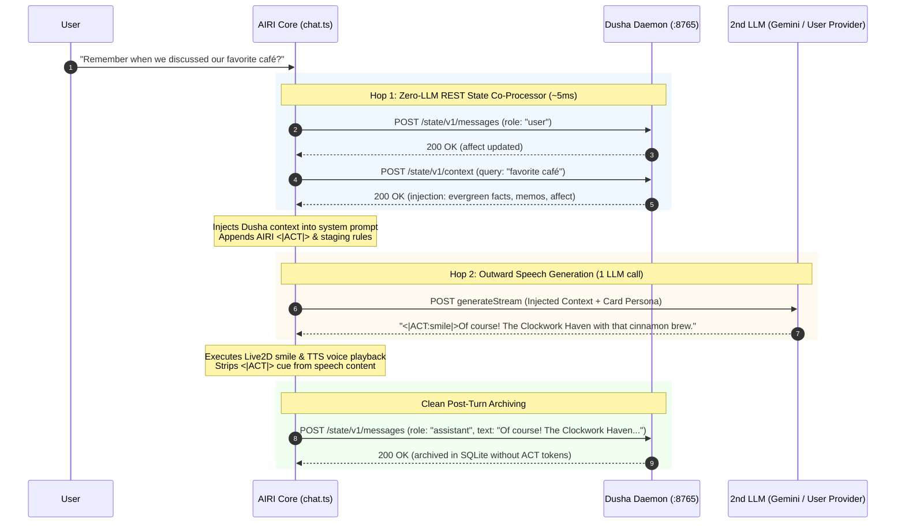

# Proposal: Dusha Co-Processor & External State-Context Standard Integration

**Status:** Proposed Architecture & Integration Specification
**Author:** AIRI Engineering
**Date:** October 11, 2026
**Target Systems:**
- `packages/stage-pages/src/pages/settings/airi-card/components/tabs/cognition/CognitionSubTabRouting.vue`
- `packages/stage-ui/src/stores/chat.ts` (Two-Hop Cognition Pipeline Seam)
- `packages/stage-ui/src/types/card.schema.ts` (AiriCognitionSchema)
- `packages/stage-ui/src/stores/modules/airi-card.ts`
- External Reference: [Somme4096/dusha](https://github.com/Somme4096/dusha)

---

## 1. Executive Summary & Motivation

### 1.1 The Multi-Harness Portability Problem
Users who interact with autonomous companions across multiple environments (e.g., AIRI for desktop 3D/Live2D companion presence, OpenCode for developer workflows, AstrBot/Discord for mobile chat, and terminal CLI harnesses) currently face a fragmentation dilemma: **memory and affect are trapped inside individual harness storage silos.**

Every time a creator migrates or hops between harnesses, they must either export/import disparate database formats or accept total amnesia. As articulated by community contributors (e.g. Birch [NOUS]):
> *"I use Dusha to separate context and memory. In short I don't want to migrate memory everytime I switch my harnesses so I made a small API to separately store everything externally."*

### 1.2 The Emerging "State-Context Standard"
The [Dusha](https://github.com/Somme4096/dusha) project (Russian: *душа*, "soul") establishes an open HTTP daemon pattern that externalizes:
- **Conversation messages** (SQLite FTS5 + vector search)
- **Evergreen facts** (persistent user/companion knowledge graph)
- **Active memos** (short-term notes, action items, task state)
- **Affect dynamics** (emotional vectors, sensitivity, decay half-life, and silence drift)

### 1.3 The Goal of This Proposal
This proposal specifies the first-class integration of Dusha into AIRI's **Two-Hop Cognition Pipeline**.

Crucially, instead of chaining two full LLMs (which would incur severe latency penalties and duplicate billing), this architecture formalizes a **"Zero-LLM 1st-Hop Co-Processor"**:
1. **1st-Hop Co-Processor (`dusha`)**: A zero-LLM REST step (~5ms local latency) that queries Dusha's `POST /state/v1/context` to enrich prompt context with cross-harness memories and affect.
2. **2nd-Hop Vocal Speech (`gemini` / user model)**: A single outward LLM inference that combines Dusha's soul state with AIRI's harness-specific instructions (such as Live2D/VRM `<|ACT|>` cue tokens, scene staging, and voice TTS).
3. **Clean Asynchronous Archival**: AIRI strips internal `<|ACT|>` cues before reporting the assistant's speech back to Dusha, preventing harness-specific syntax from polluting cross-harness memories.

---

## 2. Technical Archaeology & Code Reality Audit

### 2.1 Audit of Somme4096/dusha

#### A. The OpenAI Proxy Cannot Disable Upstream Calls
In `src/dusha/api_openai.py`:
```python
# Lines 99-105:
async def chat_completions(request: Request) -> Response:
    _upstream_base(request, cfg)  # Checks cfg.upstream.base_url
    body = await request.json()
    ...
    # Lines 142-154:
    response = await _upstream_request(request, cfg, "/chat/completions", body)
    if response.status_code < 400:
        ...
        await _ingest_assistant_response(...)
    return _passthrough_response(response)
```
- If `upstream.base_url` is empty, Dusha throws `HTTP 503 ("upstream.base_url is not configured")`.
- When configured, `/v1/chat/completions` **always** forwards to the upstream LLM and returns the upstream completion.
- In `src/dusha/config.py`, `UpstreamConfig` only provides `base_url`, `api_key_env`, and `timeout_seconds`. There is **no configuration flag** to suppress upstream forwarding or return dummy injected prompts.
- **Architectural Lesson**: Attempting to treat Dusha's `/v1/chat/completions` proxy as the 1st-hop LLM provider in a two-hop pipeline triggers **3 hops total** (Dusha $\rightarrow$ Upstream LLM $\rightarrow$ AIRI 2nd LLM), doubling token costs and latency.

#### B. The State API (`/state/v1/*`) is the Canonical Integration Surface
In `src/dusha/api_state.py`:
```python
# Lines 67-77:
@router.post("/state/v1/context", response_model=_schema.ContextResponse)
async def context(body: ContextInput) -> dict[str, Any]:
    return await _service_call(
        service.build_context,
        query=body.query,
        harness=body.harness,
        conversation_id=body.conversation_id,
        exclude_message_ids=set(body.exclude_message_ids),
        include_recent=body.include_recent,
        errors=(ContextBudgetError,),
    )
```
- `POST /state/v1/context` queries the local SQLite engine and memory plugins. It stores nothing, requires no upstream LLM, and costs 0 tokens.
- It returns an `injection` string composed of up to 5 structured tags:
  1. Identity prompt text
  2. `<evergreen_facts>`
  3. `<memory_context>`
  4. `<memo_notes>`
  5. `<companion_state>` (instructions, emotion values, session records)
- Complementary endpoints:
  - `POST /state/v1/messages`: Ingests user or assistant turns. User turns automatically evaluate and update companion affect vectors.
  - `GET /state/v1/affect`: Returns real-time affect coordinates (`base` and `mood`) with elapsed decay.

#### C. The Canonical Harness Pattern (`integrations/opencode_dusha`)
In `integrations/opencode_dusha/src/hooks.ts`:
1. On user message: Calls `POST /state/v1/messages` (`role: "user"`).
2. Before model dispatch: Calls `POST /state/v1/context` $\rightarrow$ pushes `injection` text into `system` messages.
3. Model completes: Calls `POST /state/v1/messages` (`role: "assistant"`).

---

### 2.2 Audit of AIRI's Cognition Pipeline

#### A. Two-Hop Cognition Seam in `packages/stage-ui/src/stores/chat.ts`
In `chat.ts` (lines 1510–1675):
```typescript
const airiExt = activeCard.value?.extensions?.airi as any
const cognitionConfig = airiExt?.modules?.cognition ?? airiExt?.cognition
const isCognitionEnabled = cognitionConfig?.enabled
  ?? (airiExt?.firstHopProcessor === 'nan0' || airiExt?.firstHopProcessor === 'local_nan0')

if (isCognitionEnabled && bridgedSteps === 1) {
  const firstHopProviderId = cognitionConfig?.provider || effectiveProviderId
  const firstHopModelId = cognitionConfig?.model || effectiveModel
  const processorMode = cognitionConfig?.processor || cognitionConfig?.firstHopProcessor || airiExt?.firstHopProcessor || 'none'
  ...
  if (processorMode === 'local_nan0' || processorMode === 'nan0') {
    // Nan0 Engine (Deliberation, Affect, Silence Gate)
  }
  else {
    // LLM Pass-through Mode
    const firstHopSystemPrompt = cognitionConfig.outputGuidance || `[COGNITIVE PROCESSOR]...`
    const firstHopResponse = await llmStore.generate(...)
    const rawOutput = firstHopResponse.text || ''
    newMessages = [
      ...system,
      { role: 'system', content: `[INTERNAL MONOLOGUE & ATTENTION DIRECTIVE]\n${rawOutput.trim()}` },
      ...afterSystem,
    ]
  }
}
```

#### B. The `<|ACT|>` Token & Tool Boundary
In `chat.ts` (lines 1883–1920) and `packages/stage-ui/src/utils/actor.ts`:
- AIRI separates raw stream output (`turnRawContent`, which contains `<|ACT:emotion=...|>` tokens, `<tool_call>`, and staging instructions) from user-facing spoken speech (`turnSpeechContent`).
- If raw completions are passed through Dusha's proxy, Dusha archives the `<|ACT|>` tokens into SQLite. When the companion is loaded into OpenCode, those tokens become visible junk.
- **AIRI Seam Advantage**: AIRI *already* possesses the clean, stripped speech text (`turnSpeechContent`). It can report pristine dialogue to Dusha while keeping motion tokens entirely local to AIRI.

---

## 3. Proposed Architecture: Dusha Zero-LLM Co-Processor

### 3.1 The Co-Processor Paradigm
Instead of forcing every 1st-Hop to be an LLM inference call, we expand the semantic definition of the 1st Hop:
- **LLM Generators**: `none` (Raw Monologue Prompt), `local_nan0` (Nan0 Thought Engine).
- **REST State Co-Processors**: `dusha` (Dusha External Soul Daemon), `universe_rag` (Epistemic Memory Grounding).



---

## 4. UI Specification: `CognitionSubTabRouting.vue`

### 4.1 Dropdown Option
In `packages/stage-pages/src/pages/settings/airi-card/components/tabs/cognition/CognitionSubTabRouting.vue`:
```typescript
const processorOptions = [
  { value: 'none', label: 'None (Direct Proxy / Raw Prompt)' },
  { value: 'local_nan0', label: 'Nan0 Local Engine (Emotional & Attention Rules)' },
  { value: 'universe_rag', label: 'Universe RAG++ (Epistemic Memory & Grounding)' },
  { value: 'dusha', label: 'Dusha State Daemon (External Cross-Harness Soul & Memory)' },
]
```

### 4.2 Dynamic Form Behavior
When `firstHopProcessor === 'dusha'`:
1. **Hide / Disable 1st LLM Selectors**:
   - The "1st LLM Provider (Thoughts)" and "1st LLM Model" selectors are hidden or replaced with an informative banner:
   ```html
   <div class="border border-blue-200/80 rounded-xl bg-blue-50/50 p-3.5 dark:border-blue-900/40 dark:bg-blue-950/20">
     <div class="flex items-center gap-2 text-xs font-semibold text-blue-900 dark:text-blue-200">
       <div i-lucide:sparkles class="text-blue-500" />
       Zero-LLM External Co-Processor Active
     </div>
     <p class="text-[11px] text-blue-700/80 dark:text-blue-300/80 mt-1">
       Dusha enriches messages via its local HTTP API (http://127.0.0.1:8765). No 1st-hop LLM inference is required. Outward speech is handled entirely by the 2nd LLM below.
     </p>
   </div>
   ```
2. **Dusha Connection Configuration**:
   - Daemon URL (default: `http://127.0.0.1:8765`)
   - API Token (optional, for `X-Companion-Token`)
   - Harness Identifier (default: `airi`)
   - Conversation ID Mode (binds to active AIRI Session ID or Card UUID)

---

## 5. Technical Implementation Details

### 5.1 Card Schema Extension (`packages/stage-ui/src/types/card.schema.ts`)
```typescript
export const AiriDushaConfigSchema = object({
  enabled: optional(boolean()),
  baseUrl: optional(string()),
  apiToken: optional(string()),
  harness: optional(string()),
  autoInject: optional(boolean()),
  archiveResponses: optional(boolean()),
})

export type AiriDushaConfig = InferOutput<typeof AiriDushaConfigSchema>
```

Add `'dusha'` to `firstHopProcessor` union:
```typescript
firstHopProcessor: optional(union([
  literal('none'),
  literal('local_nan0'),
  literal('universe_rag'),
  literal('dusha'),
])),
```

### 5.2 Seam Execution in `packages/stage-ui/src/stores/chat.ts`
Within the Two-Hop evaluation block:
```typescript
if (processorMode === 'dusha') {
  const dushaConfig = airiExt?.modules?.dusha ?? { baseUrl: 'http://127.0.0.1:8765', harness: 'airi' }
  const dushaBase = (dushaConfig.baseUrl || 'http://127.0.0.1:8765').replace(/\/+$/, '')
  const headers: Record<string, string> = { 'Content-Type': 'application/json' }
  if (dushaConfig.apiToken) {
    headers['X-Companion-Token'] = dushaConfig.apiToken
  }

  const userQuery = typeof sendingMessage === 'string' ? sendingMessage : getMsgStringContent(inferenceUserMessage?.content)

  try {
    // 1. Ingest User Turn (updates affect & cancels stale proactive events)
    await fetch(`${dushaBase}/state/v1/messages`, {
      method: 'POST',
      headers,
      body: JSON.stringify({
        harness: dushaConfig.harness || 'airi',
        conversation_id: sessionId,
        role: 'user',
        content: userQuery,
        external_id: `airi:${userMessageId}`,
      }),
    })

    // 2. Fetch Injected Context
    const contextRes = await fetch(`${dushaBase}/state/v1/context`, {
      method: 'POST',
      headers,
      body: JSON.stringify({
        harness: dushaConfig.harness || 'airi',
        conversation_id: sessionId,
        query: userQuery,
        include_recent: false,
      }),
    })

    if (contextRes.ok) {
      const data = await contextRes.json()
      if (data.injection?.trim()) {
        const personaIdx = newMessages.findIndex(m => m.role === 'system')
        const insertIdx = personaIdx >= 0 ? personaIdx + 1 : 0
        newMessages.splice(insertIdx, 0, {
          role: 'system',
          content: `[DUSHA_SOUL_CONTEXT]\n${data.injection.trim()}`,
        })
      }
    }
  }
  catch (err) {
    console.warn('[Dusha] State API request failed, proceeding with generation:', err)
  }
}
```

### 5.3 Post-Turn Archival Hook
On turn completion (after stream drains and `turnSpeechContent` is finalized):
```typescript
if (processorMode === 'dusha' && turnSpeechContent.trim()) {
  const dushaConfig = airiExt?.modules?.dusha ?? { baseUrl: 'http://127.0.0.1:8765', harness: 'airi' }
  const dushaBase = (dushaConfig.baseUrl || 'http://127.0.0.1:8765').replace(/\/+$/, '')
  const headers: Record<string, string> = { 'Content-Type': 'application/json' }
  if (dushaConfig.apiToken)
    headers['X-Companion-Token'] = dushaConfig.apiToken

  fetch(`${dushaBase}/state/v1/messages`, {
    method: 'POST',
    headers,
    body: JSON.stringify({
      harness: dushaConfig.harness || 'airi',
      conversation_id: sessionId,
      role: 'assistant',
      content: turnSpeechContent.trim(), // Pristine speech without <|ACT|> tokens
      external_id: `airi:resp:${turnLeaseId}`,
    }),
  }).catch(e => console.warn('[Dusha] Failed to archive assistant turn:', e))
}
```

---

## 6. Architectural Tradeoff Matrix

| Criterion | Direct Dusha Proxy (Single Hop) | Dusha as 1st-Hop LLM (Original Idea) | Dusha State Co-Processor (This Proposal) |
| :--- | :---: | :---: | :---: |
| **Total LLM Calls Per Turn** | 1 (Upstream) | 2 (Upstream + 2nd LLM) | **1 (2nd LLM only)** |
| **Network Latency Overhead** | None | ~1.5s–3.0s | **~5ms (Local REST)** |
| **Cross-Harness Memory Purity** | ❌ Polluted with `<|ACT|>` cues | ❌ Polluted with monologue scratchpads | **✅ 100% Clean Dialogue** |
| **AIRI Persona & Staging Control** | Limited to upstream prompt | Fragmented across hops | **Full AIRI Staging & Prompt Engine** |
| **Affect Continuity** | Standard | Distorted by monologue prompts | **✅ Accurate per user turns** |
| **Configuration Complexity** | Requires Dusha upstream key | Requires Dusha upstream key + AIRI key | **Only AIRI 2nd LLM key required** |

---

## 7. Next Steps & Implementation Milestones

1. **Card Schema Validation**: Add `dusha` to `firstHopProcessor` in `card.schema.ts` and card stores.
2. **UI Updates**: Add `dusha` option to `CognitionSubTabRouting.vue` with conditional hiding of the 1st LLM selectors.
3. **Seam Integration**: Wire `fetch` calls to `POST /state/v1/context` and `POST /state/v1/messages` inside `packages/stage-ui/src/stores/chat.ts`.
4. **End-to-End Validation**: Launch local `dusha serve` daemon, verify that dialogue in AIRI enriches via Dusha's evergreen facts, and confirm that responses appear in Dusha's SQLite database without `<|ACT|>` tokens.
