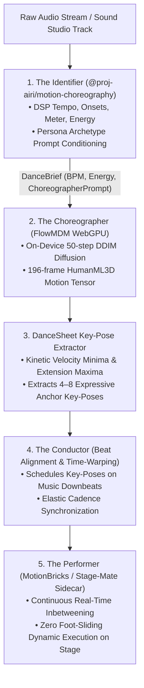

# Design & Specification: Real-Time Kinematic Inbetweening & Beat-Synced Dancing via NVIDIA MotionBricks

> **Status**: Active Implementation / Living Specification (Phases 1 & 2 Complete)
> **Document**: `docs/proposal-motionbricks-realtime-kinematics-and-beat-sync.md`
> **Target Audience**: 3D Animation Engineers, Unity Stage-Mate Developers, Sound Studio / DJ Integrators, Monorepo Architects
> **Core Package**: [`packages/motion-choreography`](../packages/motion-choreography) (`@proj-airi/motion-choreography`)
> **Key References**: [`docs/design-text-to-motion.md`](./design-text-to-motion.md), [`docs/proposal-trellis-dynamic-item-manifestation.md`](./proposal-trellis-dynamic-item-manifestation.md), [`docs/proposal-comfyui-generative-music-dj-engine.md`](./proposal-comfyui-generative-music-dj-engine.md), [`docs/project-testing-parity.md`](./project-testing-parity.md)

---

## 🧭 1. Executive Summary & Problem Space

AIRI currently features two main paradigms for avatar animation:
1. **Discrete Semantic Motion (Text-to-Motion / FlowMDM)**: Procedural LLM keyframes or WebGPU neural diffusion that takes natural-language text prompts (e.g. *"wave enthusiastically"*) and generates a discrete, multi-second `.vrma` animation clip.
2. **Fixed Animation Playback (MMD & Live2D Loops)**: Pre-baked looping animation clips (e.g. `AvatarDancePlayer.cs` in Stage-Mate, idle sway loops, or fixed dance choreography).

### The Missing Piece: Real-Time Kinematic Inbetweening
While Text-to-Motion handles high-level semantic intent, it **cannot** handle real-time responsive physical movement:
* It cannot continuously adapt an avatar's body to arbitrary music beats in real time.
* It cannot smoothly transition between arbitrary, interrupted poses without jarring pops or manual linear quaternion SLERP.
* It cannot guide an avatar's limbs to dynamically reach for and grab dynamically generated 3D items (from the **TRELLIS** pipeline) or sit down on decomposed 3D stage furniture.

**NVIDIA MotionBricks** provides the solution: an ultra-fast (~15,000 FPS, ~2ms latency), lightweight (~800 MB open model weights) autoregressive neural controller trained on over 350,000 motion clips. Rather than doing text-to-motion, MotionBricks takes a character's recent skeletal pose history plus sparse target poses/trajectories and predicts physically natural, organic in-between transitions in real time.

---

## 🎵 2. Core Application: Real-Time Beat-Synchronized Dancing

AIRI's **Sound Studio & AI DJ Engine** (`chat_music.vue`, `proposal-comfyui-generative-music-dj-engine.md`) allows companions to stream music, compose original tracks, and act as autonomous DJs. However, avatar dancing to this music has historically been restricted to static, pre-recorded MMD dance clips that loop regardless of musical tempo and cannot react dynamically.

---

## 🎭 3. The Generative Dance Pipeline Architecture

---

## 📦 4. Shipped Subsystem: `@proj-airi/motion-choreography`

To maintain monorepo hygiene and prevent top-level script bloat, all acoustic analysis, dance prompt synthesis, and kinematic key-pose extraction are housed in the dedicated monorepo package: **[`packages/motion-choreography`](../packages/motion-choreography)**.

### 4.1 Subsystem 1: The Identifier (DSP & Prompt Synthesis)
* **WAV Codec ([`src/dsp/wav.ts`](../packages/motion-choreography/src/dsp/wav.ts))**:
  * `decodeWav(buffer)`: Zero-dependency RIFF parser for 8-bit, 16-bit, 24-bit, 32-bit PCM and IEEE 32-bit float audio into normalized `Float32Array[]`.
  * `encodeWav(channels, sampleRate)`: Standard 16-bit PCM WAV byte serializer used for testing and synthetic audio generation.
* **FFT & Spectral Engine ([`src/dsp/fft.ts`](../packages/motion-choreography/src/dsp/fft.ts))**:
  * `computeMagnitudeSpectrum(signal)`: Radix-2 Cooley-Tukey FFT algorithm with bit-reversal permutation and dynamic twiddle factors.
  * `applyHannWindow(frame)`: In-place cosine windowing eliminating boundary spectral leakage.
  * `computeSpectralCentroid(magnitudes, sampleRate, fftSize)`: Frequency center of mass in Hertz determining timbral brightness (`dark` < 1400Hz, `balanced` 1400–3200Hz, `bright` > 3200Hz).
* **Acoustic Analyzer ([`src/dsp/analyzer.ts`](../packages/motion-choreography/src/dsp/analyzer.ts))**:
  * `analyzeAudioBuffer(channelData, sampleRate, options)`:
    * **RMS Energy Tiering**: Classifies signal into `low` (< 0.05), `moderate` (0.05–0.18), `high` (0.18–0.35), `explosive` (>= 0.35).
    * **Spectral Flux Onset Detection**: Half-wave rectified frequency bin flux with dynamic adaptive thresholding ($1.35 \times \text{local mean} + \delta$).
    * **Tempo Autocorrelation with Perceptual Prior**: Autocorrelation over lags spanning 60–200 BPM, weighted by a Gaussian prior centered on the human dance locomotion resonance (120 BPM, $\sigma = 40$).
    * **Subharmonic Octave Disambiguation**: Evaluates half-lag candidates to eliminate the classic backbeat octave illusion (e.g. mistaking a 120 BPM kick/snare pattern for 60 BPM).
    * **Inter-Onset Interval (IOI) Consensus**: Cross-validates autocorrelation peaks against median physical onset intervals.
    * **Metric Accent Covariance Classifier**: Computes zero-mean lag covariance across detected beat onset strengths:
      $$\text{Cov}_3 > \text{Cov}_2 \implies \text{Waltz Triple Meter (3/4 time)}$$
      $$\text{Cov}_2 > \text{Cov}_3 \implies \text{Four-on-the-Floor (4/4 time)}$$
* **Dance Brief Synthesizer ([`src/synthesizer.ts`](../packages/motion-choreography/src/synthesizer.ts))**:
  * `synthesizeDanceBrief(features, metadata?, persona?)`:
    * Combines acoustic signals with companion persona archetypes into a structured `DanceBrief`.
    * Injects kinetic movement primitives tuned for HumanML3D / FlowMDM text diffusion:
      * `idol`: *"cheerful idol stage dance, bouncy rhythmic footwork, lively arm sweeps, radiant expressive presence"*
      * `gothic_maid`: *"composed aristocratic gothic dance, graceful slow turns, poised hand gestures, noble posture"*
      * `cool_android`: *"sharp mechanical popping and locking, precise body isolation, crisp robotic transitions"*
      * `chill_gamer`: *"relaxed rhythmic swaying, effortless head bopping, casual groove"*
      * `chaotic_gremlin`: *"hyperactive erratic hopping, comical rapid arm gestures, unpredictable bouncy footwork"*
    * Automatically recommends `suggestedKeyPoseCount` (4 for 4/4, 6 for 3/4 waltz, 8 for fast breakbeat).

---

### 4.2 Subsystem 2: The Dance Sheet Key-Pose Extractor
* **Kinematics Math ([`src/kinematics/math.ts`](../packages/motion-choreography/src/kinematics/math.ts))**:
  * `quatNormalize(q)`, `quatMultiply(a, b)`, `quatInvert(q)`
  * `quatSlerp(qa, qb, t)`: Spherical linear interpolation with antipodal opposition flipping and fallback to normalized lerp for near-zero angular distances.
  * `vec3Lerp(a, b, t)`, `vec3Length(v)`, `vec3Distance(a, b)`.
* **Key-Pose Extractor ([`src/kinematics/key-pose-extractor.ts`](../packages/motion-choreography/src/kinematics/key-pose-extractor.ts))**:
  * `extractKeyPosesFromTrajectories(data, options)`: Extracts anchor poses from general motion capture / bone animation data.
  * `extractKeyPosesFromHumanML3D(motionFeatures, seqLen, options)`: Analyzes continuous 263-dim HumanML3D tensors (supporting both FlowMDM ONNX feature-major `[263, seqLen]` and frame-major `[seqLen, 263]` formats):
    1. Decodes root yaw rotation and planar velocity trajectory.
    2. Computes total joint linear velocity $V(t) = \sqrt{\sum_{j} v_j^2}$ (channels 193–258).
    3. Computes body extension amplitude $E(t) = \sum_{j} \|\mathbf{p}_j\|$ (channels 4–66).
    4. Detects foot-contact impact transitions (channels 259–262).
    5. Scores candidate inflection points:
       * **Velocity Minima (`velocity_minimum`)**: Kinetic holding moments / motion turning apexes where acceleration reverses.
       * **Extension Maxima (`extension_maximum`)**: Silhouette apexes with maximum limb reach.
       * **Foot Strikes (`foot_strike`)**: Ground contact transitions.
    6. **Multi-Pass Temporal Non-Maximum Suppression (NMS)**: Always anchors sequence boundaries (frame 0 and frame $seqLen - 1$), greedily selecting remaining candidates with temporal spacing (`minFrameInterval`) to prevent pose clustering.
* **Data Contracts ([`src/types.ts`](../packages/motion-choreography/src/types.ts))**:
  * `DanceSheetKeyframe`: Frame index, timestamp, normalized salience score (0.0–1.0), pose category (`PoseType`), root translation, root rotation quaternion, and joint rotations.
  * `DanceSheet`: Curated sequence of anchor poses ready for beat scheduling.

---

### 4.3 Zero-Binary In-Memory Test Infrastructure
To guarantee CI velocity and prevent repository bloat, no binary audio files or 3D assets are committed to Git:
* **Synthetic Audio Generator ([`tests/synthetic-audio.ts`](../packages/motion-choreography/tests/synthetic-audio.ts))**:
  * Generates pure mathematical PCM test buffers: 120 BPM 4/4 kicks + snares, 84 BPM 3/4 waltz downbeats + chord hits, and low-amplitude ambient soundscapes.
* **Synthetic Motion Generator ([`tests/synthetic-motion.ts`](../packages/motion-choreography/tests/synthetic-motion.ts))**:
  * Synthesizes 263-dim HumanML3D periodic sway tensors with known velocity minima and turning apexes.
* **Public Domain Audio Corpus Manifest ([`tests/fixtures/corpus-manifest.json`](../packages/motion-choreography/tests/fixtures/corpus-manifest.json))**:
  * Maintains verified public-domain / CC-0 audio track URLs with expected BPM and SHA-1 checksums (The Blue Danube, Maple Leaf Rag, Transit of Venus March, TheFatRat Unity, Arpeggio Dreamer).
* **On-Demand Corpus Loader ([`tests/corpus-loader.ts`](../packages/motion-choreography/tests/corpus-loader.ts))**:
  * Automated fetcher caching to gitignored `.cache/` with SHA-1 integrity checks.
* **Vitest Suite ([`tests/identifier.test.ts`](../packages/motion-choreography/tests/identifier.test.ts), [`tests/key-pose-extractor.test.ts`](../packages/motion-choreography/tests/key-pose-extractor.test.ts))**:
  * 18 unit tests executing in ~100ms covering WAV roundtripping, FFT, tempo detection, metric covariance, prompt synthesis across archetypes, quaternion slerp, and HumanML3D pose extraction.

---

## 🪑 5. Symbiosis with TRELLIS Dynamic Items & Stage Props

In [`docs/proposal-trellis-dynamic-item-manifestation.md`](./proposal-trellis-dynamic-item-manifestation.md), AIRI specifies an architecture for generating 3D items (hats, drinks, instruments) and decomposing background scenes into interactive 3D furniture (chairs, desks).

MotionBricks solves the physical interaction problem:
* **Dynamic Reaching & Equipping**: When `create_stage_item` spawns a coffee mug on a desk, MotionBricks receives a target hand transform corresponding to the mug's handle socket. It computes natural upper-body kinematics for the avatar to reach, grasp, and hold the prop.
* **Seating & Obstacle Interaction**: When `decompose_stage_scene` identifies a chair, the companion can sit down naturally because MotionBricks predicts the hip descent and knee flexion needed to meet the seat's bounding plane.

---

## 🏗️ 6. Architectural Placement & Runtime Options

### Option A: Dedicated Stage-Mate C# Runtime (Primary Recommended)
* **Location**: `apps/stage-mate/unity-src/Assets/Scripts/MotionBricks/`
* **Mechanism**: Runs the ONNX/Sentis runtime directly inside the Unity desktop companion sidecar.
* **Why this works**: Stage-Mate already hosts the high-fidelity VRM model, physics colliders, and MMD dance player. Ingesting MotionBricks as a native C# Unity job utilizes GPU compute with zero Electron bridge serialization overhead.

### Option B: Local Electron / Python Sidecar
* For Three.js stages in `apps/stage-tamagotchi`, MotionBricks can be hosted as an ONNX Runtime service emitting bone rotation arrays over local shared memory or WebSocket (`stage:motion:stream`).

---

## 📅 7. Implementation Roadmap & Current Status

- [x] **Milestone 1: The Identifier (DSP & Prompt Synthesis)**
  - Shipped in [`packages/motion-choreography/src/dsp/`](../packages/motion-choreography/src/dsp/) and [`src/synthesizer.ts`](../packages/motion-choreography/src/synthesizer.ts).
  - Implemented WAV codec, FFT, RMS energy tiering, autocorrelation beat tracking with resonance prior, metric accent covariance (3/4 waltz vs 4/4), and persona archetype FlowMDM prompt synthesis.
  - Zero-binary synthetic test harness and public domain audio manifest.
- [x] **Milestone 2: FlowMDM Key-Pose Extractor (The Dance Sheet)**
  - Shipped in [`packages/motion-choreography/src/kinematics/`](../packages/motion-choreography/src/kinematics/).
  - Implemented quaternion math and `quatSlerp`.
  - Implemented 263-dim HumanML3D tensor extractor sampling 4–8 anchor keyframes based on velocity minima, extension maxima, foot strikes, and temporal NMS.
- [ ] **Milestone 3: The Conductor (Beat-to-Keypoint Scheduler & Time-Warping)**
  - Map `DanceSheetKeyframe[]` onto live `beatTimestamps`.
  - Implement elastic tempo scaling and downbeat synchronization.
- [ ] **Milestone 4: MotionBricks Ingestion & Stage-Mate Driver**
  - Benchmark 800 MB MotionBricks ONNX checkpoint in Unity Sentis (<5ms target).
  - Implement `MotionBricksDriver.cs` in `apps/stage-mate/unity-src/` executing continuous inbetweening between selected key-poses.
- [ ] **Milestone 5: TRELLIS Dynamic Item Reaching & Furniture Sockets**
  - Connect item socket transforms to MotionBricks reaching targets for dynamic prop manipulation.
