# Proposal: Over-The-Air (OTA) Application Updates via Ergosphere Architecture

> **Status**: Proposed Architecture & Implementation Blueprint
> **Target Subsystems**:
> - `apps/stage-tamagotchi/src/launcher/` (Minimal Electron Launcher Shim & Dynamic Bundle Loader)
> - `apps/stage-tamagotchi/src/main/services/electron/auto-updater.ts` (Updater Service & IPC Contract)
> - `apps/stage-tamagotchi/electron.vite.config.ts` & `ergo.config.ts` (Ergosphere Bundling Toolchain & Public Key Configuration)
> - `.github/workflows/release-tamagotchi.yml` & `.github/scripts/plan-tamagotchi-updates.ts` (Automated OTA Release Pipeline to Cloudflare R2)
> - `packages/stage-pages/src/pages/settings/about.vue` & `packages/stage-ui/` (Update Channel Selection & Status Presentation)
> **Key Upstream References**:
> - Upstream PR [#3126](https://github.com/moeru-ai/airi/pull/3126): `feat(stage-tamagotchi): update with ergosphere-it, and publish each push to a dev channel` *(Author: `@nekomeowww`)*
> - Ergosphere-it Engine: [`https://github.com/moeru-ai/ergosphere-it`](https://github.com/moeru-ai/ergosphere-it)
> - Upstream Commit `a9b3f6cb95`: Integrated launcher, R2 update feed, and SeaweedFS OTA testing harness
> **Related Fork Skills & Specs**:
> - [`airi-release-packaging-deploy`](../.agents/skills/airi-release-packaging-deploy/SKILL.md) & [`airi-app-entry-wiring`](../.agents/skills/airi-app-entry-wiring/SKILL.md)
> - [`airi-roadmap-upstream-research`](../.agents/skills/airi-roadmap-upstream-research/SKILL.md)
> - [`docs/project-selective-upstream-sync-protocol.md`](./project-selective-upstream-sync-protocol.md)

---

## 1. Executive Summary & Value Proposition

In `dasilva333/airi`, development velocity is exceptionally high, with rapid continuous iterations across agent cognition, memory subsystems, stage visualizers, and UI surfaces. However, delivering these improvements to desktop users has historically required full binary installers:
- **Heavy Downloads**: Users must download 100 MB–150 MB packages (`.dmg`, `.exe`, `.deb`) for every minor tweak or bug fix.
- **Packaging Overhead**: Building installers locally (`pnpm run release:win`, `pnpm run release:mac`) requires heavy compilation, code-signing passes, and notarization workflows.
- **User Friction**: Upgrading requires terminating the process, executing installers or replacing `.app` bundles, and relaunching.

Upstream PR [#3126](https://github.com/moeru-ai/airi/pull/3126) introduces an elegant paradigm shift via **`ergosphere-it`**: treating the Electron binary purely as a stable **launcher runtime**, while packaging the actual application logic (main process, preloads, and renderer Vite build) into lightweight, cryptographically signed JavaScript bundles (5–15 MB) delivered over the air (OTA).

Because this fork distributes primarily to direct community users via GitHub and direct release surfaces (rather than the locked-down Mac App Store), the theoretical drawbacks (notarization scrutiny of writable user directories, strict App Store sandbox rules) do not impede us. Adopting this architecture gives our fork:
1. **Near-Instant User Updates**: Push-to-main or release channels can deliver updates in seconds via lightweight bundle downloads.
2. **Atomic Rollback on Crash**: If a new bundle fails during startup, the launcher automatically rolls back to the previous working bundle or embedded baseline.
3. **Bandwidth & Storage Efficiency**: Up to 90% reduction in release asset bandwidth and CI distribution times.
4. **Selective Native Fallback**: Seamless fallback to standard `electron-updater` only when native Node C++ addons or the Electron runtime itself change.

---

## 2. Core Architecture & Mental Model

```mermaid
flowchart TD
    subgraph Distribution["Release & Distribution Pipeline"]
        GitPush["Push to main / Tag Release"] --> CI["GitHub Actions (release-tamagotchi.yml)"]
        CI --> BuildBundle["Build JS/Vue Bundle (out/main, out/preload, out/renderer)"]
        CI --> SignBundle["Ed25519 Sign Bundle Tarball"]
        SignBundle --> PublishR2["Upload to Cloudflare R2 / S3 (release-updates.airi.build)"]
    end

    subgraph ClientBoot["Desktop Application Boot Sequence"]
        AppStart(["Application Launched (airi.exe / AIRI.app)"]) --> Launcher["out/launcher/index.mjs (Immutable Base)"]
        Launcher --> CheckLocal["Inspect app.getPath('userData')/updates/bundles/"]

        CheckLocal -->|Verified Bundle Present| VerifySignature{"Verify Ed25519 Signature"}
        VerifySignature -->|Valid & Healthy| DynamicImport["dynamic import(userData/.../main/index.mjs)"]
        VerifySignature -->|Corrupt or Incomplete| FallbackEmbedded["Fall Back to Embedded app.asar/out/main/index.mjs"]

        CheckLocal -->|First Run / No Updates| FallbackEmbedded

        DynamicImport --> AppInit["injeca.start() & Window Creation"]
        AppInit --> HealthPing["Report Health Confirmation to Launcher"]

        HealthPing -->|Timeout / Crash| AutoRollback["Mark Bundle Broken & Rollback to Previous Version"]
    end

    subgraph BackgroundUpdate["Background Update Lifecycle"]
        AutoUpdater["auto-updater.ts Service"] --> CheckFeed["Query R2 Feed Manifest (Channel: dev/beta/stable)"]
        CheckFeed -->|New Bundle Available| DownloadBundle["Download Signed Tarball to Temp Dir"]
        DownloadBundle --> UnpackVerify["Verify Ed25519 Signature & Unpack to userData/updates/bundles/<id>"]
        UnpackVerify --> NotifyUI["Notify Renderer: 'Update Ready'"]
        NotifyUI --> RestartPrompt["User Relaunches App (Fast Restart)"]
    end
```



---

## 3. Detailed Component Breakdown

### 3.1 The Launcher Shim (`src/launcher/index.ts`)
Instead of `electron.vite.config.ts` targeting `out/main/index.mjs` as the Electron package entry point, `package.json` sets `main: "out/launcher/index.mjs"`.

The launcher is a minimal, dependency-free script with three responsibilities:
1. **Locate Active Bundle**: Reads the metadata file in `app.getPath('userData')/updates/active-bundle.json`.
2. **Verify Integrity**: Ensures bundle directory exists, signature checks out against the public key baked into `ergo.config.ts`, and the bundle has not been marked as crashed.
3. **Dynamic Import**: Dynamically imports the real main process:
   ```ts
   // Simplified conceptual bootstrap
   const bundlePath = resolveActiveBundlePath() ?? resolveEmbeddedBundlePath()
   try {
     const mainModule = await import(pathToFileURL(path.join(bundlePath, 'out/main/index.mjs')).href)
     setupHealthWatchdog(bundlePath)
   }
   catch (err) {
     console.error('[Launcher] Failed to boot bundle, rolling back:', err)
     rollbackToSafeBundle()
     await import(pathToFileURL(resolveEmbeddedBundlePath()).href)
   }
   ```

### 3.2 Health Check & Fail-Safe Auto-Rollback
A primary danger of OTA updates is shipping a fatal startup crash that bricks the application. The `ergosphere-it` architecture prevents this with a strict health contract:
- The launcher starts a 10-second watchdog timer upon launching a new bundle.
- The bundle's main process must explicitly invoke `injeca.start()` and report:
  ```ts
  updaterService.reportHealthy()
  ```
- If the app terminates abruptly before reporting health, or exceeds the timeout, the launcher marks that bundle ID as `quarantined`, clears it from `active-bundle.json`, and boots the previous version or embedded fallback.

### 3.3 Channel Architecture (`ergo.config.ts`)
Channels allow fine-grained release separation:

| Channel | Trigger | Version Format | Audience |
| :--- | :--- | :--- | :--- |
| **`dev`** | Every push to `main` | `0.12.0+dev.<run>.<commit>` | bleeding-edge testers & developer pair-programming |
| **`beta`** | Milestone pre-releases (`vX.Y.Z-beta.N`) | `X.Y.Z-beta.N` | preview users testing staged releases |
| **`stable`** | Release tags (`vX.Y.Z`) | `X.Y.Z` | general community |

The channel can be switched at runtime in the Settings > About page, persisted in `userData`, or overridden via the `AIRI_UPDATE_CHANNEL` environment variable.

---

## 4. Fork-Specific Feasibility & Roadblocks Evaluation

### 4.1 "Drawbacks" vs Fork Reality
Upstream documented several constraints in PR #3126. Here is how they apply to `dasilva333/airi`:

1. **Mac App Store / Gatekeeper**:
   - *Upstream Concern*: Executing dynamic JavaScript from writable application support folders violates strict App Store guidelines.
   - *Fork Reality*: **Non-issue.** This fork does not publish to the Mac App Store. Community distribution is via GitHub Releases, where users already run notarized or developer-signed desktop binaries with local permissions.
2. **Package Manager Disabling (Steam / Flatpak / Nix)**:
   - *Requirement*: Package managers mandate that application files are immutable and managed strictly by the package manager.
   - *Fork Implementation*: Ergosphere cleanly respects `AIRI_DISABLE_UPDATER=1` or detects Flatpak/Nix runtimes, shutting off OTA checks and deferring to the package manager.
3. **Native Module Boundaries**:
   - *Requirement*: C++ native addons (e.g. `@proj-airi/electron-native-backdrop`, SQLite native drivers) cannot be loaded dynamically if Node ABI versions mismatch.
   - *Fork Mitigation*: When native bindings or Electron versions bump, `.github/scripts/plan-tamagotchi-updates.ts` marks the release as `requires_installer: true`. Ergosphere automatically delegates to `electron-updater` to download the complete installer.

---

## 5. Storage & Hosting Infrastructure: Cloudflare R2

Instead of relying on upstream's servers (`release-updates.airi.build`), `dasilva333/airi` will host its own update feed:
- **Cloudflare R2 Bucket**: `airi-updates` (Zero egress fee distribution).
- **Public Feed Domain**: e.g. `https://updates.airi.run` or GitHub Pages fallback.
- **Keypair Generation**:
  - Private Ed25519 signing key stored as a GitHub Actions secret (`ERGO_SIGNING_KEY`).
  - Public verification key committed in `apps/stage-tamagotchi/ergo.config.ts`.
- **Directory Layout on R2**:
  ```text
  /channels/
    dev/
      latest.json
      bundle-0.12.0-dev.412.3692652.tar.gz
      bundle-0.12.0-dev.412.3692652.tar.gz.sig
    beta/
      latest.json
      ...
    stable/
      latest.json
      ...
  ```

---

## 6. Phased Implementation Roadmap

### Phase 1: Toolchain & Launcher Scaffolding
- [ ] Add `@moeru-ai/ergosphere-it` or vendor the core launcher shim into `apps/stage-tamagotchi/src/launcher/`.
- [ ] Configure `apps/stage-tamagotchi/ergo.config.ts` with channel definitions and placeholder Ed25519 public key.
- [ ] Update `electron.vite.config.ts` to output both the minimal launcher and the full application bundle.

### Phase 2: Main Process & Health Integration
- [ ] Wire `auto-updater.ts` service to communicate with `ergosphere-it` client.
- [ ] Implement `injeca.start()` health confirmation in `apps/stage-tamagotchi/src/main/index.ts`.
- [ ] Implement local SeaweedFS / S3 mock test harness (`scripts/update-test`) to verify bundle extraction, dynamic load, and fail-safe rollback locally on macOS and Windows.

### Phase 3: GitHub Actions Release Automation
- [ ] Add `.github/scripts/plan-tamagotchi-updates.ts` to determine whether a commit produces an OTA bundle or a full installer.
- [ ] Configure GitHub Actions workflow to sign bundles and publish to Cloudflare R2 on push to `main` (dev lane) and release tags (stable).

### Phase 4: UI & Channel Controls
- [ ] Update `packages/stage-pages/src/pages/settings/about.vue` to display currently running bundle version and allow switching update channels (`stable` vs `dev`).
- [ ] Provide user notifications for pending restarts when updates finish downloading.
