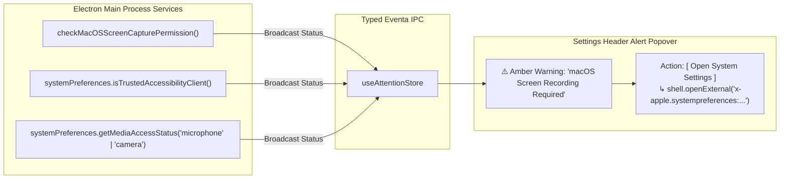

# Proposal: Unified System Attention & Alert Popover Architecture

> **Status**: Proposed Architecture & Systems Blueprint
> **Target Subsystems**:
> - `packages/stage-ui/src/stores/attention.ts` (Unified Attention & Problem Ledger Store)
> - `packages/stage-layouts/src/components/Layouts/SettingsMasterDetail/SettingsBreadcrumbHeader.vue` (Header Alert Bell / Amber Glyph Trigger)
> - `packages/stage-ui/src/components/scenarios/settings/SettingsAttentionPopover.vue` (Interactive Notification Tray Popover)
> - `packages/stage-ui/src/stores/sync-engine.ts` (BYOS & Cloud Sync Conflict Bubbling)
> - `packages/stage-ui/src/stores/chat/nap-chat.ts` (7n1m4 Peer-to-Peer Outbox / Inbound Delivery Tracking)
> - `packages/stage-ui/src/stores/providers/` (Empirical Runtime Invocation Failures)
> - `packages/stage-ui/src/stores/artistry.ts` (ComfyUI & Headless Art Generation Failures)
> **Key Upstream References**:
> - Upstream PR [#3115](https://github.com/moeru-ai/airi/pull/3115): `feat(stage-ui,stage-pages): show providers that failed their last check` *(Author: `@chiba233`)*
> - Upstream PR [#3131](https://github.com/moeru-ai/airi/pull/3131): `fix(stage-ui): show only providers in use under needs attention` *(Author: `@chiba233`)*
> - Upstream PR [#3134](https://github.com/moeru-ai/airi/pull/3134): `feat(stage-ui,stage-pages): list the remaining needs-attention cases` *(Author: `@chiba233`)*
> - Upstream PR [#3139](https://github.com/moeru-ai/airi/pull/3139): `fix(stage-ui,stage-pages,stage-tamagotchi): open needs-attention items at the setting to change` *(Author: `@chiba233`)*
> - Upstream PR [#3136](https://github.com/moeru-ai/airi/pull/3136): `chore(stage-ui,stage-pages): use the settings search field on the AIRI card page` *(Author: `@chiba233`)*
> - Upstream Issue [#3092](https://github.com/moeru-ai/airi/issues/3092): Settings home attention card proposals
> **Related Fork Skills & Specs**:
> - [`airi-ui-design-conventions`](../.agents/skills/airi-ui-design-conventions/SKILL.md) & [`airi-byos-cloud-sync`](../.agents/skills/airi-byos-cloud-sync/SKILL.md)
> - [`airi-roadmap-upstream-research`](../.agents/skills/airi-roadmap-upstream-research/SKILL.md)
> - [`docs/project-selective-upstream-sync-protocol.md`](./project-selective-upstream-sync-protocol.md)

---

## 1. Executive Summary & Problem Critique

In desktop companions and distributed multi-modal systems, background operations frequently encounter asynchronous issues:
- **Cloud Sync & BYOS**: Merge conflicts between local and remote devices, expired S3/R2 credentials, or stalled outbox writes.
- **P2P Mesh / Nap-Chat**: Unreachable peer companions over libp2p, stalled outbound messages, or pending inbound invites.
- **Generative Art & ComfyUI**: Local CUDA out-of-memory errors, missing model checkpoints, or unreachable local servers.
- **AI Providers**: Invalid API keys, depleted account balances, or rate limits.

### Why Upstream PR #3115 Fails Architecturally
Upstream PR [#3115](https://github.com/moeru-ai/airi/pull/3115) attempted to address provider issues by injecting large, persistent "needs attention" alert cards directly onto the settings home screen grid, right below the search bar.

This approach suffers from fundamental design and technical flaws:
1. **Noisy Heuristics & False Positives**: Upstream relies on proactive startup pings against every configured provider. In local-first ecosystems, users frequently leave local daemons (Ollama, LM Studio, ComfyUI, Voicevox) closed until needed. Proactive pinging marks these healthy, optional providers as "BROKEN" and nags the user with red alert cards on every app launch.
2. **Visual Clutter & Disrupted Symmetry**: Injecting dynamic cards into the top of the settings hub displaces the clean navigation grid, pushes standard configuration categories off-screen, and turns the settings window into an intimidating dashboard of errors.
3. **Tunnel Vision (Provider-Only)**: Real user frustrations rarely stem from un-pinged API accounts; they stem from **silent failures in active workflows** (e.g. why didn't my nap-chat send? why didn't my cloud sync reconcile? why did my ComfyUI prompt fail?).

### 1.1 Upstream's Course Correction: PRs #3115 ➔ #3131 ➔ #3134 ➔ #3139
Following community and fork feedback, upstream author `@chiba233` (蓝莓🫐) recognized these failure modes and progressively aligned with our architectural critiques across four rapid iterations:

1. **Filtering to In-Use Providers Only (PR #3131)**:
   - *Problem*: PR #3115 pinged every configured account on startup, flooding the UI with red warnings for unused or dormant local servers (Ollama, LM Studio, Voicevox).
   - *Correction*: Scoped the check strictly to providers actively referenced by active character cards or hearing modules (`packages/stage-ui/src/stores/providers/provider.ts`). Dormant providers are ignored.
2. **Expanding to Operational Blind Spots (PR #3134)**:
   - *Problem*: API connectivity checks alone miss the most aggravating user failures—active character pipelines silently stalling with zero explanation.
   - *Correction*: Expanded diagnostics to functional dependencies:
     - **Missing Character Voice/Model**: Characters bound to usable speech providers but lacking a voice or model selection (which previously caused unhandled `createOutput` exceptions, silently forcing text-only replies).
     - **Missing Transcriber in Always-On Hearing**: Microphone listening continuously without an active STT provider configured.
     - **Unusable / Removed Module Providers**: Characters referencing deleted provider instances.
     - **Developer Diagnostics Panel**: Added `/devtools/needs-attention` to inspect, simulate, and test all diagnostic states.
3. **Precision Deep-Linking with Highlight Reveal (PR #3139)**:
   - *Problem*: Clicking "Edit" dumped the user on the general settings root or module tab, forcing them to hunt for the offending control.
   - *Correction*: Passing query parameters (`?section=modules&setting=...`) to auto-scroll the exact input field into view and apply a visual highlight focus animation.
4. **Card Page Search Parity (PR #3136)**:
   - Integrated settings search field into the AIRI card page for consistent navigation.

While upstream continues to render these alerts as large banner blocks on the Settings Home grid, their revised detection logic and deep-linking reveal mechanism perfectly complement our **Unified Attention Store & Header Popover** architecture.

### The Solution: A Unified Attention Ledger & Header Popover
Instead of polluting the settings navigation grid, this proposal establishes:
1. **A Unified Attention Store (`useAttentionStore`)**: A centralized reactive problem ledger that collects genuine, empirical operational issues across all subsystems.
2. **Non-Intrusive Header Status Glyph**: An amber warning glyph (`i-solar:danger-triangle-bold-duotone` or orange bell) in the Settings header bar, placed immediately to the left of the Cloud Sync glyph.
3. **Actionable Notification Popover**: Clicking the glyph opens a clean popover listing categorized attention items with direct contextual resolution actions (`Retry`, `Resolve Conflict`, `Edit Settings`, `Dismiss`).

---

## 2. Visual Architecture & Placement

```
Settings Header Bar:
┌────────────────────────────────────────────────────────────────────────────────────────┐
│ [ < ] [ 設 HUB ] [ 🔍 Search... ]             [ ⚠️ 2 ] [ ☁️ Cloud Sync ] [ 🌙 ] [ 🟣 ▾ ] │
└───────────────────────────────────────────────────┬────────────────────────────────────┘
                                                    │ (click)
                                                    ▼
┌────────────────────────────────────────────────────────────────────────────────────────┐
│  SYSTEM ATTENTION (2 Active Issues)                                       [ Dismiss All ]│
├────────────────────────────────────────────────────────────────────────────────────────┤
│  ☁️ Cloud Sync (S3 / R2)                                                               │
│  Merge conflict detected in Character "Kurisu" (remote updated 5m ago).                 │
│  [ View & Resolve Conflict ]                                             [ Dismiss ]   │
├────────────────────────────────────────────────────────────────────────────────────────┤
│  💬 Friends / Nap-Chat                                                                 │
│  2 outbound messages queued: Peer "Rem (MacBook)" unreachable over mesh.               │
│  [ Retry Handshake ]                                                     [ Dismiss ]   │
├────────────────────────────────────────────────────────────────────────────────────────┤
│  ⚡ AI Providers                                                                        │
│  OpenRouter: Last generation failed (402 Insufficient Credits).                        │
│  [ Open Provider Settings ]                                              [ Dismiss ]   │
└────────────────────────────────────────────────────────────────────────────────────────┘
```

### Reference Surface Placement
In [`packages/stage-layouts/src/components/Layouts/SettingsMasterDetail/SettingsBreadcrumbHeader.vue`](file:///Users/richardpinedo/Projects.nosync/airi/airi_dasilva333/packages/stage-layouts/src/components/Layouts/SettingsMasterDetail/SettingsBreadcrumbHeader.vue#L178):
- Current header right side:
  ```vue
  <!-- Cloudflare & Edge Account Indicator Widget -->
  <CloudflareAccountHeaderWidget shrink-0 />

  <!-- Color Palette & Theme Mode Header Widget -->
  <SettingsThemeHeaderWidget shrink-0 />
  ```
- Proposed placement:
  ```vue
  <!-- System Attention & Notification Popover Widget -->
  <SettingsAttentionHeaderWidget v-if="hasActiveAlerts" shrink-0 />

  <!-- Cloudflare & Edge Account Indicator Widget -->
  <CloudflareAccountHeaderWidget shrink-0 />
  ```

---

## 3. Coalesced Event Taxonomy: What Enters the Ledger?

Rather than guessing via background polling, the **Unified Attention Store** captures issues where they actually occur:

```mermaid
flowchart TD
    subgraph Sources["Subsystem Error & Attention Producers"]
        SyncEngine["Sync Engine / BYOS<br/>(Merge Conflicts, Outbox Stalls)"]
        NapChat["Friends / Nap-Chat<br/>(P2P Stalls, Mesh Unreachable)"]
        ProviderStore["Provider Runtime<br/>(Empirical 401/402/429/500 Failures)"]
        Artistry["Autonomous Artistry<br/>(ComfyUI CUDA/OOM, Node Errors)"]
        MemoryWorker["Dreaming & Lifetime<br/>(Context Overflow, Distill Halts)"]
    end

    subgraph Store["useAttentionStore (Unified Reactive Problem Ledger)"]
        AttentionItem["AttentionItem {<br/>  id, domain, severity,<br/>  title, description,<br/>  actionLabel, actionRoute,<br/>  timestamp, dismissable<br/>}"]
    end

    subgraph Presentation["User Surface"]
        HeaderIcon["Header Warning Glyph (⚠️ / 🔔)"]
        Popover["Interactive Popover Tray"]
    end

    SyncEngine -->|reportAttention()| Store
    NapChat -->|reportAttention()| Store
    ProviderStore -->|reportAttention()| Store
    Artistry -->|reportAttention()| Store
    MemoryWorker -->|reportAttention()| Store

    Store --> HeaderIcon
    HeaderIcon -->|Click| Popover
```

### Detailed Event Categories:

| Domain | Event Trigger | Severity | Action |
| :--- | :--- | :--- | :--- |
| **`cloud-sync`** | Conflict detected during outbox reconciliation or S3 head comparison | `warning` | Navigates to Diff/Conflict resolution dialog |
| **`cloud-sync`** | Expired bucket token or 403 Access Denied on sync attempt | `error` | Navigates to `Settings > Cloud Sync` |
| **`friends-mesh`** | Outbound nap-chat message queued > 15m without peer ack | `info` | Opens peer debug inspector or retries handshake |
| **`friends-mesh`** | Incoming pairing request from unknown local device | `info` | Opens Pairing authorization prompt |
| **`modules`** | Active character has configured speech provider but missing model or voice (PR #3134) | `warning` | Deep-links to character editor with speech row highlighted (PR #3139) |
| **`modules`** | Always-on microphone listening, but no transcription provider configured (PR #3134) | `warning` | Deep-links to Hearing module with transcriber row highlighted (PR #3139) |
| **`modules`** | Character card or module references a removed or unusable provider (PR #3134) | `error` | Deep-links to module configuration with provider row highlighted (PR #3139) |
| **`providers`** | In-use provider failed its latest health check or connection verification (PR #3131) | `error` | Deep-links to provider page with basic section highlighted (PR #3139) |
| **`providers`** | Active chat turn or TTS synthesis failed with 401 (Auth) or 402 (Credits) | `error` | Navigates to `Settings > Providers > [Account]` |
| **`artistry`** | ComfyUI prompt failed due to missing model checkpoint or CUDA OOM | `warning` | Opens Artistry error drawer with error trace |
| **`memory`** | Lifetime memory distillation worker exceeded token budget or halted | `warning` | Navigates to `Settings > Memory > Lifetime` |
| **`audio-hw`** | Active microphone or speaker disconnected during live speech turn | `warning` | Re-opens Audio selector |
| **`audio-hw`** | Microphone permission rejected / blocked in browser (`stage-web`) | `warning` | Opens permission unblock guide & auto-listens for permission state change |
| **`os-permissions`** | Screen Recording permission missing/denied on macOS (`stage-tamagotchi`) | `error` | Opens macOS Screen Recording settings (`Privacy_ScreenCapture`) |
| **`os-permissions`** | Accessibility trust missing on macOS (`stage-tamagotchi`) | `warning` | Opens macOS Accessibility settings for window telemetry & input simulation |
| **`os-permissions`** | Desktop microphone/camera permission denied by OS privacy controls | `error` | Opens OS Microphone / Camera privacy preferences |

#### 3.1 Special Focus: Web Stage Microphone Permission Denial
In `stage-web`, browser permission boundaries introduce a common failure mode: the user accidentally clicks **"Block"** on the microphone prompt, or browser site settings permanently revoke access.

While the chat composer's local microphone popover (`VoiceInputHoverCard.vue` and `hearing-config.vue`) owns the immediate input button state, bubbling this to the **Unified Attention Store** solves three critical blind spots:
1. **Global App Awareness**: If the user is navigating Settings, configuring voice profiles, or testing local speech modules, they are disconnected from the chat voice button. A persistent header warning alerts them *why* audio features are dead.
2. **Actionable Browser Guidance**: The popover action triggers a lightweight dialog showing browser-specific steps (e.g. clicking the padlock/tune icon in Chrome/Safari/Firefox address bar to reset permissions).
3. **Reactive Self-Healing**: Using the Permissions API, the store attaches a live state watcher:
   ```ts
   // packages/stage-ui/src/composables/audio/device.ts
   if ('permissions' in navigator) {
     const status = await navigator.permissions.query({ name: 'microphone' as PermissionName })
     status.onchange = () => {
       if (status.state === 'granted') {
         attentionStore.resolveAttention('audio-hw:mic-permission-denied')
       }
     }
   }
   ```
   The second the user toggles permission back to **Allow** in their browser bar, the warning automatically self-heals and disappears without requiring a page reload.

#### 3.2 Native OS Permissions & System Access in Desktop Electron (`stage-tamagotchi`)
Currently in `stage-tamagotchi`, desktop permission handling is fragmented and fire-and-forget:
- Individual modules call `systemPreferences.getMediaAccessStatus()` or `askForMediaAccess()`.
- When denied, components either throw silent console errors or trigger an ephemeral `toast.error('Screen recording permission denied', { action: { label: 'Fix' } })` (e.g. in `vision.ts` line 178).
- If the user misses the toast or clicks outside, the screen perception or vision witness engine quietly stalls forever with **zero visible explanation** why proactivity, screen awareness, or computer-use are non-functional.

The **Unified Attention Store** formalizes desktop OS permissions as first-class ledger items:



##### Tracked Desktop Permission Gates:
1. **Screen Recording (`Privacy_ScreenCapture` on macOS)**:
   - **Dependent Subsystems**: Continuous Screen Perception (Attention Ecology), Cascaded Salience Gate, VLM Vision Witness, and Computer Use screenshot reading.
   - **Action**: Opens `x-apple.systempreferences:com.apple.preference.security?Privacy_ScreenCapture` via `shell.openExternal`.
   - **Note on macOS Invariant**: macOS requires an application relaunch after granting Screen Recording. The popover displays: *"Permission granted? Relaunch AIRI to activate screen vision."* with a one-click `[ Relaunch AIRI ]` button (`app.relaunch()` + `app.exit()`).
2. **Accessibility Trust (`isTrustedAccessibilityClient` on macOS)**:
   - **Dependent Subsystems**: Sensory Proactivity (inspecting active frontmost application name and window titles for environmental awareness) and Computer Use (synthesizing mouse clicks and keyboard typing via native inputs).
   - **Action**: Opens `x-apple.systempreferences:com.apple.preference.security?Privacy_Accessibility`.
3. **Desktop Microphone & Camera**:
   - **Dependent Subsystems**: Low-latency PCM audio ingestion, VAD hotkey capture, CAM++ voiceprint diarization, MediaPipe face mesh, and Live2D Magic camera tracking.
   - **Action**: Directs to `Privacy_Microphone` / `Privacy_Camera` system settings when `getMediaAccessStatus` reports `'denied'`.

---

## 4. Technical Design & Store Contracts

### 4.1 Schema (`packages/stage-ui/src/stores/attention.ts`)
```ts
export type AttentionDomain
  = | 'cloud-sync'
    | 'friends-mesh'
    | 'providers'
    | 'modules'
    | 'artistry'
    | 'memory'
    | 'os-permissions'
    | 'audio-hw'
    | 'system'

export type AttentionSeverity = 'info' | 'warning' | 'error'

export interface AttentionItem {
  id: string
  domain: AttentionDomain
  severity: AttentionSeverity
  title: string
  description: string
  timestamp: number
  /** Primary button action to immediately resolve or navigate to the issue */
  action?: {
    label: string
    route?: string
    /** Precision deep-link setting identifier to auto-scroll into view and highlight (PR #3139) */
    settingTarget?: string
    handler?: () => Promise<void> | void
  }
  /** Source metadata for deduplication and self-clearing */
  sourceKey?: string
  dismissable?: boolean
}
```

### 4.2 Deduplication & Self-Healing Lifecycle
1. **Source Key Deduplication**: Repeated failures with the same `sourceKey` (e.g. `provider:openrouter:auth-failed`) do not spam multiple items; they update the timestamp and message on the existing item.
2. **Self-Healing (Auto-Dismissal)**: When a previously failing operation subsequently succeeds (e.g. user replenishes credits and a turn succeeds, or Cloud Sync successfully pulls), the producer calls `resolveAttention(sourceKey)`. The alert disappears automatically without requiring manual user dismissal.
3. **Session Persistence**: Alerts are kept in-memory for the current session, with unresolved high-severity alerts (`cloud-sync` conflicts) persisted to IndexedDB so they survive restarts until resolved.

---

## 5. Implementation Roadmap

### Phase 1: Core Store & Reactive Ledger
- [ ] Implement `packages/stage-ui/src/stores/attention.ts` (`useAttentionStore`) with `reportAttention()`, `resolveAttention()`, and `dismissAttention()`.
- [ ] Add unit tests verifying deduplication, self-healing, and domain filtering.

### Phase 2: UI Header Widget & Popover Component
- [ ] Build `SettingsAttentionHeaderWidget.vue` using `@proj-airi/ui` primitives (`IconButton`, `Badge`, `Popover`).
- [ ] Integrate into `packages/stage-layouts/src/components/Layouts/SettingsMasterDetail/SettingsBreadcrumbHeader.vue` immediately to the left of `<CloudflareAccountHeaderWidget />`.
- [ ] Apply dynamic chromatic theming (`amber-500` for warnings, `rose-500` for errors) matching fork styling rules.

### Phase 3: Subsystem Wiring
- [ ] Wire `sync-engine.ts`: report merge conflicts and stalled outbox records.
- [ ] Wire `nap-chat.ts` / libp2p mesh: report pending outbound queues and peer connectivity drops.
- [ ] Wire `useLLM` / speech runtime: report empirical 401/402/429 failures without noisy background polling.
- [ ] Wire `artistry.ts`: report ComfyUI execution aborts.
- [ ] Wire `composables/audio/device.ts` & `web-speech-api`: report browser microphone permission denial (`NotAllowedError`) with Permissions API self-healing listener.
- [ ] Wire `electron-screen-capture` & `system-preferences.ts`: report macOS Screen Recording, Accessibility, and desktop Microphone/Camera permission denials with direct System Settings actions and restart prompts.

### Phase 4: Precision Deep-Linking & Diagnostics Simulation
- [ ] Implement highlight reveal helper (`useSettingsReveal` or query param handler) to auto-scroll to `settingTarget` with focus animation (PR #3139).
- [ ] Port the developer simulation harness (`/devtools/needs-attention`) for testing, simulating, and verifying all attention ledger states in development (PR #3134).
