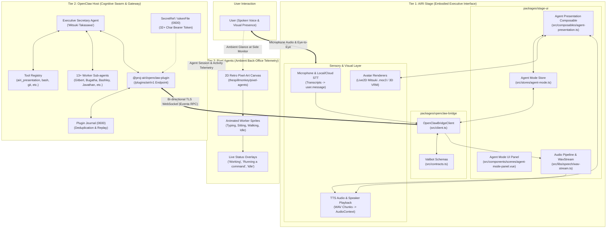
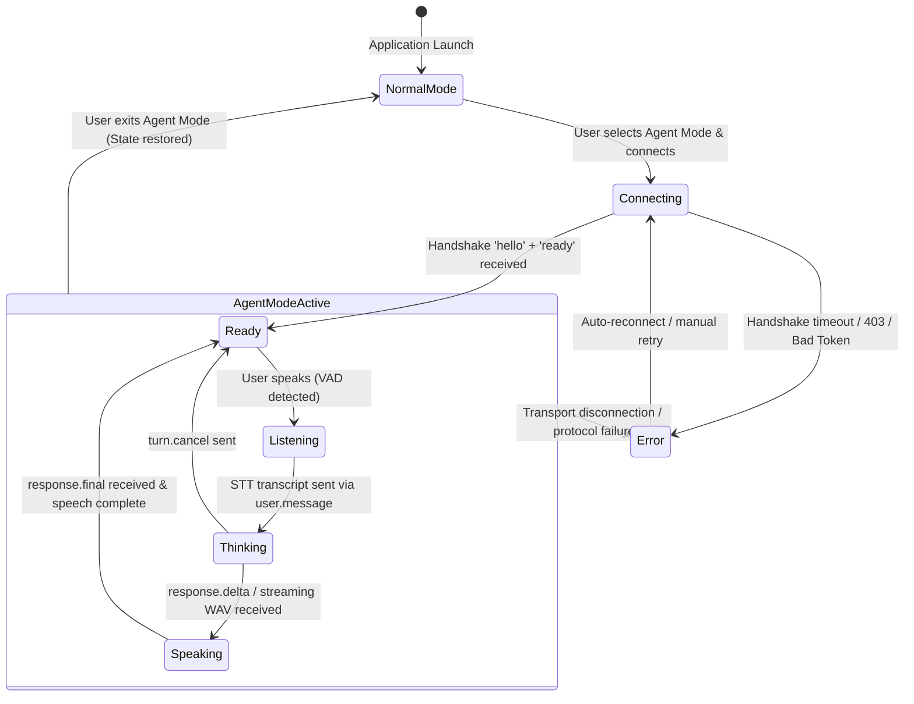
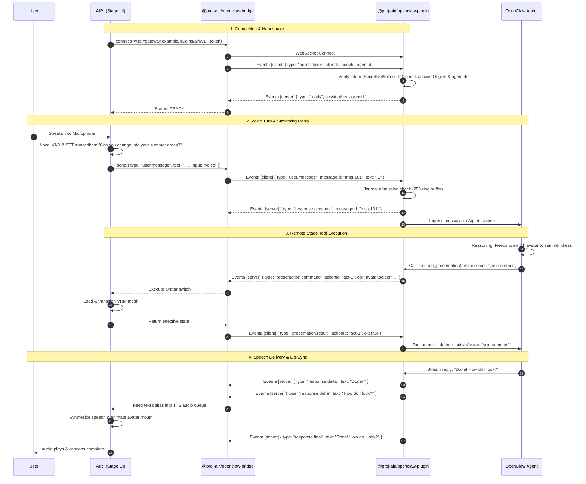
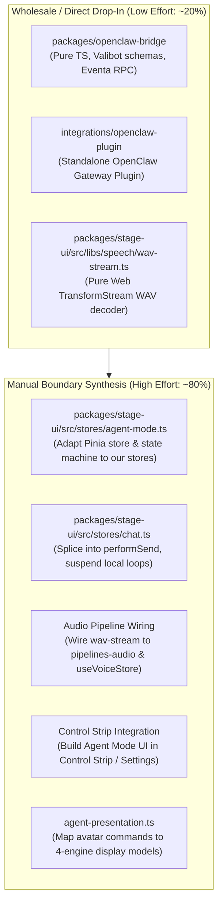
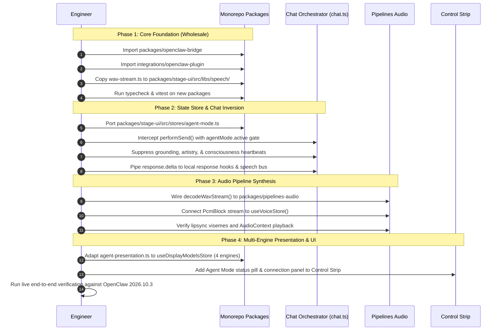

# Research & Architecture: thespillmonkey/airi OpenClaw Remote Stage Harness

A technical dissection and evaluation of the OpenClaw Stage integration implemented in the [`thespillmonkey/airi`](https://github.com/thespillmonkey/airi) fork by Gary Stango ([@thespillmonkey](https://github.com/thespillmonkey)).

- **Repository**: [thespillmonkey/airi](https://github.com/thespillmonkey/airi)
- **Primary Feature Branch**: [`thespillmonkey/feat/openclaw-agent-mode`](https://github.com/thespillmonkey/airi/tree/thespillmonkey/feat/openclaw-agent-mode)
- **Companion Swarm Visualizer**: [`thespillmonkey/pixel-agents`](https://github.com/thespillmonkey/pixel-agents) (OpenClaw multi-agent virtual office provider)
- **Base Version**: AIRI `0.13.0` (commit `13eef81f02261281a35d1ec21c834ede8c786fa3`)
- **Target OpenClaw Version**: `2026.10.3`
- **Related Upstream Threads**: PR [#1040](https://github.com/moeru-ai/airi/pull/1040) (*feat(openclaw): add OpenClaw bridge and Stage integration*), Issue [#1127](https://github.com/moeru-ai/airi/issues/1127)

---

## Executive Summary

[OpenClaw](https://openclaw.ai) is an open-source, self-hosted, continuous AI assistant framework and automation harness. It handles long-running reasoning, tool execution, persistent workspace memory, human-in-the-loop approvals, and messaging integrations (e.g., Telegram, Discord, WhatsApp).

While AIRI natively bundles its own LLM dispatch loop, consciousness heartbeats, prompt builders, and autonomous artistry, users who already run an autonomous OpenClaw agent faced a major redundancy: they wanted AIRI's rich physical presentation layer (3D VRM, Live2D, voice pipelines, idle motions, and desktop stage widgets) to be remote-controlled by their OpenClaw agent without running two competing LLM brains.

In [`thespillmonkey/airi`](https://github.com/thespillmonkey/airi), developer Gary Stango built **OpenClaw Agent Mode**:
1. **Separation of Concerns**: Inverts AIRI from an autonomous LLM agent into a **headless presentation & sensory peripheral** ("the Stage & Body"), while OpenClaw acts as the authoritative **cognitive harness** ("the Mind").
2. **Dedicated Agent Mode State Machine**: Blocks AIRI's internal LLM generation, prompt recipes, autonomous director reactions, and cognitive heartbeats, while preserving microphone input, Speech-to-Text (STT), Voice Activity Detection (VAD), audio playback, Live2D/VRM rendering, auto-blinking, and idle motion.
3. **`@proj-airi/openclaw-bridge`**: A typed, validated WebSocket client leveraging `@moeru/eventa` and Valibot contracts (`airi:openclaw:v1:client` and `airi:openclaw:v1:server`) with monotonic sequence tracking, message deduplication, and replay recovery.
4. **`integrations/openclaw-plugin`**: A native OpenClaw channel plugin targeting the OpenClaw Gateway (`/plugins/airi/v1`), featuring enterprise-grade security (first-frame authentication, SecretRef / 0600 file credentials, strict origin allowlists, per-principal session isolation, and zero tokens in URLs).
5. **Stage Presentation Tool (`airi_presentation`)**: Exposes remote avatar swapping, voice switching, and stage parameter manipulation directly as an native tool inside the OpenClaw agent's reasoning loop.
6. **Streaming WAV Audio Pipeline**: Enables streaming WAV chunks during audio synthesis to minimize latency between OpenClaw token generation and avatar lipsync.

---

## The Complete Ecosystem: Multi-Agent Corporate Hierarchy

Understanding Gary's work requires placing it within his actual multi-agent operational setup. Rather than running a single isolated chatbot, Gary operates an **autonomous multi-agent organization with 14+ specialized agents** managed by OpenClaw.

Running 14 full-sized Live2D or 3D VRM avatars simultaneously would overwhelm both system GPU resources and desktop screen real estate. To solve this, the architecture splits embodiment and telemetry into two complementary layers:

```
                            ┌────────────────────────────────────────┐
                            │               USER (Gary)              │
                            └───────────────────┬────────────────────┘
                                                │ Spoken Voice & Eye-to-Eye
                                                ▼
     ┌────────────────────────────────────────────────────────────────────────────────────────┐
     │  TIER 1: THE FRONT DESK / EXECUTIVE SECRETARY (AIRI Stage)                             │
     │  • Agent: "Mitsuki Takasawa"                                                           │
     │  • Medium: High-fidelity Live2D (.moc3) / 3D VRM desktop avatar                        │
     │  • Role: Speech-to-text, conversational voice, facial expressions, executive gateway   │
     └──────────────────────────────────────────┬─────────────────────────────────────────────┘
                                                │ Delegates subtasks & issues tool calls
                                                ▼
     ┌────────────────────────────────────────────────────────────────────────────────────────┐
     │  TIER 2: THE COGNITIVE ENGINE & SWARM RUNTIME (OpenClaw Gateway)                       │
     │  • Core reasoning, memory, persistent state, workspace execution, & security policy   │
     │  • Orchestrates 13+ specialized background sub-agents:                                 │
     │    Gitbert (git ops), Javathan & Bashley (script execution), Bugatha (bug triage),     │
     │    Crawlerton (web scraping), High Archivist Mektharion (docs/memory), Codeelia, etc.  │
     └──────────────────────────────────────────┬─────────────────────────────────────────────┘
                                                │ Broadcasts live activity & state metadata
                                                ▼
     ┌────────────────────────────────────────────────────────────────────────────────────────┐
     │  TIER 3: THE BACK OFFICE / AMBIENT TELEMETRY (Pixel Agents)                            │
     │  • Medium: Retro 2D pixel-art virtual office canvas (thespillmonkey/pixel-agents)      │
     │  • Role: Ambient operational dashboard: see sprite workers typing at desks,           │
     │    gathering at conference tables, or wandering to the lounge when idle                │
     └────────────────────────────────────────────────────────────────────────────────────────┘
```

### The Three Roles in Practice:

1. **AIRI Stage = The 1-on-1 Embodied Companion (Front Desk)**:
   - When the user wants to interact, they do not manage 14 CLI terminal tabs. They speak directly to **Mitsuki Takasawa** (the executive secretary).
   - AIRI provides Mitsuki with high-fidelity embodiment: microphone audio capture (VAD/STT), real-time speech response (TTS), viseme-synchronized mouth movement, and Live2D/VRM emotional expressions.
   - When the user says *"Check open issues and start the refactor"*, they speak to Mitsuki.

2. **OpenClaw = The Autonomous Brain & Workforce (Middle Tier)**:
   - Mitsuki acts as the coordinator in OpenClaw. She breaks down the user's high-level request into tasks and delegates them to specialized sub-agents (`Gitbert` for branch management, `Bugatha` for test debugging, `Bashley` for shell builds).

3. **Pixel Agents = Ambient Macro-Telemetry (Back Office)**:
   - Built on Gary's fork of [`thespillmonkey/pixel-agents`](https://github.com/thespillmonkey/pixel-agents) (a fork of `pixel-agents-hq/pixel-agents`), this renders an isometric/top-down retro 2D pixel-art office (RPG / Stardew Valley style).
   - As OpenClaw agents execute tasks, their corresponding pixel sprites animate: walking to desks, typing furiously when executing bash/file tools (*"Working"*), or sitting in the lounge (*"Idle"*).
   - Status badges hover above each sprite in real time:
     - `Mitsuki Takasawa`: *"Running a command"*
     - `Bugatha · subtask`: *"Working"*
     - `Gitbert · subtask`: *"Working"*
     - `Codeelia`: *"Idle"*
     - `Doctor Tae Takemi`: *"Idle"*
   - This provides the user with an ambient, glanceable overview of the entire swarm on a side monitor without desktop clutter.

---

## System Architecture



---

## Comparison: thespillmonkey vs Upstream PR #1040 vs Native AIRI Gateway

| Dimension | Upstream PR #1040 (`@botBehavior`) | thespillmonkey's Agent Mode (`@thespillmonkey`) | Native AIRI Local Channel Server (`port 6121`) |
| :--- | :--- | :--- | :--- |
| **Architectural Model** | Polling chat history bridge; emits artificial chunks | Native OpenClaw Channel Plugin + Dedicated AIRI Inversion Mode | Electron main-process WebSocket server for companion apps |
| **Client/Server Role** | AIRI acts as server; external script polls completed chat | AIRI acts as client connecting to OpenClaw Gateway plugin | AIRI is local WebSocket server; external clients connect to AIRI |
| **Cognitive Isolation** | Weak; AIRI's internal LLM loop can easily conflict with bridge | Complete; Agent Mode suppresses local LLM dispatch, recipes & heartbeats | None built-in; expects peer messages to be injected into chat session |
| **Stage Presentation Tools** | ❌ None (chat text only) | ✅ Yes (`airi_presentation` for dynamic avatar/voice/stage swapping) | ❌ None (raw event bus relay) |
| **Authentication & Security** | Basic token | First-frame payload, 32+ char token, SecretRef / `tokenFile` mode 0600, strict origin check | Token handshake (`server-channel/config.json`), mkcert TLS, LAN binding |
| **Approval Lifecycle** | ❌ None | ✅ Full OpenClaw Human-in-the-Loop (`approval.resolve`) pass-through | ❌ None |
| **Speech Latency** | Emits after full generation | Streaming response deltas + streaming WAV chunks (`wav-stream.ts`) | Sentence-sync streaming |
| **Crash / Replay Safety** | Sockets drop without replay records | 256-event bounded journal, monotonic sequence numbers, gap detection | In-memory message relay |

---

## Subsystem Deep Dive

### 1. `@proj-airi/openclaw-bridge`

Located in `packages/openclaw-bridge/`, this is a pure, framework-agnostic TypeScript client library that governs wire serialization and connection lifecycle.

- **Eventa Envelope Contract**:
  Every frame transmitted over the WebSocket route `/plugins/airi/v1` is wrapped in an Eventa envelope validated with Valibot schemas in [`packages/openclaw-bridge/src/contracts.ts`](file:///Users/richardpinedo/Projects.nosync/airi/airi_dasilva333/packages/openclaw-bridge/src/contracts.ts):
  - Client-to-Server Event ID: `airi:openclaw:v1:client`
  - Server-to-Client Event ID: `airi:openclaw:v1:server`
  - Version: strictly `1`
  - Payload Size Limit: 1 MiB per frame; string IDs bounded at 256 characters; response text bounded at 131,072 characters.

- **Client Message Types**:
  - `hello`: First frame sent immediately upon WebSocket open. Contains bearer `token`, `clientId`, `conversationId`, `agentId`, and optional `lastSequence` for session replay.
  - `user.message`: Emits user chat or STT transcripts. Distinguishes `input: "text" | "voice"`. Voice passes clean STT transcripts without piping heavy binary audio over the agent channel.
  - `turn.cancel`: Targets an exact `messageId` to cancel a slow or running turn without disrupting other agent sessions.
  - `capabilities.update`: Informs OpenClaw of effective stage capabilities (loaded avatars, available voices, supported settings).
  - `presentation.result`: Returns execution status (`ok`, `state`, `capabilities`, `error`) for an `airi_presentation` command.
  - `approval.resolve`: Resolves OpenClaw action approvals (`allow-once`, `allow-always`, `deny`).

- **Server Message Types**:
  - `ready`: Confirms authenticated handshake and returns `connectionId`, `sessionKey`, `selectedAgentId`, and permitted `agentIds`.
  - `response.accepted`: Confirms message admission into OpenClaw's queue.
  - `response.delta`: Incremental streamed text delta to update captions and feed the TTS queue.
  - `response.final`: Full terminal text representing the completed agent response.
  - `response.cancelled`: Confirms explicit turn cancellation.
  - `response.error`: Bounded diagnostic code and error message.
  - `status`: High-level agent state machine updates (`thinking`, `listening`, `speaking`, `idle`, `disconnected`).

---

### 2. `integrations/openclaw-plugin`

The native OpenClaw channel plugin in `integrations/openclaw-plugin/` bridges the OpenClaw Gateway to connected AIRI instances.

- **Installation & Packaging**:
  Packaged as a standalone tarball:
  ```bash
  cd integrations/openclaw-plugin
  pnpm run pack:standalone
  openclaw plugins install ./proj-airi-openclaw-plugin-0.1.0.tgz
  ```

- **Configuration (`openclaw.plugin.json`)**:
  Registered in the OpenClaw Gateway configuration:
  ```json
  {
    "plugins": {
      "entries": {
        "airi": {
          "enabled": true,
          "config": {
            "clients": [
              {
                "principalId": "gary",
                "agentIds": ["mitsuki"],
                "tokenFile": "/private/etc/openclaw/airi-client-token"
              }
            ],
            "allowedOrigins": ["http://localhost:5173", "https://airi.local"]
          }
        }
      }
    },
    "channels": {
      "airi": { "enabled": true }
    },
    "tools": {
      "alsoAllow": ["airi_presentation"]
    }
  }
  ```

- **Credential Hardening**:
  - Credentials must be at least 32 characters long.
  - Tokens are never accepted via URL query parameters or headers susceptible to logging.
  - Supports three credential sources:
    1. `tokenEnv`: Environment variable name.
    2. `token`: Managed OpenClaw `SecretRef` resolving from secure stores.
    3. `tokenFile`: Private path to a single-value credential file. The plugin opens it with `O_NOFOLLOW`, requiring file mode `0600`, regular file status, single hardlink, and rejecting symlinks.
  - The Gateway requires first-message authentication within 5 seconds; unauthenticated connections are immediately terminated.

- **Deduplication & Replay Journal**:
  The plugin maintains a local journal under OpenClaw's state directory (`plugins/airi/`):
  - Files created with mode `0600` inside a directory of mode `0700`.
  - Retains a bounded ring buffer of 256 events and 256 message IDs.
  - Prevents double execution if network fluctuations cause duplicate client transmissions.

---

### 3. Stage Presentation Tool (`airi_presentation`)

One of the standout design decisions in thespillmonkey's architecture is giving the OpenClaw agent explicit remote tools to manipulate the AIRI Stage. Rather than treating the avatar as a dumb text box, the agent can express itself visually and aurally.

When `airi_presentation` is added to the agent's allowed tools, OpenClaw can issue structured commands:

```json
[
  {
    "command": {
      "operation": "avatar.select",
      "avatarId": "vrm-shion-summer-outfit",
      "scope": "client"
    }
  },
  {
    "command": {
      "operation": "voice.select",
      "voice": {
        "providerId": "elevenlabs",
        "modelId": "eleven_turbo_v2_5",
        "voiceId": "21m00Tcm4TlvDq8ikWAM"
      }
    }
  },
  {
    "command": {
      "operation": "settings.update",
      "settings": {
        "cameraZoom": 1.25,
        "lightingPreset": "dusk"
      }
    }
  }
]
```

#### Supported Operations:
1. `avatars.list`: Queries all models registered in AIRI's avatar store (Live2D, VRM, Spine).
2. `avatar.select`: Commands the AIRI stage to dynamically transition to a specific avatar.
3. `voices.list`: Retrieves the client's configured speech providers and voice catalog.
4. `voice.select`: Switches the active speech model and voice ID.
5. `settings.update`: Modifies stage camera framing, positioning, and visual effects.
6. `profile.save` / `profile.load`: Saves and recalls presentation profiles (storing resource IDs only; credentials are never included).

**Security Guard**: The tool strictly binds to the authenticated session key. Model arguments cannot specify an arbitrary target client or principal; the agent can only manipulate the specific AIRI stage that originated the conversation turn.

---

### 4. AIRI Agent Mode State Machine (`packages/stage-ui`)

In `packages/stage-ui/src/stores/agent-mode.ts` and `src/components/scenes/agent-mode-panel.vue`:



#### State Machine Invariants:
1. **Suppression of Local Cognition**: When transitioning to `AgentModeActive`, AIRI's orchestrator disables:
   - `performSend` LLM dispatch
   - Consciousness heartbeat (`sensory-telemetry` & proactivity loops)
   - Autonomous artistry / ComfyUI background prompts
   - Local prompt builders and recipe injection
2. **Preservation of Presentation & I/O**:
   - Live2D / VRM render loops continue running at 60 FPS
   - Physics, auto-blinking, breathing, and mouse look-at tracking remain active
   - Local STT (VAD + Web Speech or Whisper) continues capturing user audio and transcribes it into text for `user.message`
   - Local TTS continues synthesizing audio from `response.delta` / `response.final`
3. **Restoration on Exit**: When the user exits Agent Mode back to Normal Mode, AIRI restores the pre-session avatar, voice settings, and local prompt state.

---

## Wire Contract Sequence Example



---

## Technical Assessment & Fork Integration Analysis (`airi_dasilva333`)

### 1. Key Architectural Strengths
1. **Architectural Purity**: The separation between **Stage/Body** (AIRI) and **Agent/Mind** (OpenClaw) is exceptionally clean. It avoids synchronizing two massive state stores by establishing an authenticated RPC boundary over WebSocket.
2. **Defensive Security Posture**: Avoiding bearer tokens in query parameters, enforcing file permissions (`0600`), using `O_NOFOLLOW` on secret files, and isolating sessions per principal sets an enterprise standard that outclasses upstream PR [#1040](https://github.com/moeru-ai/airi/pull/1040).
3. **Rich Physical Feedback**: Giving external agents the `airi_presentation` tool makes the companion feel embodied: OpenClaw agents can swap outfits, change voices, or manipulate stage lighting in response to conversation context.

---

### 2. The Core Divergence: Why a Direct `git cherry-pick` / `git merge` Fails

Gary Stango based his work on **upstream `moeru-ai/airi` at v0.13.0** (`13eef81f02261281a35d1ec21c834ede8c786fa3`). Our fork (`dasilva333/airi`) has deliberately diverged from upstream across several core architectural boundaries. Attempting an automated merge or cherry-pick will fail with severe conflicts.

| Subsystem / Layer | Gary's Upstream Base (v0.13.0) | Our Fork Reality (`dasilva333/airi`) | Integration Impact & Porting Strategy |
| :--- | :--- | :--- | :--- |
| **`packages/core-agent`** | Present. Upstream extracted runtime ports (`AgentContextPort`, `AgentLLMPort`) and speech output (`core-agent/src/voice/output/response.ts`). | **Absent**. Intentionally rejected (see [`research-forks-ecosystem.md`](file:///Users/richardpinedo/Projects.nosync/airi/airi_dasilva333/docs/research-forks-ecosystem.md)) because our runtime is a strict superset. | **High Effort**: Cannot copy Gary's `core-agent` diffs. Must wire `wav-stream.ts` and speech hooks directly into `packages/pipelines-audio/` and `packages/stage-ui/src/stores/modules/speech.ts`. |
| **Chat Orchestration (`chat.ts`)** | Upstream rewrote `chat.ts` into `ChatOrchestratorRuntime` (`runtime.submit()`, `prepareSend()`, `startSend()`). | **Custom `performSend()` (2,732 lines)** with 8-source grounding, 5-dialect tool loops, autonomous artistry hooks, `<|ACTOR|>` switching, and BroadcastChannel ingest. | **High Effort**: Gary hooked into `runtime.submit()`. We must manually splice `agentMode.active` checks into *our* `performSend()` and `ingest()` entry points. |
| **Desktop Surfaces** | Legacy monolithic `Stage.vue` hosting floating panels and menus in the same window. | **Decoupled**: Split in commit `e10223f2e` into **Actor Stage** (`windows/stage`, `RendererStage.vue`) and **Control Strip** (`ControlStripHost.vue`, `ControlStrip.vue`). | **Medium Effort**: Cannot inject `<AgentModePanel>` into `Stage.vue`. The UI panel must be surfaced as an action pill / modal in the **Control Strip** or Settings pages. |
| **Avatar Capabilities** | Basic 1:1 Live2D and VRM model handling. | **4 Avatar Engines** (VRM, Live2D, Spine, MMD with PMX physics) plus a Unity companion sidecar (`apps/stage-mate`). | **Medium Effort**: Gary's `agent-presentation.ts` must be mapped to our multi-engine `useDisplayModelsStore()` and `<|ACTOR|>` registry. |
| **Inference Providers** | `packages/provider-inference/` | In-tree provider modules under `packages/stage-ui/src/stores/modules/` and `providersStore` / `providersRepo`. | **Low Effort**: Gary's provider adjustments are self-contained and do not affect our provider instances. |

---

### 3. Component Portability Matrix



#### Category A: Wholesale / Direct Copy (~20% Effort)
1. **`integrations/openclaw-plugin/`**:
   Runs completely outside AIRI inside the user's OpenClaw daemon (`openclaw plugins install ./proj-airi-openclaw-plugin-0.1.0.tgz`). It has zero coupling to AIRI internals.
2. **`packages/openclaw-bridge/`**:
   Self-contained TypeScript library containing Valibot wire contracts (`airi:openclaw:v1:client` / `airi:openclaw:v1:server`), sequence tracking, and connection lifecycle. No UI or store dependencies.
3. **`packages/stage-ui/src/libs/speech/wav-stream.ts`**:
   Zero-dependency streaming PCM16 decoder (`ReadableStream<Uint8Array>` $\rightarrow$ `ReadableStream<PcmBlock>`). Works out-of-the-box.

#### Category B: High-Effort Manual Boundary Synthesis (~80% Effort)
1. **`chat.ts` Interception & Cognition Suspension**:
   Gary hooked upstream's `startSend()`. In our fork, we must intercept at the top of `performSend()`:
   ```ts
   // In packages/stage-ui/src/stores/chat.ts
   if (agentMode.active) {
     return startRemoteSend(payload, voice)
   }
   ```
   Furthermore, when `agentMode.active` is true, we must actively gate and suppress:
   - Contextual Grounding Assembler (`buildGroundingMessages`)
   - Autonomous Director / Artistry background prompt loops (`artistry-autonomous.ts`)
   - Cognitive heartbeats / sensory proactivity loops (`consciousness.ts`)
   - Built-in tool marker evaluation (`tryBridgeMarker`)
2. **Audio Pipeline Wiring (Bypassing `core-agent`)**:
   Instead of patching upstream's `packages/core-agent/src/voice/output/response.ts`, we connect `decodeWavStream()` directly into:
   - [`packages/pipelines-audio/src/speech-pipeline.ts`](file:///Users/richardpinedo/Projects.nosync/airi/airi_dasilva333/packages/pipelines-audio/src/speech-pipeline.ts)
   - [`packages/stage-ui/src/stores/voice.ts`](file:///Users/richardpinedo/Projects.nosync/airi/airi_dasilva333/packages/stage-ui/src/stores/voice.ts) (`useVoiceStore().enqueuePcmStream()`)
3. **Control Strip UI Integration**:
   Instead of modifying `Stage.vue`, we author a dedicated Agent Mode popover or pill in:
   - [`packages/stage-ui/src/components/scenes/ControlStripHost.vue`](file:///Users/richardpinedo/Projects.nosync/airi/airi_dasilva333/packages/stage-ui/src/components/scenes/ControlStripHost.vue)
   - Or a dedicated connection tab in [`packages/stage-pages/src/pages/settings/`](file:///Users/richardpinedo/Projects.nosync/airi/airi_dasilva333/packages/stage-pages/src/pages/settings/)
4. **Multi-Engine Avatar Presentation**:
   Adapt `agent-presentation.ts` so `avatar.select` can switch between Live2D (`.moc3`), 3D VRM, Spine, and MMD models managed in [`useDisplayModelsStore`](file:///Users/richardpinedo/Projects.nosync/airi/airi_dasilva333/packages/stage-ui/src/stores/display-models.ts).

---

### 4. Step-by-Step Phased Implementation Plan



#### Phase 1: Foundation & Standalone Packages (~3–4 hours)
- Add `packages/openclaw-bridge/` to pnpm workspace. Verify Valibot contracts and unit tests pass.
- Add `integrations/openclaw-plugin/` to repository root. Ensure standalone packaging script (`pack:standalone`) produces a valid `.tgz`.
- Drop `packages/stage-ui/src/libs/speech/wav-stream.ts` and its test suite into `stage-ui`.

#### Phase 2: Agent Mode Store & State Machine (~4–5 hours)
- Create `packages/stage-ui/src/stores/agent-mode.ts`.
- Implement reactive connection state machine (`disconnected` $\rightarrow$ `connecting` $\rightarrow$ `ready` $\rightarrow$ `thinking` $\rightarrow$ `speaking`).
- Implement token in-memory clearing policy (tokens are purged from reactive form state after handshake).
- Implement normal-mode state backup (saves active avatar, voice, and camera settings before Agent Mode activates, and restores them on disconnect).

#### Phase 3: Manual `chat.ts` Splicing & Cognition Inversion (~1 day)
- Locate the entry point of `performSend()` in `packages/stage-ui/src/stores/chat.ts`.
- Siphon turns when `agentMode.active`:
  1. Capture user text or STT voice transcript.
  2. Send `{ type: "user.message", text, input: voice ? "voice" : "text" }` through `agentMode.send()`.
  3. Await `response.accepted` to confirm OpenClaw journal admission.
  4. Stream incoming `response.delta` directly to transcript bubbles and the audio synthesis queue.
  5. Cancel turns cleanly via `turn.cancel` if the user clicks Stop.
- Ensure that when Agent Mode is engaged, `consciousness.ts` heartbeats, `artistry-autonomous.ts` background jobs, and `buildGroundingMessages` are suspended.

#### Phase 4: Audio Pipeline & Streaming WAV Wiring (~4–6 hours)
- Connect `decodeWavStream()` output (`ReadableStream<PcmBlock>`) into `packages/pipelines-audio/src/speech-pipeline.ts` and `useVoiceStore()`.
- Ensure streaming audio chunks feed directly into the Web Audio timeline and avatar viseme lipsync calculation without waiting for complete response text.

#### Phase 5: Multi-Engine Presentation & Control Strip UI (~1 day)
- Adapt `agent-presentation.ts`:
  - Map `avatars.list` to return all installed models from `useDisplayModelsStore` across all 4 engines (VRM, Live2D, Spine, MMD).
  - Map `avatar.select` to invoke our existing model transition pipeline.
  - Map `voices.list` and `voice.select` to our `useSpeechStore`.
- Design and integrate the **Agent Mode Status & Connection Panel** into `ControlStripHost.vue` (following `@proj-airi/ui` button and drawer primitives, using UnoCSS grouped array classes).

---

## Conclusion & Strategic Recommendation

Treat Gary Stango's [`thespillmonkey/airi`](https://github.com/thespillmonkey/airi) repository as an **authoritative specification and modular package repository**, not as a branch to be git-merged.

By copying the clean boundary packages (`openclaw-bridge`, `openclaw-plugin`, and `wav-stream.ts`) wholesale and manually implementing the store hooks inside our fork's existing `performSend()` and `ControlStripHost.vue`, we can gain full OpenClaw Stage control within **~2.5 to 3 engineering days** without breaking our fork's multi-actor, multi-engine, or local-first invariants.

---

## References & Authority

- GitHub Branch: [`thespillmonkey/airi@thespillmonkey/feat/openclaw-agent-mode`](https://github.com/thespillmonkey/airi/tree/thespillmonkey/feat/openclaw-agent-mode)
- Swarm Visualizer: [`thespillmonkey/pixel-agents`](https://github.com/thespillmonkey/pixel-agents) (OpenClaw Multi-Agent Provider & Relay)
- Upstream Visualizer: [`pixel-agents-hq/pixel-agents`](https://github.com/pixel-agents-hq/pixel-agents)
- OpenClaw Official Documentation: [https://openclaw.ai](https://openclaw.ai)
- Upstream Pull Request: [moeru-ai/airi#1040](https://github.com/moeru-ai/airi/pull/1040)
- Upstream Tracking Issue: [moeru-ai/airi#1127](https://github.com/moeru-ai/airi/issues/1127)
- Local Fork Ecosystem Research: [`docs/research-forks-ecosystem.md`](file:///Users/richardpinedo/Projects.nosync/airi/airi_dasilva333/docs/research-forks-ecosystem.md)
- Local Gateway Architecture: [`docs/arch-gateway-security-hardening.md`](file:///Users/richardpinedo/Projects.nosync/airi/airi_dasilva333/docs/arch-gateway-security-hardening.md)
- Local Peer Ingestion Proposal: [`docs/proposal-peer-ingestion.md`](file:///Users/richardpinedo/Projects.nosync/airi/airi_dasilva333/docs/proposal-peer-ingestion.md)
